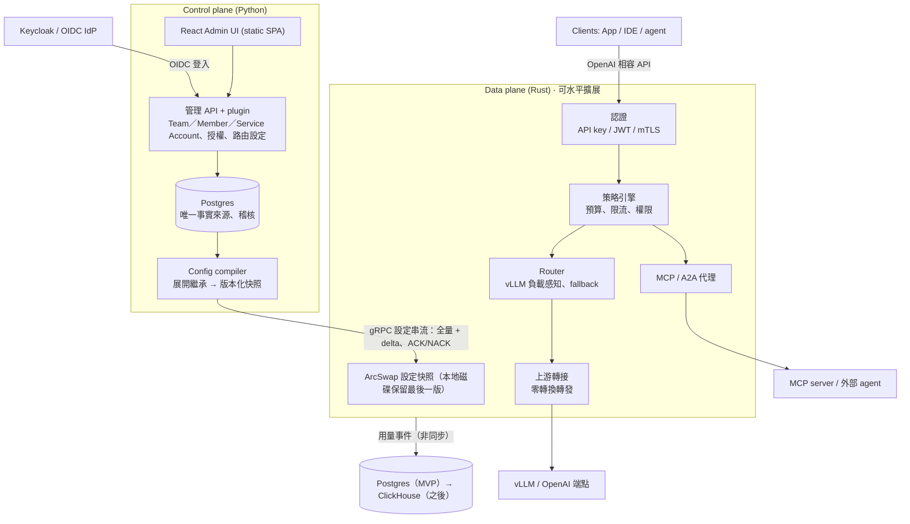

# Lumewarp 架構設計

> 來源：[Lumewarp 架構設計提案](https://claude.ai/artifact/HmNpAUHpzFNzQLCURx3nHo)（2026-10-21，Andy 已核可）。本檔是給 repo 與 Claude Code 讀的版本。

## 摘要

Lumewarp 是比 LiteLLM 更快、更好管理的 LLM gateway，拆成兩個獨立部署的元件：

- **Data plane（gateway）**：Rust。只處理請求，熱路徑不碰資料庫、不跑 Python。
- **Control plane（管理端）**：Python（FastAPI）+ React Admin UI。管理 Team／Member／Service Account、SSO、路由、plugin，產生設定快照。

兩者之間只透過一條版本化的 gRPC 設定串流溝通。control plane 掛掉時 gateway 照常服務。

核心原則：

1. 熱路徑不碰 DB、不跑 Python；計數與用量非同步送出。
2. 客製化（換 OAuth、加 router、加通知管道）用 Python plugin，結果編譯進設定快照由 gateway 執行。
3. 只做 OpenAI 相容 API，上游只有 vLLM 與 OpenAI（及 OpenAI 相容端點），不做其他 provider 轉換。
4. 設定是不可變的版本快照，可 canary、可回滾。
5. LLM、MCP、A2A 三種流量共用同一套認證、配額、稽核。

## 架構

## 語言與技術選型

| 元件 | 技術 | 理由 |
| --- | --- | --- |
| gateway | Rust：tokio、hyper、rustls、ArcSwap | 無 GC、p99 穩定、大量串流連線記憶體低 |
| control plane | Python：FastAPI、SQLAlchemy + Alembic、Authlib、grpcio | plugin 門檻最低，OIDC 生態成熟 |
| Admin UI | React + Vite 靜態 SPA、TanStack Query / Router | 編譯成靜態檔由 FastAPI 提供，部署不需 Node.js；型別由 OpenAPI 產生。可換 Preact 更輕 |
| 合約 | protobuf（設定快照 schema） | 兩種語言各自產生型別，schema 是唯一定義 |
| 授權 | Apache-2.0 | |

## 設定下發

1. 管理者在 UI/API 改設定，寫入 Postgres 並留稽核紀錄。
2. Config compiler 把 team 與 key owner 的繼承、路由、權限展開成已解析的 protobuf 快照，給遞增版本號，發布前驗證。
3. gateway 開機訂閱 gRPC 串流，先收全量，之後收 delta（例如新增/撤銷 API key）。
4. gateway 背景建好新索引，ArcSwap 原子替換；成功回 ACK，失敗回 NACK 並保留舊版。
5. 最後一份成功快照寫到本地磁碟，control plane 掛掉仍可重啟服務。
6. 支援 canary 發布；回滾 = 重推舊版本號。

反方向：用量、token、花費、稽核由 gateway 非同步批次送出（OTLP / NATS），MVP 寫入 Postgres，之後換 ClickHouse。預算與限流計數在 gateway 本地累加，約每秒與 Redis 對帳一次。

另有 standalone 模式：gateway 直接讀同格式 YAML，不需 control plane（GitOps、本機開發）。

## 功能

### SSO（Keycloak / OIDC）

- control plane 是標準 OIDC RP；Keycloak 是預設但非必要。SAML 交給 Keycloak brokering。
- 管理端登入：Authorization Code + PKCE；groups claim 對應 team 與角色；之後加 SCIM。
- gateway 憑證：虛擬 API key（只存 hash）、IdP 簽發的 JWT（JWKS 本地驗證）、mTLS / workload identity。
- 停權時推撤銷 delta，所有 gateway 秒級內拒絕。

### Team / Member / Service Account

- 階層：installation（superuser）→ team → member（admin／member）與 service account → API key；沒有 org／project 層級。
- API key 屬於一個 team，owner 是該 team 的成員或 service account；key 本身不帶 policy，owner 身分也不進快照，compiler 只把展開後的有效策略寫進 key。
- team 與 key owner（member、service account）各自可設模型清單、限流、預算；owner 只能收窄 team，compiler 預先展開成每個 key 的有效策略。
- 授權：installation superuser、team admin、team member。member 可讀 team、建立與管理自己的 key；admin 另可改 team 設定、管理成員、service account 與 team 內所有 key；superuser 可建立／刪除 team 與管理安裝層設定。
- 授權後端可換：內建讀 `users.is_superuser` 與 `team_members`；也可用 `lumewarp.authz` entry point 接外部系統（例如 OpenFGA）。後端只回答關係（superuser／admin／member），單一 async 函式 `check(user_id, relation, resource) -> Decision`；`admin` 隱含 `member`、`superuser` 隱含所有 team 的 `admin`，由後端保證。`ERROR`（後端不可用或逾時）不是 deny：管理 API 回 503。
- 用量與限流按 team 與 key owner 歸屬：member 的 scope id 是 `uuid5(team_id, user_id)`，service account 用其 id；限流 scope 為 `team:<id>`、`member:<id>`、`sa:<id>`。
- 預算：依 token 與單價計費，軟上限通知、硬上限拒絕。

### Router

- 模型別名 → 路由 → 多個 deployment（上游 + 模型 + 憑證）。
- 策略：加權、最低延遲（EWMA）、最少進行中請求、vLLM 負載感知；依 team、header、輸入 token 數條件分流。
- 彈性：fallback 鏈、有上限的重試、circuit breaker、主動健康檢查、尊重 Retry-After。
- cache 親和：相同 session 或 prompt 前綴黏在同一 deployment。
- 變更即設定版本，可百分比切流與回滾。

### MCP / A2A gateway

- 註冊上游 MCP server（Streamable HTTP；stdio 由 sidecar 包裝），依 team 組成虛擬 MCP server，工具名加 namespace。
- 工具級權限、高風險工具需人工核准。
- gateway 是 MCP authorization 規範中的 OAuth resource server，代管上游使用者 OAuth token。
- A2A：Agent Card 註冊表，代理 JSON-RPC 與串流任務。
- 每次工具/agent 呼叫都進稽核並串在同一 trace。

## Python plugin

以 entry points 註冊（`lumewarp.auth`、`lumewarp.router`、`lumewarp.notifier`），`pip install` 後重啟管理端生效。**Python 永遠不在 gateway 熱路徑上。**

| 擴充點 | 執行位置 | 例子 | 延遲影響 |
| --- | --- | --- | --- |
| 認證 plugin | control plane | 公司自有 OAuth、LDAP、自訂 groups 對應；非 JWT 的 IdP 由管理端換發 Lumewarp JWT | 無 |
| Router policy plugin | control plane，定期執行 | 依 GPU 成本、時段、vLLM 負載算權重與規則，寫進快照 | 無 |
| 逐請求 hook（選用） | gateway 呼叫外部 gRPC 服務 | 依 prompt 分類選模型 | 多一次往返，需明確開啟，有逾時與預設路由 |

## vLLM / OpenAI 一級支援

- 端點：`/v1/chat/completions`、`/v1/completions`、`/v1/embeddings`、`/v1/models` 原樣轉發；vLLM 額外參數（guided decoding、`extra_body`）直接透傳。
- 自動探索：定期讀 `/v1/models`，註冊模型與 LoRA adapter。
- 負載感知路由：讀 vLLM `/metrics` 的等待中請求數與 KV cache 使用率。
- prefix cache 親和。
- 健康檢查：vLLM `/health`。
- token 計量：用上游 usage（串流自動加 `stream_options.include_usage`）；自架 vLLM 可依 GPU 小時成本換算。

## Metrics 與 Alert

gateway 原生輸出 Prometheus `/metrics` 與（選用）OTLP traces；control plane 的 metrics 與 OTLP 為後續階段（見「P1 已實作」）。

| 指標 | 標籤 | 用途 |
| --- | --- | --- |
| `lumewarp_requests_total` | model, route, deployment, team, status | 流量與錯誤率 |
| `lumewarp_request_duration_seconds` | model, route, deployment | 端到端延遲 |
| `lumewarp_gateway_overhead_seconds` | route | gateway 自身額外延遲 |
| `lumewarp_ttft_seconds`、`lumewarp_tpot_seconds` | model, deployment | 串流延遲 |
| `lumewarp_tokens_total` | model, team, direction | token 用量 |
| `lumewarp_spend_total` | team | 花費 |
| `lumewarp_upstream_circuit_state` | deployment | 熔斷與健康 |
| `lumewarp_upstream_attempts_total` | model, deployment, outcome | 每次上游嘗試；success / retryable_status / connect_error / timeout / circuit_open / non_retryable |
| `lumewarp_fallbacks_total` | model, fallback_model | 切換至備援路由 |
| `lumewarp_retries_budget_exhausted_total` | model | 全域重試額度耗盡 |
| `lumewarp_upstream_healthy` | upstream | 主動健康檢查狀態（1 正常、0 異常）；探測不計入請求與用量 |
| `lumewarp_vllm_queue_depth`、`lumewarp_vllm_kv_cache_usage` | deployment | vLLM 負載（每秒背景抓取；`vllm_load` 路由使用） |
| `lumewarp_vllm_scrape_failures_total` | upstream | vLLM metrics 抓取失敗（失敗即退回 in-flight 比較） |
| `lumewarp_upstream_latency_ewma_seconds` | deployment | `lowest_latency` 使用的回應標頭時間 EWMA（於 `/metrics` 抓取時計算） |
| `lumewarp_split_requests_total` | model, split | 依 traffic split 分配的請求數（canary 比例） |
| `lumewarp_mcp_tool_calls_total` | server, tool, team, status | MCP 使用 |
| `lumewarp_config_version`、`lumewarp_config_apply_failures_total` | gateway | 設定同步 |

### P0 已實作

P0 當時 gateway 提供 `lumewarp_requests_total`、`lumewarp_request_duration_seconds`、`lumewarp_gateway_overhead_seconds`、`lumewarp_request_body_read_seconds`、`lumewarp_ttft_seconds`、`lumewarp_upstream_errors_total`、`lumewarp_in_flight_requests`、`lumewarp_config_version`（YAML 為 0）與 `lumewarp_config_info`，由獨立 admin listener 的 `/metrics` 輸出；當時尚無 `team` 標籤、token／TPOT／spend 計量或 OTLP metrics，OTLP traces 為選用。P1 新增的指標見下節。非串流與串流的 overhead 均為「body 讀完 → upstream request 送出」加「upstream headers 收到 → handler 返回」；串流再加第一個 frame 已 ready 到轉交的本地處理時間，不含等待 upstream headers、prefill、後續 body 生成或 client socket flush／ACK。未路由的請求以 body 讀完到 handler 返回近似，未讀 body 則從 request start 計；取消中的 upload 只進 body-read duration，不算 overhead。此為內部處理時間近似，不同於 bench 的 gateway／direct 端到端延遲差值。完整操作、TTFT／body-read 與標籤定義見 [gateway README](../gateway/README.md)。

API key 級細節不進 metrics（避免標籤爆炸）。Alert：Helm chart 可選 ServiceMonitor；Prometheus rules 與 Grafana dashboard 規劃中（維運）；control plane 內建預算告警，經 webhook / Slack / Email / PagerDuty（業務），可用 notifier plugin 擴充。每個請求一條 OTel trace，接續 W3C `traceparent`。log 預設不記 prompt/response。

## P1 已實作

P1 的 control plane、設定串流、Team 模型與 Admin UI 第一版已實作；SSO 與進階路由仍屬 P2。以下只列現況，設計內容以上文為準。

**Control plane（`control-plane/`）**

- 單一 Python 程序：FastAPI（HTTP 8091）＋ gRPC（50051）的 ConfigService／UsageService／health，加上 compiler loop、月結 rollover 與 notifier outbox；`/readyz` 檢查 DB、migration head 與背景服務，`/healthz` 為 liveness，gRPC 意外停止會讓程序結束。
- Postgres schema 由 Alembic 管理（單一 scope）；bootstrap token（安裝層 superuser）與每人 PAT；授權為 installation superuser 與 team admin／member，成員關係在 `team_members`，也可換成外部 `lumewarp.authz` 後端。
- REST `/api/v1`：team／member／service account／key（含撤銷與輪替）、預算／限流／模型 allowlist、upstream／deployment／route（含價格）、使用者、usage 聚合、audit、gateway 狀態與 token、config versions 與 routing rollback。
- 設定發布：寫入交易內同時寫 outbox；compiler 以 advisory lock 序列化，產生不可變版本快照；gRPC 串流支援全量／delta、digest、ACK／NACK、base mismatch 重送全量、壞版本隔離與 persist 重試，舊版 payload 依保留策略壓縮。
- 用量與預算：`UsageService.Report` 以 `request_id` 冪等寫入，同一交易累計 team 與 owner（member／service account）的 UTC 月總額並評估預算；超額把 key 翻成 `BUDGET_EXCEEDED` 並推新版本（eventual，約 5 秒內；不切斷進行中的串流）。soft limit 走 notifier outbox（內建 webhook，可換 plugin）。
- Plugin：`lumewarp.router`（編譯期調整 deployment 權重，2 秒逾時，非法輸出整批丟棄）與 `lumewarp.notifier`（outbox 投遞）已接上；`lumewarp.auth` 只有 protocol，P1 不呼叫。
- Admin UI：Vite 靜態檔由 control plane 掛在 `/`，登入用 bootstrap token 或 PAT；API 文件在 `/docs`，OpenAPI 可離線輸出。UI 沒 build 時只有 API。

**Gateway（`gateway/`）**

- 新增 control-plane 模式：`--control-plane`、`--gateway-token-env`、`--state-dir`、`--scope`、`--gateway-id`、`--local-config`；standalone YAML 模式不變。
- 開機先載入 `<state-dir>/snapshot.pb`（驗證 scope、長度與結尾 SHA-256）並立即服務，再背景連線；沒有可用快照時 `/v1/*` 與 `/readyz` 回 503，不會退回 open router。每次套用先持久化再 swap 再 ACK，重啟可回到最後 ACK 的版本。
- CP 模式一律要求 key；status／expiry／allowlist 與預算狀態照舊（401／403／429）。rpm、tpm、max_parallel 在每個 gateway 行程本機累計（N 個實例可有 N 倍上限），429 帶 `Retry-After`。
- 用量：串流在上游支援時注入 `stream_options.include_usage`，客戶端沒要求時剝除多出的 usage chunk；事件經有界佇列（100k）每 1 秒或 500 筆批次送出，滿了就丟並計數；token／spend 指標與 `deployment.price` 成本換算已接上。
- 指標：config stream 連線／版本／NACK code、usage 佇列與 capture 狀態、tokens／spend 皆已輸出；`/metrics` 仍在 admin listener。

**部署**

- `deploy/helm/lumewarp`：control plane 與 gateway 的 Deployment／Service、DB URL 與 gateway token 的既有 Secret 參照、`/readyz`＋`/healthz` probes、gateway state dir（emptyDir 預設、PVC 選用）、migration hook Job、可選 ServiceMonitor。
- `deploy/dev/compose.yaml` 提供本機 Postgres 16。

**尚未包含（延後）**

- OIDC／SSO、JWT／mTLS 用戶端認證、SCIM、auth plugin 執行（P2）。
- 跨 gateway 的共享限流（Redis 對帳）、ClickHouse、control plane 的 Prometheus `/metrics` 與 OTLP metrics／traces；gateway 只有選用的 OTLP traces，沒有 metrics exporter。
- Canary／百分比切流、vLLM 負載感知與最低延遲路由。
- 預算為 eventual；佇列滿或 gateway 重啟會遺失用量事件，進行中的串流不會因超額被切斷；月窗口固定為 UTC 日曆月。
- MCP／A2A 代理與其稽核、工具權限。
- `gateway/Dockerfile`、`control-plane/Dockerfile` 可建置映像，但尚未有發佈映像的 CI；Helm chart 需自行指定 repository/tag。

## P2 W5 gateway 路由韌性

- 快照與 standalone YAML 支援 `retry`、`fallbacks`、`health_check`、
  `circuit_breaker` capability；W6 策略與切流欄位仍拒絕套用。
- 重試僅限回應送出前，串流僅限收到上游 headers 前；最多五次，
  共用原路由 timeout 與全域重試額度（預設 20%，低流量允許三次 burst）。
  `Retry-After` 使用 deployment cooldown，重試跳過冷卻中的 deployment。
- 部署熔斷狀態以名稱保存在 Runtime，跨快照保留；主動健康探測在背景執行，
  接受新快照才重啟。所有候選都異常或開路時仍嘗試一個，避免 fail closed；
  已進行中的 half-open trial 不重複。
- 每次 attempt 有獨立 OTel 子 span；請求指標與用量只記最終 attempt。
  fallback 的 JSON／SSE 回應保留原公開模型名。

## 效能目標（尚未實測）

| 指標 | 目標 |
| --- | --- |
| gateway 額外延遲 p50（不含上游） | < 100 µs |
| gateway 額外延遲 p99 | < 1 ms |
| 單一 4 vCPU 實例 | ≥ 10,000 RPS（非串流） |
| 同時串流連線 | ≥ 50,000，記憶體 < 2 GB |
| 設定生效時間 | < 2 s |

驗證：固定延遲、可模擬 SSE 的 mock 上游；同機對 LiteLLM 與 Lumewarp 跑 1k / 5k / 10k RPS（oha 或 k6），比較額外延遲、TTFT、CPU、記憶體，結果進 CI 追蹤退化。

## Roadmap

| 階段 | 內容 | 進入下一階段的門檻 |
| --- | --- | --- |
| **P0** gateway 骨架 + benchmark | Rust gateway 以 YAML 啟動；OpenAI 相容端點，上游 vLLM 與 OpenAI，含 SSE；mock 上游 + 對 LiteLLM 的 benchmark 進 CI；基本 Prometheus 指標 | 同機額外延遲 p99 明顯低於 LiteLLM |
| **P1** control plane + Team | Python control plane + Postgres + gRPC 設定串流與本地快照；plugin 介面；team／member／service account、虛擬 key、預算限流；React Admin UI 第一版 | control plane 停機時 gateway 照常服務、可重啟 |
| **P2** SSO + 路由 | Keycloak/OIDC、groups 對應、JWT 呼叫 gateway；vLLM 負載感知路由、fallback、canary、router plugin；OTel trace、告警規則與 dashboard | SSO → 發 key → 呼叫 → 計費 端到端跑通 |
| **P3** MCP / A2A | MCP 註冊聚合、工具權限、OAuth 代管；A2A 代理；三種流量共用稽核與 tracing | |

