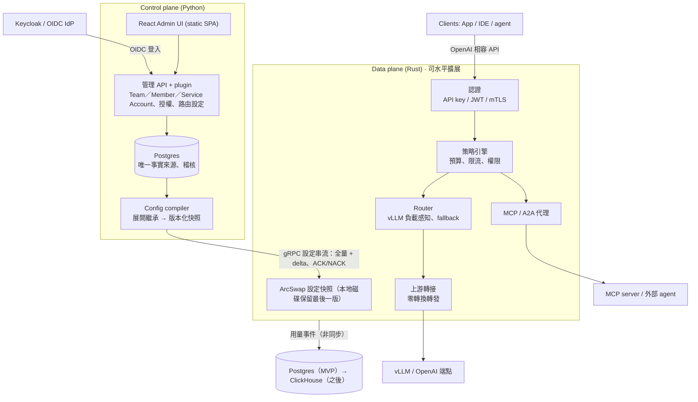

# Lumewarp 架構設計

> 來源：[Lumewarp 架構設計提案](https://claude.ai/artifact/HmNpAUHpzFNzQLCURx3nHo)（2026-10-21，Andy 已核可）。本檔是給 repo 與 Claude Code 讀的版本。

## 摘要

Lumewarp 是比 LiteLLM 更快、更好管理的 LLM gateway，拆成兩個獨立部署的元件：

- **Data plane（gateway）**：Rust。只處理請求，熱路徑不碰資料庫、不跑 Python。
- **Control plane（管理端）**：Python（FastAPI）+ React Admin UI。管理 Team／Member／Service Account、SSO、路由、plugin，產生設定快照。

兩者之間只透過一條版本化的 gRPC 設定串流溝通。control plane 掛掉時 gateway 照常服務。

核心原則：

1. 熱路徑不碰 DB、不跑 Python；計數與用量非同步送出。
2. 客製化（換 OAuth、加通知管道）用 Python plugin，結果編譯進設定快照由 gateway 執行；router 策略是編譯進 gateway 的 Rust crate。
3. 只做 OpenAI 相容 API，上游只有 vLLM 與 OpenAI（及 OpenAI 相容端點），不做其他 provider 轉換。
4. 設定是不可變的版本快照，可 canary、可回滾。
5. LLM、MCP、A2A 三種流量共用同一套認證、配額、稽核。

## 架構

## 語言與技術選型

| 元件 | 技術 | 理由 |
| --- | --- | --- |
| gateway | Rust：tokio、hyper、rustls、ArcSwap | 無 GC、p99 穩定、大量串流連線記憶體低 |
| control plane | Python：FastAPI、SQLAlchemy + Alembic、Authlib、grpcio | plugin 門檻最低，OIDC 生態成熟 |
| Admin UI | React + Vite 靜態 SPA、TanStack Query / Router | 編譯成靜態檔由 FastAPI 提供，部署不需 Node.js；型別由 OpenAPI 產生。可換 Preact 更輕 |
| 合約 | protobuf（設定快照 schema） | 兩種語言各自產生型別，schema 是唯一定義 |
| 授權 | Apache-2.0 | |

## 設定下發

1. 管理者在 UI/API 改設定，寫入 Postgres 並留稽核紀錄。
2. Config compiler 把 team 與 key owner 的繼承、路由、權限展開成已解析的 protobuf 快照，給遞增版本號，發布前驗證。
3. gateway 開機訂閱 gRPC 串流，先收全量，之後收 delta（例如新增/撤銷 API key）。
4. gateway 背景建好新索引，ArcSwap 原子替換；成功回 ACK，失敗回 NACK 並保留舊版。
5. 最後一份成功快照寫到本地磁碟，control plane 掛掉仍可重啟服務。
6. 支援 canary 發布；回滾 = 重推舊版本號。

反方向：用量、token、花費、稽核由 gateway 非同步批次送出（OTLP / NATS），MVP 寫入 Postgres，之後換 ClickHouse。預算與限流計數在 gateway 本地累加，約每秒與 Redis 對帳一次。

另有 standalone 模式：gateway 直接讀同格式 YAML，不需 control plane（GitOps、本機開發）。

## 功能

### SSO（Keycloak / OIDC）

- control plane 是標準 OIDC RP；Keycloak 是預設但非必要。SAML 交給 Keycloak brokering。
- 管理端登入：Authorization Code + PKCE 由 control plane 後端完成（Authlib），之後發伺服器端 session（httpOnly、`SameSite=Lax` cookie，寫入需 `X-Lumewarp-CSRF`）；以 `iss`+`sub` 認人，首次登入可 JIT 建立零權限使用者（只接受已驗證 email）。程式呼叫管理 API 用 PAT（bearer 只接受 PAT）。
- IdP 負責認證，並可由 groups claim（`LUMEWARP_OIDC_GROUPS_CLAIM`，token 沒有時查 userinfo）告知誰在 admin group；內建後端只把這個 group 記在 session，登入時決定。team 權限不來自 IdP，其他 claim 也不授予權限。IdP 與 IAM 的人員狀態同步由部署方負責。
- 緊急登入（break-glass）：`POST /api/v1/session/break-glass` 用密碼換 session cookie，IdP 或 IAM 故障時仍可管理。生產用 argon2id hash（`LUMEWARP_BREAK_GLASS_PASSWORD_HASH`），明文密碼要 `LUMEWARP_DEV_MODE=true`。這個 session 不是使用者，不問授權後端；有 TTL（預設 1 小時，上限 4 小時）、失敗延遲與次數限制、可限制來源網段，嘗試都寫稽核，換密碼立刻失效。
- gateway 憑證只有 admin 發出的虛擬 API key（只存 hash）；JWT／mTLS 呼叫 gateway 延後。
- 停權時推撤銷 delta，所有 gateway 秒級內拒絕：內建後端在移除成員的同一交易停用 key；外部 IAM 由 key reconciler 讀變更串流，約 5 秒內停用；IAM 錯誤或逾時絕不停用 key。

### Team / Member / Service Account

- 階層：team → member（admin／member）與 service account → API key；沒有 org／project 層級。安裝層管理員不是角色：`LUMEWARP_ADMIN_GROUP` 指定的 IAM group 成員，或緊急 session。
- API key 屬於一個 team，owner 是該 team 的成員或 service account；key 本身不帶 policy，owner 身分也不進快照，compiler 只把展開後的有效策略寫進 key。
- team 與 key owner（member、service account）各自可設模型清單、限流、預算；owner 只能收窄 team，compiler 預先展開成每個 key 的有效策略。
- 授權：安裝層管理員、team admin、team member。member 可讀 team、建立與管理自己的 key；admin 另可改 team 設定、管理成員、service account 與 team 內所有 key；安裝層管理員可建立／刪除 team、管理安裝層設定，並通過所有 team 的檢查。
- 授權後端可換：內建用 session 的 group 與 `team_members`（所以內建後端下 PAT 不會是安裝層管理員，它沒有 group）；內附 `openfga` 與 `http` 後端，也可用 `lumewarp.authz` entry point 接外部系統。後端只回答關係，單一 async 函式 `check(user_id, relation, resource) -> Decision`：`relation` 是 `admin`（team）或 `member`（team、group），`resource` 是 `group:<admin group>` 或 `team:<uuid>`。`admin` 隱含 `member` 由後端保證；admin group 涵蓋所有 team 由 Lumewarp 自己套用。`ERROR`（後端不可用或逾時）不是 deny：管理 API 回 503。
- 用量與限流按 team 與 key owner 歸屬：member 的 scope id 是 `uuid5(team_id, user_id)`，service account 用其 id；限流 scope 為 `team:<id>`、`member:<id>`、`sa:<id>`。
- 預算：依 token 與單價計費，軟上限通知、硬上限拒絕。

### Router

- 用戶端呼叫的是「名字」，一個名字是 model（一個 upstream 上的一個模型）、alias（model 或 router 的另一個名字，只有一層）或 router（把請求分給後面的 models）。三種共用名字空間，都可以改名，內部參照都用 id。權限依呼叫的名字檢查。完整規則見[模型目錄計畫](plans/model-catalog.md)。
- 回應的 `model` 是呼叫時的名字；usage 的 `model` 是實際服務的 model，另外記錄來源的 alias、router、fallback 與 attempts。
- 策略是 Rust crate（`docs/router-strategies.md`），重新 build gateway 即可，proto、control plane、UI 都不用改。Retry、fallback、traffic split 只在 router 上；直接呼叫 model 就是一次嘗試。
- 策略：加權、最低延遲（EWMA）、最少進行中請求、vLLM 負載感知（P2 已實作）；依 team、header、輸入 token 數條件分流（延後）。
- 彈性：fallback 鏈、有上限的重試、circuit breaker、主動健康檢查、尊重 Retry-After（P2 已實作）。
- cache 親和：相同 session 或 prompt 前綴黏在同一 model（延後）。
- 變更即設定版本，可回滾；路由層百分比切流（traffic split，可依 header／team／key sticky）已實作，設定版本 canary 延後。

### MCP / A2A gateway

- 註冊上游 MCP server（Streamable HTTP；stdio 由 sidecar 包裝），依 team 組成虛擬 MCP server，工具名加 namespace。
- 工具級權限、高風險工具需人工核准。
- gateway 是 MCP authorization 規範中的 OAuth resource server，代管上游使用者 OAuth token。
- A2A：Agent Card 註冊表，代理 JSON-RPC 與串流任務。
- 每次工具/agent 呼叫都進稽核並串在同一 trace。

## Python plugin

以 entry points 註冊（`lumewarp.auth`、`lumewarp.notifier`、`lumewarp.authz`），`pip install` 後重啟管理端生效。**Python 永遠不在 gateway 熱路徑上。**

| 擴充點 | 執行位置 | 例子 | 延遲影響 |
| --- | --- | --- | --- |
| 認證 plugin（`lumewarp.auth`） | control plane，只在首次 SSO 登入 | `map_identity(claims)` 把外部身分對應到 email 與顯示名稱，不授予權限 | 無 |
| 授權後端（`lumewarp.authz`） | control plane | `check(user_id, relation, resource)` 接公司自有 AAA；介面見 [control plane README](../control-plane/README.md#authorization) | 無 |
| 通知 plugin（`lumewarp.notifier`） | control plane，outbox 投遞 | `send(event, config)` 送預算通知 | 無 |
| 逐請求 hook（選用） | gateway 呼叫外部 gRPC 服務 | 依 prompt 分類選模型 | 多一次往返，需明確開啟，有逾時與預設路由 |

## vLLM / OpenAI 一級支援

- 端點：`/v1/chat/completions`、`/v1/completions`、`/v1/embeddings`、`/v1/models` 原樣轉發；vLLM 額外參數（guided decoding、`extra_body`）直接透傳。
- 自動探索：定期讀 `/v1/models`，註冊模型與 LoRA adapter。
- 負載感知路由：讀 vLLM `/metrics` 的等待中請求數與 KV cache 使用率。
- prefix cache 親和。
- 健康檢查：vLLM `/health`。
- token 計量：用上游 usage（串流自動加 `stream_options.include_usage`）；自架 vLLM 可依 GPU 小時成本換算。

## Metrics 與 Alert

gateway 原生輸出 Prometheus `/metrics` 與（選用）OTLP traces；control plane 在獨立的 metrics listener（`LUMEWARP_METRICS_BIND`，預設 `127.0.0.1:9465`，不在 admin API port）輸出 `lumewarp_cp_*`（下表後半，完整說明見 [control-plane README](../control-plane/README.md#metrics)）；control plane 的 OTLP 仍為後續階段。

| 指標 | 標籤 | 用途 |
| --- | --- | --- |
| `lumewarp_requests_total` | requested, endpoint, model, team, status | 流量與錯誤率 |
| `lumewarp_request_duration_seconds` | requested, endpoint, model | 端到端延遲 |
| `lumewarp_gateway_overhead_seconds` | endpoint | gateway 自身額外延遲 |
| `lumewarp_ttft_seconds`、`lumewarp_tpot_seconds` | requested, model | 串流延遲 |
| `lumewarp_tokens_total` | requested, team, direction | token 用量 |
| `lumewarp_spend_total` | team | 花費 |
| `lumewarp_upstream_circuit_state` | model | 熔斷與健康 |
| `lumewarp_upstream_attempts_total` | requested, model, outcome | 每次上游嘗試；success / retryable_status / connect_error / timeout / circuit_open / non_retryable |
| `lumewarp_response_model_rewrite_compressed_total` | model | 需要改寫回應 `model` 但上游仍壓縮：原樣轉發、不解壓縮，用戶端看到上游模型名，usage 為 invalid |
| `lumewarp_fallbacks_total` | router, model | 切換至 fallback model |
| `lumewarp_retries_budget_exhausted_total` | router | 全域重試額度耗盡 |
| `lumewarp_upstream_healthy` | upstream | 主動健康檢查狀態（1 正常、0 異常）；探測不計入請求與用量 |
| `lumewarp_vllm_queue_depth`、`lumewarp_vllm_kv_cache_usage` | model | vLLM 負載（每秒背景抓取；`vllm_load` 路由使用） |
| `lumewarp_vllm_scrape_failures_total` | upstream | vLLM metrics 抓取失敗（失敗即退回 in-flight 比較） |
| `lumewarp_upstream_latency_ewma_seconds` | model | `lowest_latency` 使用的回應標頭時間 EWMA（於 `/metrics` 抓取時計算） |
| `lumewarp_split_requests_total` | router, split | 依 traffic split 分配的請求數（canary 比例） |
| `lumewarp_mcp_tool_calls_total` | server, tool, team, status | MCP 使用 |
| `lumewarp_config_version`、`lumewarp_config_apply_failures_total` | gateway | 設定同步 |
| `lumewarp_cp_compile_duration_seconds`、`lumewarp_cp_compile_failures_total` | — | 設定編譯（CP） |
| `lumewarp_cp_config_version`、`lumewarp_cp_outbox_pending` | — | 最新發布版本與 outbox 積壓（CP） |
| `lumewarp_cp_gateway_sessions`、`lumewarp_cp_gateway_acks_total` | result（ack／nack） | config stream 連線與回覆（CP） |
| `lumewarp_cp_usage_events_ingested_total`、`lumewarp_cp_usage_events_skipped_total` | reason（skipped） | 用量匯入（CP） |
| `lumewarp_cp_authz_checks_total` | backend, decision | 授權後端（CP） |
| `lumewarp_cp_keys_suspended_total`、`lumewarp_cp_key_reconcile_last_success_timestamp_seconds` | reason（suspended） | key 停用與 reconciler 新鮮度（CP） |

### P0 已實作

P0 當時 gateway 提供 `lumewarp_requests_total`、`lumewarp_request_duration_seconds`、`lumewarp_gateway_overhead_seconds`、`lumewarp_request_body_read_seconds`、`lumewarp_ttft_seconds`、`lumewarp_upstream_errors_total`、`lumewarp_in_flight_requests`、`lumewarp_config_version`（YAML 為 0）與 `lumewarp_config_info`，由獨立 admin listener 的 `/metrics` 輸出；當時尚無 `team` 標籤、token／TPOT／spend 計量或 OTLP metrics，OTLP traces 為選用。P1 新增的指標見下節。非串流與串流的 overhead 均為「body 讀完 → upstream request 送出」加「upstream headers 收到 → handler 返回」；串流再加第一個 frame 已 ready 到轉交的本地處理時間，不含等待 upstream headers、prefill、後續 body 生成或 client socket flush／ACK。未路由的請求以 body 讀完到 handler 返回近似，未讀 body 則從 request start 計；取消中的 upload 只進 body-read duration，不算 overhead。此為內部處理時間近似，不同於 bench 的 gateway／direct 端到端延遲差值。完整操作、TTFT／body-read 與標籤定義見 [gateway README](../gateway/README.md)。

API key 級細節不進 metrics（避免標籤爆炸）。Alert：Helm chart 可選 ServiceMonitor（gateway admin port 與 control plane metrics port）；Prometheus 告警規則（`deploy/prometheus/rules.yaml`，附 promtool 測試）與四張 Grafana dashboard（`deploy/grafana/dashboards/`，Helm 可選安裝）；control plane 內建預算告警，經 webhook / Slack / Email / PagerDuty（業務），可用 notifier plugin 擴充。每個請求一條 OTel trace，接續 W3C `traceparent`。log 預設不記 prompt/response。

## P1 已實作

P1 的 control plane、設定串流、Team 模型與 Admin UI 第一版已實作；SSO 與進階路由仍屬 P2。以下是 P1 完成時的紀錄，設計內容以上文為準。其中 bootstrap token 與 superuser 已被 P2.5 取代（見上文 SSO 與 Team 兩節）。

**Control plane（`control-plane/`）**

- 單一 Python 程序：FastAPI（HTTP 8091）＋ gRPC（50051）的 ConfigService／UsageService／health，加上 compiler loop、月結 rollover 與 notifier outbox；`/readyz` 檢查 DB、migration head 與背景服務，`/healthz` 為 liveness，gRPC 意外停止會讓程序結束。
- Postgres schema 由 Alembic 管理（單一 scope）；bootstrap token（安裝層 superuser，P2.5 已移除）與每人 PAT；授權為 installation superuser（P2.5 已移除）與 team admin／member，成員關係在 `team_members`，也可換成外部 `lumewarp.authz` 後端。
- REST `/api/v1`：team／member／service account／key（含撤銷與輪替）、預算／限流／模型 allowlist、upstream／model／router（含價格）、使用者、usage 聚合、audit、gateway 狀態與 token、config versions 與 routing rollback。
- 設定發布：寫入交易內同時寫 outbox；compiler 以 advisory lock 序列化，產生不可變版本快照；gRPC 串流支援全量／delta、digest、ACK／NACK、base mismatch 重送全量、壞版本隔離與 persist 重試，舊版 payload 依保留策略壓縮。
- 用量與預算：`UsageService.Report` 以 `request_id` 冪等寫入，同一交易累計 team 與 owner（member／service account）的 UTC 月總額並評估預算；超額把 key 翻成 `BUDGET_EXCEEDED` 並推新版本（eventual，約 5 秒內；不切斷進行中的串流）。soft limit 走 notifier outbox（內建 webhook，可換 plugin）。
- Plugin：`lumewarp.notifier`（outbox 投遞）已接上；`lumewarp.auth` 只有 protocol，P1 不呼叫。P1 當時的 `lumewarp.router` 已移除，策略改成 Rust crate。
- Admin UI：Vite 靜態檔由 control plane 掛在 `/`，登入當時用 bootstrap token 或 PAT（P2.5 起改為 SSO 或緊急登入）；API 文件在 `/docs`，OpenAPI 可離線輸出。UI 沒 build 時只有 API。

**Gateway（`gateway/`）**

- 新增 control-plane 模式：`--control-plane`、`--gateway-token-env`、`--state-dir`、`--scope`、`--gateway-id`、`--local-config`；standalone YAML 模式不變。
- 開機先載入 `<state-dir>/snapshot.pb`（驗證 scope、長度與結尾 SHA-256）並立即服務，再背景連線；沒有可用快照時 `/v1/*` 與 `/readyz` 回 503，不會退回 open router。每次套用先持久化再 swap 再 ACK，重啟可回到最後 ACK 的版本。
- CP 模式一律要求 key；status／expiry／allowlist 與預算狀態照舊（401／403／429）。rpm、tpm、max_parallel 在每個 gateway 行程本機累計（N 個實例可有 N 倍上限），429 帶 `Retry-After`。
- 用量：串流在上游支援時注入 `stream_options.include_usage`，客戶端沒要求時剝除多出的 usage chunk；事件經有界佇列（100k）每 1 秒或 500 筆批次送出，滿了就丟並計數；token／spend 指標與 `model.price` 成本換算已接上。
- 指標：config stream 連線／版本／NACK code、usage 佇列與 capture 狀態、tokens／spend 皆已輸出；`/metrics` 仍在 admin listener。

**部署**

- `deploy/helm/lumewarp`：control plane 與 gateway 的 Deployment／Service、DB URL 與 gateway token 的既有 Secret 參照、`/readyz`＋`/healthz` probes、gateway state dir（emptyDir 預設、PVC 選用）、migration hook Job、可選 ServiceMonitor。
- `deploy/dev/compose.yaml` 提供本機 Postgres 16。

**尚未包含（延後）**

- JWT／mTLS 用戶端認證、SCIM（OIDC／SSO 與 auth plugin 已於 P2 實作）。
- 跨 gateway 的共享限流（Redis 對帳）、ClickHouse、control plane 的 OTLP metrics／traces（Prometheus `lumewarp_cp_*` 已於 P2 加入）；gateway 只有選用的 OTLP traces，沒有 metrics exporter。
- 預算為 eventual；佇列滿或 gateway 重啟會遺失用量事件，進行中的串流不會因超額被切斷；月窗口固定為 UTC 日曆月。
- MCP／A2A 代理與其稽核、工具權限。
- `gateway/Dockerfile`、`control-plane/Dockerfile` 可建置映像，但尚未有發佈映像的 CI；Helm chart 需自行指定 repository/tag。

## P2 已實作

P2 把權限模型縮成 team → member／service account，加上 SSO、可抽換的授權後端、路由韌性與可觀測性。以下是 P2 完成時的紀錄，設計內容以上文為準。其中 superuser、bootstrap token 與「不讀 IdP groups」已被 P2.5 取代（見上文 SSO 與 Team 兩節）。

**權限與 SSO（control plane）**

- 模型：installation superuser（P2.5 已移除）→ team → member（admin／member）與 service account → API key；org 與 project 已移除（新的 Alembic baseline，不相容 P1 資料）。
- 授權：`Authorizer.check(user_id, relation, resource)`；內建 `builtin`、`openfga`（Check／BatchCheck／ListObjects／ReadChanges，`HIGHER_CONSISTENCY`）、`http`，或 `lumewarp.authz` entry point。每次呼叫有逾時（`LUMEWARP_AUTHZ_TIMEOUT_SECONDS`），逾時即 `ERROR` → 管理 API 503。共用情境測試 `authz/contract_tests.py`。
- key reconciler：有 `changes()` 時每 2 秒輪詢、只重算變動的使用者，另每 5 分鐘全掃；明確 deny → `SUSPENDED`（`owner_removed`）並推新版本。恢復權限不自動復原；service account 的 key 不受影響。
- OIDC 登入、伺服器端 session 與 CSRF 見上文 SSO 一節；當時 superuser 不能以 email 自動連結，只能用 bootstrap token 或 PAT（P2.5 起是 admin group 成員不能以 email 自動連結）。
- 成員可用 email 加入；成員與 key 顯示擁有者是否仍啟用。

**路由（gateway + control plane）**

- 快照與 standalone YAML 支援 `retry`、`fallbacks`、`health_check`、`circuit_breaker`、`traffic_split`、`vllm_load` 與 `strategy:<name>` capability；control plane 只在欄位有用到時列出對應 capability，驗證規則與 gateway 一致（含 URI 文法）。fallback 只能是 model，需要至少 2 次 attempt 的 retry policy。
- 重試僅限回應送出前，串流僅限收到上游 headers 前；最多五次，
  共用原路由 timeout 與全域重試額度（預設 20%，低流量允許三次 burst；
  只有設定 `retry` 的路由請求會存入額度）。`Retry-After` 使用 model
  cooldown（上限 60 秒與 breaker `open_ms`），重試跳過冷卻中的 model。
  被路由 `total_timeout_ms` 截斷的 attempt 不算 model 失敗。
- model 熔斷狀態以名稱保存在 Runtime，跨快照保留；主動健康探測在背景執行，
  接受新快照後依 (upstream, URL, 設定, 憑證) 比對，只重啟有變動的探測。
  所有候選都異常或開路時仍嘗試一個，避免 fail closed；已進行中的
  half-open trial 不重複，改用其他候選。
- 每次 attempt 有獨立 OTel 子 span；請求指標與用量只記一次，歸屬實際產生
  回應的 attempt。回應的 `model` 見下節。
- `LOWEST_LATENCY`：每個 model 的回應標頭時間 EWMA，power of two choices。`VLLM_LOAD`：每秒背景抓取 vLLM `/metrics`（`num_requests_waiting`、KV cache 使用率），power of two choices；抓取失敗或超過 3 秒未更新就退回 in-flight 比較。
- traffic split：依權重選 split，再在 split 內依策略選 model；sticky 依 header／team／key 的固定種子雜湊。重試先留在同一 split，再換其他 split，最後才走 fallback。
- Bench A6（quick ×3，1000 RPS，含認證）：非串流 overhead p99 −0.07 ms（雜訊範圍），串流 TTFT overhead p99 3.3 ms；LiteLLM 同機飽和。
  P2 收尾在 main 跑 full ×3（含認證）：1000 RPS 非串流 overhead p99 0.20 ms
  （A6 通過），300 RPS 0.28 ms；10000 RPS 時 lumewarp 與 direct 都達到目標速率。
  串流 TTFT overhead p99：並行 100 為 −1.9 ms（雜訊），並行 1000 為 14.5 ms。
  LiteLLM 在 1000 RPS 以上達不到目標速率。

**可觀測性**

- gateway 新指標見上表；control plane 在獨立 listener 輸出 `lumewarp_cp_*`。
- 19 條告警規則與 promtool 測試、四張 dashboard、Helm 可選 PrometheusRule／dashboard ConfigMap／兩個 ServiceMonitor。

**驗收**

- `scripts/e2e-p2.sh`：builtin 與 openfga 各跑一次 OIDC 登入、建 key、呼叫、用量對帳、撤權（實測 builtin 0.2 s、openfga 1.1 s 內回 401）、IAM 故障不誤停；另含路由 e2e（重試、fallback、熔斷、URI 契約）。
- `scripts/e2e-p1.sh`（含路由 e2e）、`scripts/load-e2e.sh` 8/8。

**尚未包含（延後）**

- JWT／mTLS 呼叫 gateway、讀 IdP claims 做 team 授權（admin group 已於 P2.5 實作）、SCIM、IdP→IAM 人員同步、更細的角色、key 層級限制。
- 跨 gateway 共享限流（Redis）、設定版本 canary、cache 親和、依 header／token 數條件分流、逐請求外部 hook、LoRA 自動探索。
- control plane 的 OTLP traces／metrics。
- MCP／A2A（P3）。

## 模型目錄已實作

P2.5 把 deployment／route 換成 model、alias、router。計畫、已定的決定與實作差異見[模型目錄計畫](plans/model-catalog.md)，以下只列現況。

- **目錄與 API：** `/models`、`/aliases`、`/routers`、`/strategies`、`/catalog`。名字跨種類唯一（`catalog_names`），參照與權限都用 id（`policy_grants`），改名不弄斷關係；舊名字立刻 404，只有 model 可以 `keep_old_name_as_alias`。被參照的名字不能刪（409）。
- **快照：** `Snapshot` 直接帶 models、aliases、routers，gateway 在套用時建成一張名字表，請求路徑仍是一次查表。`Router.strategy` 是字串。`ApiKey.allowed_models` 由 control plane 展開成當下的名字。
- **Rollback：** 依 id 還原目錄（`config_versions.catalog_state`），已刪除的項目用原 id 重建；授權不還原。
- **回應改寫：** 不緩衝的掃描器（`rewrite.rs`）把 JSON 與 SSE 最外層的 `model` 換成呼叫的名字，大小不設上限。呼叫的名字等於 `upstream_model` 時走快速路徑。需要改寫時移除送往上游的 `Accept-Encoding`；上游仍壓縮就原樣轉發並累加 metric。契約見 [config protocol](config-protocol.md)。
- **Usage：** 每筆 event 保存 `requested`、`model`、`alias`、`router`、`upstream`、`upstream_model`、`fallback`、`attempts`、`endpoint`，加上 control plane 解析的 `model_id`、`alias_id`、`router_id`。`GET /usage` 不是每個欄位都能查：`group_by` 支援 `day`、`requested`、`model`、`upstream_model`、`alias`、`router`、`team`、`owner`、`key`；篩選支援 `from`、`to`、`team_id`、`user_id`、`service_account_id`、`key_id`、`requested`、`model`、`upstream_model`、`alias`、`router`、`model_id`、`alias_id`、`router_id`、`alias_missing`、`router_missing`。`upstream`、`fallback`、`attempts`、`endpoint` 只能從資料列讀。改名前後的用量連續。
- **策略：** `register!` 宣告 params 與成員欄位，schema 從 struct 產生，在 `Hello` 回報，存進 `gateway_strategies`；寫入時依 schema 驗證，內建策略有 commit 的 manifest。見 [router strategies](router-strategies.md)。
- **用 OTel 查請求：** gateway 不寫 access log。回應帶 `x-lumewarp-request-id`，等於 usage 的 `request_id` 與 span 的 `request_id`。`request` span 帶呼叫的名字、alias、router、最後的 model 與 attempts，每次嘗試一個 `upstream_attempt`。前提：沒設 OTLP endpoint 就沒有紀錄；取樣低於 100% 或 exporter 佇列滿了會查不到，要當 access log 建議 100%；保留多久由 OTel 後端決定。Sampler 不聽從用戶端 `traceparent` 的 sampled flag。Helm 的設定是 `gateway.otel.endpoint`、`gateway.otel.samplingRatio`。
- **Metrics：** 標籤 `model` 是實際服務的 model，`requested` 是呼叫的名字，`endpoint` 是 API 路徑。改名後 label 換成新名字，舊名字的時間序列就此結束，這是 Prometheus 的正常行為。
- **驗收：** `tests/e2e/test_catalog.py`（真實 control plane + gateway）。

**尚未包含：** 註冊時的連線測試、在 Models／Routers 顯示「已生效／被 NACK」、`api_key_ref` 錯誤的處理、對成員隱藏上游資訊、dropped spans 的 metric（span 遺失目前是無聲的）。

## 效能目標（尚未實測）

| 指標 | 目標 |
| --- | --- |
| gateway 額外延遲 p50（不含上游） | < 100 µs |
| gateway 額外延遲 p99 | < 1 ms |
| 單一 4 vCPU 實例 | ≥ 10,000 RPS（非串流） |
| 同時串流連線 | ≥ 50,000，記憶體 < 2 GB |
| 設定生效時間 | < 2 s |

驗證：固定延遲、可模擬 SSE 的 mock 上游；同機對 LiteLLM 與 Lumewarp 跑 1k / 5k / 10k RPS（oha 或 k6），比較額外延遲、TTFT、CPU、記憶體，結果進 CI 追蹤退化。

## Roadmap

| 階段 | 內容 | 進入下一階段的門檻 |
| --- | --- | --- |
| **P0** gateway 骨架 + benchmark | Rust gateway 以 YAML 啟動；OpenAI 相容端點，上游 vLLM 與 OpenAI，含 SSE；mock 上游 + 對 LiteLLM 的 benchmark 進 CI；基本 Prometheus 指標 | 同機額外延遲 p99 明顯低於 LiteLLM |
| **P1** control plane + Team | Python control plane + Postgres + gRPC 設定串流與本地快照；plugin 介面；team／member／service account、虛擬 key、預算限流；React Admin UI 第一版 | control plane 停機時 gateway 照常服務、可重啟 |
| **P2** SSO + 路由（已完成） | 權限模型縮成 team／member／service account；Keycloak/OIDC 登入、可抽換授權後端（builtin／OpenFGA／HTTP）與 key 同步；vLLM 負載感知與最低延遲路由、重試、fallback、熔斷、健康檢查、百分比切流；告警規則、dashboard、control plane metrics | SSO → 發 key → 呼叫 → 計費 → 撤權 端到端跑通（`scripts/e2e-p2.sh`） |
| **P3** MCP / A2A | MCP 註冊聚合、工具權限、OAuth 代管；A2A 代理；三種流量共用稽核與 tracing | |

