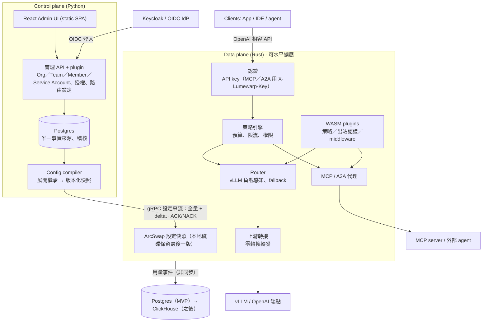

# Lumewarp 架構設計

> 來源：[Lumewarp 架構設計提案](https://claude.ai/artifact/HmNpAUHpzFNzQLCURx3nHo)（2026-10-21，Andy 已核可）。本檔是給 repo 與 Claude Code 讀的版本。

## 摘要

Lumewarp 是比 LiteLLM 更快、更好管理的 LLM gateway，拆成兩個獨立部署的元件：

- **Data plane（gateway）**：Rust。只處理請求，熱路徑不碰資料庫、不跑 Python。
- **Control plane（管理端）**：Python（FastAPI）+ React Admin UI。管理 Org／Team／Member／Service Account、SSO、路由、plugin，產生設定快照。

兩者之間只透過一條版本化的 gRPC 設定串流溝通。control plane 掛掉時 gateway 照常服務。

核心原則：

1. 熱路徑不碰 DB、不跑 Python；計數與用量非同步送出。
2. 客製化分成兩層：control plane 的認證與授權用 Python plugin（`lumewarp.auth`、`lumewarp.authz`），產生的宣告式設定編譯進快照；gateway 端的 plugin（router 策略、上游認證、A2A middleware）是 WASM 元件，開機時從目錄載入，內建策略與內建認證仍是 native。
3. 只做 OpenAI 相容 API，上游只有 vLLM 與 OpenAI（及 OpenAI 相容端點），不做其他 provider 轉換；MCP 與 A2A 只做代理轉發。
4. 設定是不可變的版本快照，可 canary、可回滾。
5. LLM、MCP、A2A 三種流量共用同一套 API key 認證與用量、metrics、trace；限流與預算只在 LLM 路徑。

## 架構

## 語言與技術選型

| 元件 | 技術 | 理由 |
| --- | --- | --- |
| gateway | Rust：tokio、hyper、rustls、ArcSwap | 無 GC、p99 穩定、大量串流連線記憶體低 |
| gateway plugin | WASM（wasmtime、Component Model、WIT，Rust SDK） | 換 plugin 不需重 build image，同一個沙箱介面涵蓋三種擴充點 |
| control plane | Python：FastAPI、SQLAlchemy + Alembic、Authlib、grpcio | plugin 門檻最低，OIDC 生態成熟 |
| Admin UI | React + Vite 靜態 SPA、TanStack Query / Router、Tailwind v4、shadcn/ui（Radix primitives） | 編譯成靜態檔由 FastAPI 提供，部署不需 Node.js；型別由 OpenAPI 產生。可換 Preact 更輕 |
| 合約 | protobuf（設定快照 schema） | 兩種語言各自產生型別，schema 是唯一定義 |
| 授權 | Apache-2.0 | |

Admin UI 的呈現層全部是 shadcn/ui 元件（底層 Radix），版面用 Tailwind utility，`ui/src/styles.css` 只有主題 token 與 `@layer base`。`ui/scripts/check-shadcn.mjs` 是守門腳本：用 AST 掃 `ui/src` 的 `.ts`／`.tsx`，禁止舊的 page class、`components/ui/` 之外的原生 `<button>`／`<select>`／`<input>`／`<textarea>`／`<table>`／`<datalist>`／`<option>` 與 `radix-ui` import，並要求 `styles.css` 沒有 `@layer components`；沒有 allowlist，任何發現都讓檢查失敗。在 `ui/` 跑 `pnpm check` 會執行型別檢查、守門腳本自己的 fixture 測試與守門本身，CI 的 ui job 另外跑 Playwright。頁面按路由拆成 lazy chunk，只有登入後的首頁會先載入。Bundle（`pnpm build`，`gzip -9`）：entry chunk 145,047 bytes，安裝管理員進站實際下載的 JS 198,791 bytes（`ui/e2e/s11-lazy-routes.spec.ts` 守 219,415 bytes 上限），所有 JS chunk 分別壓縮後合計 238,642 bytes，CSS 13,283 bytes。Overview 與 Usage 的每日圖（`ui/src/components/UsageChart.tsx`）依模型堆疊，可切換 Tokens／Cost（每個瀏覽器各自記住，預設 Tokens），每個模型在頁面、範圍與指標切換間保持同色，超過八個模型折入 Other，資料表保留全部數字。

## 設定下發

1. 管理者在 UI/API 改設定，寫入 Postgres 並留稽核紀錄。
2. Config compiler 把 org、team 與 key owner 的繼承、路由、權限展開成已解析的 protobuf 快照，給遞增版本號，發布前驗證。
3. gateway 開機訂閱 gRPC 串流，先收全量，之後收 delta（例如新增/撤銷 API key）。
4. gateway 背景建好新索引，ArcSwap 原子替換；成功回 ACK，失敗回 NACK 並保留舊版。
5. 最後一份成功快照寫到本地磁碟，control plane 掛掉仍可重啟服務。
6. 支援 canary 發布；回滾 = 重推舊版本號。

反方向：用量、token、花費、稽核由 gateway 非同步批次送出（OTLP / NATS），MVP 寫入 Postgres，之後換 ClickHouse。預算與限流計數在 gateway 本地累加，約每秒與 Redis 對帳一次。

另有 standalone 模式：gateway 直接讀同格式 YAML，不需 control plane（GitOps、本機開發）。

## 功能

### SSO（Keycloak / OIDC）

- control plane 是標準 OIDC RP；Keycloak 是預設但非必要。SAML 交給 Keycloak brokering。
- 管理端登入：Authorization Code + PKCE 由 control plane 後端完成（Authlib），之後發伺服器端 session（httpOnly、`SameSite=Lax` cookie，寫入需 `X-Lumewarp-CSRF`）；以 `iss`+`sub` 認人；任何通過 IdP 驗證的使用者都能登入，首次登入 JIT 建立零權限使用者（只接受已驗證 email；`LUMEWARP_OIDC_JIT_USERS=false` 時只能登入已存在的帳號，唯一例外是還沒有 `proxy_admin` 時符合 `LUMEWARP_INITIAL_ADMIN_EMAIL` 的首次登入）。程式呼叫管理 API 用 PAT（bearer 只接受 PAT）。登入過程的 nonce 與 PKCE code verifier 不進 DB，放在用 `LUMEWARP_SECRET_KEY` 做 AES-256-GCM 封存的登入 cookie；沒設金鑰時服務拒絕啟動。
- IdP 只負責認證，不授予任何 Lumewarp 角色：groups／roles claim 一律忽略。安裝層角色存在 Postgres 的 `installation_admins`（`proxy_admin` 唯一，`admin` 可多人），每次請求讀取，撤銷在下一個請求生效；org 與 team 的 admin／member 關係只來自授權後端（安裝層角色永遠讀 Postgres）。IdP 與 IAM 的人員狀態同步由部署方負責。
- 緊急登入（break-glass）：`POST /api/v1/session/break-glass` 用密碼換 session cookie，IdP 或 IAM 故障時仍可管理。生產用 argon2id hash（`LUMEWARP_BREAK_GLASS_PASSWORD_HASH`），明文密碼要 `LUMEWARP_DEV_MODE=true`。這個 session 不是使用者，不問授權後端；有 TTL（預設 1 小時，上限 4 小時）、失敗延遲與次數限制、可限制來源網段，嘗試都寫稽核，換密碼立刻失效。
- gateway 憑證只有虛擬 API key（只存 hash）；JWT／mTLS 呼叫 gateway 延後。
- 停權時推撤銷 delta，所有 gateway 秒級內拒絕：內建後端在移除成員的同一交易停用 key；外部 IAM 由 key reconciler 讀變更串流，約 5 秒內停用；IAM 錯誤或逾時絕不停用 key。

### 憑證儲存與稽核

- DB 只存不可逆或不可用的形式。API key、PAT、gateway token、session／CSRF token 與 OIDC state 只存 sha256：它們是 256-bit 隨機值，快速 hash 就足以防離線猜測。OIDC 的 nonce 與 PKCE code verifier 只放在 AES-256-GCM 封存的登入 cookie（金鑰由 `LUMEWARP_SECRET_KEY` 派生），`oidc_login_states` 只有 state hash、return path、redirect URI 與到期時間，用過即刪；SSO 開啟但沒設金鑰時服務拒絕啟動。Helm 以 `controlPlane.extraEnv` 的 `secretKeyRef` 傳入，範例見 [Helm 部署](./operations/helm.md#sso-and-authorization-backend)。
- Upstream API key 有兩種來源，擇一：`api_key_ref`（gateway 環境變數名稱）或在 API 輸入的 key。輸入的 key 以 AES-256-GCM 封存在 `upstreams.api_key_ciphertext`（金鑰由 `LUMEWARP_ENCRYPTION_KEY` 以 HKDF 派生，與 `LUMEWARP_SECRET_KEY` 分開），API 只回 `api_key_set`，稽核只記 `credential_changed`。snapshot 帶密文（capability `encrypted_api_key`），gateway 用同一把 `LUMEWARP_ENCRYPTION_KEY` 在套用 snapshot 時解開，不在請求路徑上；落地的 snapshot 也只有密文。gateway 沒有或金鑰不符時 NACK `INVALID_CONFIG`。換這把金鑰後，已存的 key 必須重新輸入。Helm 以 `encryptionKey.secretName` 同時傳給 control plane 與 gateway。
- `upstreams.metrics_url` 不帶 query string（`?token=...` 會把憑證放進 API 會回傳、也會進稽核的欄位）；API 與 compiler 都拒絕帶 query 或 userinfo 的值。
- 稽核 `details` 是每個 action 的 allowlist：沒分類的欄位不記錄；`last_error` 類欄位只存 exception class。守門測試掃每個 Text／String／JSONB 欄位與原始碼中每個 `audit.record(action=...)`，新增而未分類就失敗。
- e2e suite 會掃描資料庫，確認沒有明文憑證。

### Org / Team / Member / Service Account

五個角色，上層繼承下層的管理權：

| 角色 | 來源 | 能做什麼 |
| --- | --- | --- |
| `proxy_admin` | `installation_admins`，全庫唯一一列 | 安裝層全部：上游、路由、gateway、config、使用者、org 與安裝層角色。只有本人或緊急 session 能轉移這個角色、停用／刪除帳號、改 email 或代發 PAT |
| `admin` | `installation_admins`，可多人 | 與 `proxy_admin` 相同，除了不能降級／拔除 `proxy_admin` 或動其帳號；任何 `admin` 都能指派與移除其他 `admin` |
| org admin | `org_admins` 一列，即 `admin` on `org:<id>` | 旗下 team 的建立與封存、team 的模型／限流／並行／預算、指派 team admin、成員、service account 與任何 key、org 用量與旗下 audit；org 政策本身唯讀 |
| team admin | `team_members.role=admin`，即 `admin` on `team:<id>` | team 名稱、member key 上限、member 預設與例外配額、service account、team 內任何 key、成員、team 用量與 audit；不能改 team 的模型與總額 |
| member | `team_members.role=member`，即 `member` on `team:<id>` | 讀 team 基本資料與模型目錄名字、在自己的有效限額內建立與管理自己的 key、看自己的用量 |

安裝層管理員（`proxy_admin` 或 `admin`）在 team 之上；org admin 繼承旗下 team 的 team admin 能力，team admin 是該 team 的直接成員。繼承由 control plane 套用（`RequestAuthz` 決定權限，`keys.owners` 決定 key 擁有權），授權後端只回答直接關係，`member` 永遠只代表直接成員。

繼承者也會出現在下層名單並能持有 key，不寫入任何 `team_members` 或 `org_admins` 資料列：

- 名單：`GET /orgs/{id}/admins` 列出本地 `org_admins` 與所有安裝層管理員；`GET /teams/{id}/members` 列出直接成員、該 org 的本地 org admin 與所有安裝層管理員。每列帶 `inherited_from`（`installation`／`org`／null）與 `direct`；只有繼承身分的列 `role` 是 `admin`、唯讀，不能編輯例外政策或移除，要在授予它的那一層移除。外部授權後端無法列舉某資源的所有 admin，所以只列得出安裝層管理員與本地 `org_admins` 有的人。
- 持有 key：直接成員、安裝層管理員或 team 所屬 org 的 org admin 都能在該 team 建立、恢復自己的 key；用的是 team 的 member 預設限流、`max_keys_per_member` 與 `max_member_key_lifetime_seconds`。compiler 以同樣的規則判斷 key 的 owner 是否仍有資格（builtin 後端），所以繼承者的 key 在 snapshot 裡是有效的。緊急 session 沒有使用者，不擁有 key。
- 失去資格：移除直接成員、org admin 或安裝層管理員時，在同一筆交易內停權該使用者在「已無任何來源允許」的 team 內的 key（`owner_removed`），仍有其他來源的 team 不受影響；轉移 `proxy_admin` 後原持有者變成 `admin`，key 不受影響。外部後端的變動由 key reconciler 發現；判斷回 `ERROR` 時一律不停權。重新取得資格後，本人可以恢復 `owner_removed` 的 key。

- 階層：org → team → member（admin／member）與 service account → API key。org 是配額階層的根（模型、限流、並行與預算）。只有安裝層管理員能建立 org（`POST /orgs`）、改名或改政策（`PATCH /orgs/{id}`）、封存（`DELETE /orgs/{id}`）與指派／移除 org admin（`PUT|DELETE /orgs/{id}/admins/{user_id}`）；org admin 可以讀自己的 org（`GET /orgs`、`GET /orgs/{id}`）與旗下 team 的用量彙總（`GET /orgs/{id}/usage`，查詢時由 `usage_events` 依 team 分組）。org admin 的指派需要 builtin 後端（外部後端回 409），且對象必須先登入過一次。`POST /teams` 帶明確的 `org_id`，沒有預設 org；org 封存不可逆，旗下沒有未封存 team 才能封存，封存後不能再建 team。org admin 是 `org_admins` 一列，代表 `admin` on `org:<id>`；team 管理權由 `RequestAuthz` 從 `team.org_id` 繼承，後端只回答直接關係，`member` 永遠只代表直接成員；org admin 不需直接成員身分就能在旗下 team 持有 key，`/users/me` 的 team 清單包含繼承的 team（`inherited_from`、`direct`），另外回傳 `admin_orgs`。安裝層管理員是 Postgres 的 `installation_admins` 一列（`proxy_admin` 或 `admin`），緊急 session 也算安裝層管理員。第一個 `proxy_admin` 由「還沒有 proxy_admin 時，第一個通過驗證且 email 等於 `LUMEWARP_INITIAL_ADMIN_EMAIL` 的登入」建立（`LUMEWARP_OIDC_JIT_USERS=false` 時只有這個 email 可以即時建立）；變數之後失效，改值不會換人。緊急 session 可以建立或轉移 `proxy_admin`，`proxy_admin` 也可以轉移給別人，轉移後自己變成 `admin`。
- team 封存（`DELETE /teams/{id}`）在同一交易鎖住 config scope、寫 `deleted_at`、撤銷所有 key（含 rotation grace 的舊 hash）、停用 service account 並釋放名稱；名稱只在未封存的 team 之間唯一。compiler 略過封存的 team，所有寫入路徑（含不經 team loader 的 key 與 service account 路徑）都拒絕它；歷史讀取不過濾封存，晚到的 usage 仍找得到 team 與 owner，audit 與 org 月額也含已封存 team。service account 另有停用狀態（`PATCH /service-accounts/{id}` 的 `is_active=false`），compiler 會把停用帳號的 key 排除，重新啟用後未撤銷的 key 會再進快照。
- API key 屬於一個 team，owner 是該 team 的成員或 service account；key 本身只有限流（`rpm_limit`／`tpm_limit`／`max_parallel`，NULL 表示沒有 key 層），owner 身分不進快照，compiler 只把展開後的有效策略寫進 key。
- 配額階層是 org → team → owner（member／service account）→ key，由單一 resolver（`quota.py`）計算，compiler、`/users/me` 與寫入驗證共用：模型取整條鏈的交集，限流與並行逐層取最小，預算每層各自累計、剩餘額取 `min(org, team, owner)`。member 的有效限流是「例外配額 ?? team 的 `member_rpm_default`／`member_tpm_default`／`member_max_parallel_default`」再夾在 team 之內；service account 不套 member 預設。member 的例外政策與 grants 存在獨立的 `member_policies`（不依賴 `team_members`），外部授權後端沒有成員 row 時仍生效。
- 寫入只檢查實際變更的值：不得超過父層當下的有效值（422），沒變更的舊值不重檢；上層調降一律成功，有效值逐層取最小。建立與封存 team（`TEAM_CREATE`／`TEAM_DELETE`）、team 總額與模型（`TEAM_QUOTA_SET`）都是 org 層權限；member 預設、member 例外、service account 與任何 key 的限額是 team admin 以上；key 的擁有者可在自己的有效值內改自己的 key，service account 的 key 只有 team admin 以上能改。每個 key 最多四個限流 scope（org、team、owner、key），control plane 與 gateway（`snapshot.rs`）都拒絕更多。
- 自助 key：team 另可設 `max_keys_per_member`（每人在該 team 的非撤銷 key 上限，撤銷即釋放名額）與 `max_member_key_lifetime_seconds`（member key 最長效期）。數量上限只在建立時檢查；效期上限在建立、輪替與改到期日時強制，沒有到期日的 key 在建立或輪替時補上期限，超過上限則拒絕。service account 的 key 由 team admin 管理，不受這兩項限制；安裝層管理員與 team admin 也不能繞過 member key 的效期檢查。降低 team 上限不會自動撤銷既有 key：降低數量上限只會拒絕之後的建立（輪替不新增 key，仍可進行），降低效期上限則會拒絕之後超過上限的建立、輪替與延長。成員可以自行恢復自己暫停的 key（`owner`）與因被移出 team 而暫停的 key（`owner_removed`，恢復成員身分之後）；`admin` 暫停需要 team admin，`owner_deactivated` 需要管理員在帳號重新啟用之後處理，擁有者未啟用時任何人都不能恢復。
- 輪替寬限：`POST /keys/{id}/rotate` 可帶 `grace_seconds`（預設 0，最多 24 小時）。寬限內舊 hash 與新 hash 都以同一個 key_id 認證，用量歸同一個 key；舊 hash 自帶到期時間，gateway 只靠快照就能在 CP 停機、從磁碟快照開機時停止接受它。快照最多帶一個舊 hash，寬限內再輪替一次會提前結束較舊的那段寬限。撤銷會同時清除新舊 hash。過期的舊 hash 沒有背景清理：gateway 依快照自帶的到期時間停止接受它，下一次 compile 不再帶上它並以 delta 移除，DB 的欄位要到下一次輪替或撤銷才改變。
- `GET /users/me` 逐 team 回傳 member 的全鏈有效模型清單（org ∩ team ∩ 自身 member 政策；若為 universal 則列出當下 catalog 並標 `all_models`）、有效限流（含 org 與 team 預設）、key 數量上限／最長效期與目前持有數，以及本月各層預算的剩餘額度（org 的推導花費也算在內）；org 與 team 的預算數字只給 team admin 以上，一般成員只看到算好的剩餘額。建立、輪替與改 key（包含限額）都以 principal 與 operation 為單位限流（各每分鐘 30 次，與目標 team／key 無關，計數在 process 內）：認證後、目標查詢與授權前檢查；安裝層管理員與緊急 session 豁免，只有 team admin 身分的 member 不豁免。成功寫入寫 audit；429 只進 metric、不寫 audit，避免灌爆稽核表。
- 授權：安裝層管理員、org admin、team admin、member，動作分得比角色細：
  - `TEAM_READ` 只給 team 基本資料（id、名稱、時間與 `max_keys_per_member`／`max_member_key_lifetime_seconds`；member 預設限流與 team 政策只在 `TeamOut`）；member 的有效政策一律走 `/users/me`，`TeamOut`（含 team 政策）只回給 team admin 以上。
  - `TEAM_ADMIN_READ` 才是成員與 service account 清單、他人 key、team 用量與 audit。member 讀這些清單回 403，非成員仍是 404。
  - `TEAM_SETTINGS_UPDATE`（team admin，org admin 繼承）只含名稱、member key 上限與 member 預設限流；team 的模型清單、限流、並行與預算是 `TEAM_QUOTA_SET`，指派／降級／移除 team admin 是 `TEAM_ADMIN_ASSIGN`；建立 team 在 body 的 `org_id` 上檢查、封存 team 在 URL 那支 team 所屬的 org 上檢查，所以 org admin 只能管自己 org 的 team，team admin 完全不能建立、封存或設定。team 更新依實際變更判斷（`proposed != base`），team admin 重送未改動的政策值可以成功。
  - 讀他人 key 是 team admin（含 org admin 繼承）或本人：`GET /keys/{id}` 對同 team 的其他 member 回 403，team 外的人仍是 404；`GET /teams/{id}/keys` 對 member 一律 AND 上「自己的 user key」，指定別人的 `user_id`／`service_account_id`／`owner_kind` 只會得到空清單。usage 由伺服器加 owner 條件，member 只看得到自己在所屬 team 的 key 的列（含任何 group by 的加總），查詢參數不能擴大；team admin 與 org admin 維持自己管理的 team 的完整視圖。audit 只給 team admin 以上：team admin 只看得到掛在自己 team 的列，org admin 還看得到 org 層事件（org 政策、org admin、org 預算，`team_id` 為 NULL）與旗下所有 team（含已封存）的列；`GET /audit` 可用 `org_id` 篩選（`AuditOut` 也回傳 `org_id`，UI 在有多個 org 時顯示 Org 欄與篩選），member 一律 403。
  - `ROUTING_READ` 是安裝層（upstreams、models、aliases、routers、plugins、MCP servers 與 A2A agents，含 GET）；任何已認證呼叫者可以讀 `/catalog`（只有 id、name、kind），因為設定 allowlist 只需要名字。
  - 沒有「最後一位 team admin」限制：安裝層管理員永遠在 team 之上，team 可以沒有 admin。
- 安裝層角色管理：`GET /installation-admins` 列出角色，`PUT /installation-admins/{user_id}` 指派 `admin`，`DELETE /installation-admins/{user_id}` 移除 `admin`，`POST /installation-admins/transfer` 轉移 `proxy_admin`。任何安裝層管理員都能指派／移除 `admin`（含自己）；`proxy_admin` 不能透過指派或移除被降級或拔除，只能轉移；轉移只允許目前的 `proxy_admin` 或緊急 session。`proxy_admin` 帳號本身受保護：只有該帳號自己或緊急 session 能停用、刪除、改 email 或代發 PAT，其他安裝層管理員一律 403。指派與轉移要求目標至少已有一個 IdP identity（先登入過一次），否則回 409；這是因為新的 IdP identity 不能連結到已有安裝層角色的帳號，先給角色會讓該帳號永遠無法登入。每次角色變更寫 audit（`installation_admin.assign`／`remove`／`transfer`／`bootstrap`）。
- 授權後端可換：內建用 `org_admins` 與 `team_members`；內附 `openfga` 與 `http` 後端，也可用 `lumewarp.authz` entry point 接外部系統。全部後端（含三個內建）都經同一個 entry point 載入，factory 可收 `AuthzContext`（settings、session factory、metrics）或零參數。後端只回答直接關係，單一 async 函式 `check(user_id, relation, resource) -> Decision`：`relation` 是 `admin`（org 或 team）或 `member`（只限 team），`resource` 是 `org:<uuid>` 或 `team:<uuid>`；安裝層角色永遠不問後端。`admin` 隱含 `member` 由後端保證；`member` 只代表直接成員，org 繼承只由 `RequestAuthz` 套用，team→org 一律讀 Postgres、不信任 payload。`ERROR`（後端不可用或逾時）不是 deny：管理 API 回 503，解析繼承權限時也一樣，不會變成空清單。`openfga` 可用 `LUMEWARP_OPENFGA_OBJECT_TYPES`／`LUMEWARP_OPENFGA_RELATIONS` 接既有 store 的不同 type／relation 名稱，Check、BatchCheck、ListObjects、ReadChanges 共用同一份對應；`changes()` 遇到無法對應到使用者的變更（userset、wildcard）改成要求全掃，不丟棄。
- 用量與限流按 team 與 key owner 歸屬：member 的 scope id 是 `uuid5(team_id, user_id)`，service account 用其 id；限流 scope 為 `org:<id>`、`team:<id>`、`member:<id>`、`sa:<id>`、`key:<id>`，未設定的層不產生 scope。限流在每個 gateway 行程本機累計，N 個 instance 最多 N 倍；這是刻意的取捨，跨 instance 共享限流延後。
- 預算：依 token／音訊時長與單價計費，達上限即拒絕。org 不存自己的月總額：花費是旗下所有 team（含已封存）當月 `usage_totals` 的加總，compiler 與 `/users/me` 都這樣算，因此不會與 team 數字漂移。只有設了預算的 org 才在 ingest 後檢查；首次超額以 `INSERT ... ON CONFLICT DO NOTHING` 寫入 `org_budget_windows`，audit 恰好一筆（`org_id`，`team_id` 為 NULL），下一次 compile 把旗下 key 轉成 `BUDGET_EXCEEDED`。調高或移除 org 預算會刪除當月的 window 列，下一次超額會再寫一次 audit 並重新 compile。並行批次可能互相看不到，超額判定最晚在下一次 ingest 或 compile 生效。

### Admin UI

- Playground（`/playground`，所有人的選單都有，緊急 session 除外）透過 session 與 CSRF 保護的 control plane 代理呼叫 gateway，只能選擇本人在未封存 team 中仍有效的 user key，模型清單只列有效政策交集內的 LLM 名字；模型（或指向它的 alias）有設定 reasoning 檔位時可以選擇，預設用模型的 default level。需設定 `LUMEWARP_PLAYGROUND_GATEWAY_URL` 並與 gateway 共用 `LUMEWARP_ENCRYPTION_KEY`；代理以 HKDF 派生的 HMAC 短效 token 委派該 key，SSE 不緩衝轉送，稽核 `playground.request` 只記 key id 與有效政策允許且不超過 256 字元的模型名稱，不記 prompt。Token 由 `LUMEWARP_ENCRYPTION_KEY` 派生，所有持有該金鑰的服務都能簽發 token；`LUMEWARP_PLAYGROUND_GATEWAY_URL` 跨主機連線必須使用 TLS。
- 選單依角色出現，API 仍是最後的權限來源。member 看到 My keys、Usage、Settings；team admin 多 Overview、Teams（含單一 team 的 Members／Service accounts／Keys／Usage／Settings 分頁）與 Audit log；org admin 多 Orgs 與旗下 team（`RequestAuthz` 從 `org_id` 繼承，`/users/me` 的 `admin_orgs` 是 UI 的依據），不算直接成員。成員與 org admin 名單以「inherit」標示繼承者且不顯示編輯與移除；My keys 列出直接成員與繼承的所有 team，Settings 只列直接成員身分與 org admin 身分；安裝層管理員多 Users、Upstreams、Models、Aliases、Routers、MCP servers、A2A agents、Plugins、Gateways 與 Config versions。Upstream、model、alias、router、MCP server 與 A2A agent 的新增與編輯是獨立頁面（`/upstreams/new`、`/upstreams/{id}`、`/models/new`、`/models/{id}`、`/aliases/new`、`/aliases/{id}`、`/routers/new`、`/routers/{id}`、`/mcp-servers/new`、`/mcp-servers/{id}`、`/a2a-agents/new`、`/a2a-agents/{id}`），離開未儲存的頁面會先確認；Models 列表只顯示名稱、`<upstream>/<upstream_model>`、Health、輸入／輸出長度與輸入／輸出價格（每 1M token，未設定的一側為 `--`）。Plugins 頁唯讀，列出每個 plugin 的 schema 與哪些 gateway 回報它。既非安裝層管理員也不是 team admin 的人首頁是 `/my-keys`，其餘是 Overview；緊急 session 不擁有 key，My keys 只說明這件事。
- Orgs 頁（`/orgs`、`/orgs/{id}`）只在安裝層管理員與 org admin 的選單出現。列表只列未封存的 org：安裝層管理員可以建立、改名與設定 org 政策（模型、RPM／TPM／並行、預算）、指派或移除 org admin、封存（旗下還有未封存 team 時按鈕停用並說明原因）；org admin 只看到自己的 org，政策唯讀，但可以在其中建立與封存 team。明細頁有 org 政策摘要、旗下 team（建立／封存）、org admin 清單（僅安裝層管理員；外部授權後端下唯讀）與本月依 team 分組的用量。建立 team 的對話框在只有一個 org 時自動選它，多個 org 時顯示選單。
- 只有一個 org 時，Orgs 頁以外不顯示 org 層：Teams 沒有 Org 欄、Audit 沒有 Org 篩選、team 設定不顯示所屬 org；多個 org 時三處都出現。Orgs 頁本身永遠顯示它的 org，否則無法建立第二個 org。
- 沒有獨立的 `/keys` 管理頁：整個 team 的 key 在 team 的 Keys 分頁。team admin 看得到並管理別人的 key 與 service account 的 key；member 的 Keys 分頁只列自己的 key。Members／Service accounts 分頁只對 team admin 掛載，member 不會對這些端點發請求。Service account 可由 team admin 停用與恢復；停用後它的 key 不進快照，恢復後未撤銷的 key 重新生效。建立 key 的 owner 選單不列已停用的 service account。
- team admin 的 Settings 分頁把 team quota（模型、限流、預算）顯示為唯讀，能改名稱、member key 上限、member 預設限流（`member_*_default`）與每個 member 的例外政策；org admin 可以改 team quota。member 只看得到名稱與 member key 上限，沒有編輯按鈕。Teams 頁與 team 設定頁的刪除都是封存，確認對話框說明不可逆（撤銷 key、停用 service account、釋放名稱）；封存後 team 從列表與 org 明細消失，用量與 audit 歷史仍保留。
- My keys 上方是自己所有 key 的單一表格（多個 team 時有 Team 欄與篩選），可建立、改名、改到期日、輪替（可選寬限）、暫停、恢復與撤銷；下方的 team 表每列一個 team（直接成員在前），以圖示 pill 顯示可用的 model／MCP server／A2A agent 數量、有效限流（含 org 與 team 預設）、本月剩餘預算與 key 數／上限，展開後列出可呼叫的 model（取交集後的實際清單，每個是型別圖示加名稱）、MCP server／tool、A2A agent、限流、預算與 key 上限和最長效期；只有一個 team 時預設展開。最下方是本月個人用量。
- Key 的建立與編輯對話框（My keys 與 team 的 Keys 分頁共用）都有 `rpm_limit`、`tpm_limit`、`max_parallel`；表單以 key owner 的有效限額為上限並顯示提示，超過時伺服器回 422，訊息顯示在對應欄位。team admin 改他人 key 時上限取自 member 例外／team 預設再夾 team 政策（org 可能再調降，仍由伺服器把關）。所有編輯限流的地方都註明限流是每個 gateway instance 各算一份。
- 存取變更：受保護頁面每次進入都重驗 `/users/me`。快取允許時頁面先掛上，背景重驗發現權限被收回就換成「沒有權限」；快取拒絕時先等重驗。用網址打開看不到的頁面只顯示說明，不對該 team 發請求。
- 授權後端不可用時顯示「暫時無法確認、這不是拒絕」的狀態（`authz_unavailable`），管理 API 回 503；My keys 不會把它當成「沒有 team」。
- 一次性 secret：建立或輪替 key、建立 PAT 與 gateway token 的 secret 由 root 的同一個對話框顯示，只有「I've saved it」能關（Esc、點擊外部、標頭的 X 都無效）。它在換頁、背景檢查失敗與 session 過期（401 轉到登入頁）後仍顯示，因為對話框在 router 與 guard 之上；登出會清掉，重新載入頁面則消失。secret 不進 query cache；mutation 快取裡只有不含 secret 的結果。

### Router

- 用戶端呼叫的是「名字」，一個名字是 model（一個 upstream 上的一個模型）、alias（model 或 router 的另一個名字，只有一層）或 router（把請求分給後面的 models）。三種共用名字空間，都可以改名，內部參照都用 id。權限依呼叫的名字檢查。完整規則見下方「模型目錄已實作」。
- 回應的 `model` 是呼叫時的名字；usage 的 `model` 是實際服務的 model，另外記錄來源的 alias、router、fallback 與 attempts。
- 策略是 gateway 的 plugin（`docs/router-strategies.md`）：`weighted`、`least_in_flight`、`lowest_latency`、`vllm_load` 是 native，其他策略是 WASM 元件，放在 `LUMEWARP_ROUTER_PLUGIN_DIR`，開機載入，換策略不必重 build gateway，proto、control plane、UI 都不用改。Retry、fallback、traffic split 只在 router 上；直接呼叫 model 就是一次嘗試。
- 策略：加權、最低延遲（EWMA）、最少進行中請求、vLLM 負載感知；依 team、header、輸入 token 數條件分流（延後）。
- 彈性：fallback 鏈、有上限的重試、circuit breaker、主動健康檢查、尊重 Retry-After。
- cache 親和：相同 session 或 prompt 前綴黏在同一 model（延後）。
- 變更即設定版本，可回滾；路由層百分比切流（traffic split，可依 header／team／key sticky）已實作，設定版本 canary 延後。

### MCP gateway

- **端點：** `POST /mcp` 是依 key 聚合的虛擬 server，工具與 prompt 名是 `<server>__<name>`，在第一個 `__` 切分；`POST /mcp/servers/<name>` 是單一上游，名字不加前綴。`DELETE` 轉給對應上游；`GET /mcp` 回 405，`GET /mcp/servers/<name>` 原樣轉發（`list_changed` 只在單一 server 端點收得到）。MCP 2025-11-25（Streamable HTTP）；上游回 2025-06-18 時原樣轉發，不做欄位轉換。
- **認證：** 兩個端點都只接受恰好一個 `X-Lumewarp-Key`；0 個或多個回 401，`Authorization: Bearer` 與 Playground 的 `lwpg.` token 都不算。撤銷、暫停、過期的 key 拒絕；`BUDGET_EXCEEDED` 接受，因為預算屬於 LLM 路徑。
- **出站認證：** 每個 server 一個 `UpstreamAuth`：內建 `none`（不加憑證）、`static_bearer`（token 來自 gateway 環境變數或封存的密文）、`passthrough`（把 client 的 `Authorization` 原樣送上游），或 WASM `upstream-auth` plugin。gateway 一律移除 `X-Lumewarp-Key`、`Cookie`、`Proxy-Authorization`；client 的 `Authorization` 只有 `passthrough` 保留。auth 結果依（流量、target id、params digest）快取，`passthrough` 不快取。
- **Session 與 id：** 聚合端點的 `initialize` 由 gateway 自己回答，回一個封存的 `Mcp-Session-Id`：以 `LUMEWARP_GATEWAY_ID_KEY` 經 HKDF 派生金鑰的 AES-256-GCM，內含 key id、各上游 session id 與協商版本，24 小時過期；任何一台同金鑰的 gateway 都能接手，不需要 sticky。initialize 時平行初始化這把 key 看得到的所有上游，失敗的上游在這個 session 內視為不存在，membership 之後不變。上游回 404 → client 也回 404，讓它重新 initialize。上游發給 client 的 request（elicitation、sampling、roots）id 改寫成 `"lw:<server>:<原 id JSON>"`；聚合端點的 cursor 是 gateway 封存的 (server 序號, 上游 cursor)。
- **授權與限流：** grant 依呼叫的名字（server）檢查，工具再細到單一 tool（`McpGrant` 的 `all_tools` 或 `tools`）；被授權 server 的所有 prompt 都可用。未授權的 server／tool 在清單看不到、呼叫被拒。`tools/call` 計入 key 既有的 `requests_per_minute` scope，不計 token、並行與預算。
- **定義審核：** `review_mode` 是 `tofu`（預設）／`manual`／`off`。gateway 從上游觀察 tools 與 prompts；hash 是 RFC 8785 正規化 JSON 的 sha256（tool 取 name、title、description、inputSchema、outputSchema、annotations；prompt 取 name、title、description、arguments，其他欄位丟棄）。`tofu` 對沒見過的名稱自動核准並回報，已知名稱換了定義就從 list 移除、呼叫也拒絕，直到核准；`manual` 一律要核准；`off` 不檢查。快照只帶每個已知定義的名稱、hash 與 state（approved／pending／rejected），不帶定義本身；未指定的 state 視為 pending。
- **回報：** 被擋下的定義與 `tofu` 首次核准的定義用 `CatalogReport` 回報（與 `HealthReport` 同一條 config stream），control plane 自行重算 hash；同一 (server, hash) 每台 gateway 每 10 分鐘最多一次，每 server 待回報最多 200 筆、每筆 64 KiB，超過丟棄並計 `lumewarp_mcp_catalog_reports_dropped_total`。
- **TOFU 是多 gateway 的本地決定：** 第一台看到新名稱的 gateway 立刻服務並回報，control plane 對該名稱以第一筆回報為準（first writer wins），之後不同的 hash 一律 pending；在回報與新快照抵達其他 gateway 之前，兩台可能短暫服務同一名稱的不同定義。這只偵測定義變更，不證明上游實際執行什麼。
- **Discover now：** auth 是 `none`、`static_bearer` 或 `passthrough` 的 server，編輯頁可由 control plane 打一次 `tools/list` 與 `prompts/list`。`none` 不需要 token；`static_bearer` 用 server 已存的 secret（環境變數或封存密文）或管理員當次貼上的 token；`passthrough` 需要管理員貼上使用者自己的 token。貼上的 token 只用一次、不儲存、不稽核，錯誤訊息也不回上游內容。只有 URL 與已存設定在呼叫期間沒變時，結果才以同樣的 hash 記錄，否則只是預覽；WASM auth 的 server 只能從流量觀察。
- **大小上限：** request body 4 MiB（413）、非串流回應 16 MiB、單一 SSE event 1 MiB（502）。

### A2A gateway

- **端點：** `POST /a2a/<agent>`（JSON-RPC，含 SSE 串流與 `SubscribeToTask`）、`GET /a2a/<agent>/.well-known/agent-card.json`、`GET /a2a`（列出這把 key 能用的 agent）。認證規則與 MCP 相同（恰好一個 `X-Lumewarp-Key`），出站認證也用同一個 `UpstreamAuth`。A2A v1.0 JSON-RPC binding；每個請求要 `A2A-Version: 1.0`，缺或不同回 `-32009`；push notification 設定一律回 `-32003`。
- **id 擁有權：** task 與 context id 包成 `lwt.<owner>.<原 id>.<HMAC>`，owner 是 key 本身（同一個人的另一把 key 也看不到），MAC 金鑰是 `LUMEWARP_GATEWAY_ID_KEY`。`ListTasks` 只在 agent 的出站 auth 是 `passthrough` 時轉發（上游以使用者自己的 token 隔離），其他回 `-32004`。
- **Agent Card：** gateway 用 agent 的出站 auth 定期抓 card（預設 5 分鐘，含 jitter；`card_url` 留空是 `url` 的 origin 加 `/.well-known/agent-card.json`；憑證只送往同 origin 的 card URL），經 `CatalogReport` 回報，抓失敗時沿用上次的 card。對外的 card 是 gateway 改寫的：`supportedInterfaces` 只留一個 JSON-RPC 1.0 介面，URL 是 `LUMEWARP_GATEWAY_PUBLIC_URL` 加 `/a2a/<agent>`（不看 Host header）；`securitySchemes`／`securityRequirements` 換成 apiKey `X-Lumewarp-Key`；移除 `signatures`；`capabilities.pushNotifications=false`。`GetExtendedAgentCard` 同樣改寫。`passthrough` agent 抓不到 card 時用管理員貼上的 `card_json`。
- **Middleware：** 一個 agent 最多一個 WASM `a2a-middleware`，request 與 response（含每個 SSE event）都能改；只有 `TaskArtifactUpdateEvent` 可以被丟棄，丟棄其他 event 視為錯誤。
- 沒有 `LUMEWARP_GATEWAY_ID_KEY` 時 MCP 與 A2A 都回 503；只有 `LUMEWARP_GATEWAY_PUBLIC_URL` 缺少時只有 A2A 回 503。LLM 不受影響。

### Gateway plugin（WASM）

- 三種 gateway plugin 都是 WASM component（wasmtime + Component Model，WIT 介面在 `gateway/wit/`）：`router-strategy`、`upstream-auth`、`a2a-middleware`。開機時讀三個目錄：`LUMEWARP_ROUTER_PLUGIN_DIR`、`LUMEWARP_AUTH_PLUGIN_DIR`、`LUMEWARP_A2A_MIDDLEWARE_DIR`，每個 `.wasm` 呼叫一次它 export 的 `manifest()`（name、kind、title、description、params schema、ABI）。換 plugin 是換檔加上重啟，沒有熱載入；kind 不符、名稱重複、ABI 不符或 manifest 不合法都拒絕啟動。內建策略與內建認證（`none`、`static_bearer`、`passthrough`）是 native code，LLM 熱路徑只有 router 指名 WASM 策略時才進 WASM。
- **回報與 capability：** `Hello.plugins` 帶每個 plugin 的 descriptor（含 `builtin`、`wasm_sha256`、`digest`），`Hello.plugin_abi` 帶 ABI；gateway 為每個 plugin 廣告 `strategy:<name>`、`auth:<name>` 或 `a2a_middleware:<name>`。快照用到 gateway 沒有的 plugin → 該 gateway NACK `UNSUPPORTED_FEATURE`；control plane 對指名它的寫入回 422，帶 `force` 才能存。
- **沙箱與時限：** 每次呼叫有 timeout（`Router.plugin_timeout_ms`、`PluginRef.timeout_ms`，0 = 60 s；WASM plugin 適用，內建 plugin 忽略），只有設定的 timeout 或 client 斷線會取消，慢的 plugin 只拖慢呼叫它的請求，不佔 tokio worker。每個 instance 上限 32 MiB，全部 instance 共用 1 GiB（`LUMEWARP_PLUGIN_MEMORY_LIMIT_BYTES`）。`upstream-auth` 另有 `http-fetch`（只限 `params.allowed_origins`）與 `secret()`（只讀 `LUMEWARP_PLUGIN_SECRET_*`）；router 與 middleware 沒有任何 host I/O。trap／timeout：router 走 fall-through，auth 與 middleware 回 502／504，串流中則以最後一個 JSON-RPC error event 結束。
- `lumewarp plugins [--json]` 只讀目錄、不連 control plane，列出這個 process 會有的 plugin（含 built-ins），是部署前的檢查。完整介面、manifest 與載入規則見 [gateway plugins](plugins.md)。

## Python plugin

以 entry points 註冊（`lumewarp.auth`、`lumewarp.authz`），`pip install` 後重啟管理端生效。**Python 永遠不在 gateway 熱路徑上。**

| 擴充點 | 執行位置 | 例子 | 延遲影響 |
| --- | --- | --- | --- |
| 認證 plugin（`lumewarp.auth`） | control plane，只在首次 SSO 登入 | `map_identity(claims)` 把外部身分對應到 email 與顯示名稱，不授予權限 | 無 |
| 授權後端（`lumewarp.authz`） | control plane | `check(user_id, relation, resource)` 接公司自有 AAA；介面見 [Python plugins](./extending/python-plugins.md#writing-an-authorization-backend) | 無 |
| 逐請求 hook（選用，延後） | gateway 呼叫外部 gRPC 服務 | 依 prompt 分類選模型 | 多一次往返，需明確開啟，有逾時與預設路由 |

## vLLM / OpenAI 一級支援

每個 model 必須明確指定 `model_type`（API）／`type`（snapshot 與 standalone YAML），沒有預設型別；未指定的 snapshot 會 NACK `INVALID_CONFIG`。支援四種型別：

| 型別 | POST 端點 | 請求 body |
| --- | --- | --- |
| `llm` | `/v1/chat/completions`、`/v1/completions`、`/v1/responses` | JSON |
| `embedding` | `/v1/embeddings` | JSON |
| `transcription` | `/v1/audio/transcriptions`、`/v1/audio/translations` | multipart/form-data |
| `decision` | `/v1/decisions`、`/v1/systemone` | JSON，非串流 |

- Alias 繼承 target 的型別；router 的所有有效 members、split members 與 fallbacks 必須同型，API 拒絕混型設定（422），gateway 也驗證並 NACK。授權依呼叫的名字檢查後，型別不符的端點呼叫回 400 `model_type_mismatch`，計入既有 rejected metric，並產生帶 requested／endpoint 的 REJECTED usage event。
- `GET /v1/models` 的每個 model、alias、router 項目帶 `type`；清單與型別從 snapshot 建立，不在請求路徑查控制平面。
- `/v1/responses` 只接受 POST；`previous_response_id`、response ids 與未知欄位原樣透傳，`GET/DELETE /v1/responses/{id}` 是 404，沒有 id sealing。vLLM 額外參數（guided decoding、`extra_body`）也直接透傳。
- Transcription 從已緩衝、上限 32 MiB 的 multipart body 找出 `model` 與 `stream` text parts；替換上游 model 時以 reference-counted slices 保留檔案 bytes，重試重用同一份 upload。採嚴格解析：缺少 boundary／model、重複 boundary／Content-Type、preamble、非空 epilogue、`name*`、空 headers、跨越下一 delimiter 的 headers、多個 Content-Disposition，或不分大小寫的重複 model／stream 均回固定訊息的 400 `invalid_request`；model／stream 不得為 file parts，參數以 quote-aware tokenizer 解析但拒絕反斜線跳脫，delimiter 接受 RFC 2046 transport padding。每次請求最多 256 parts、256 個無效 delimiter 候選，超過也回 400；搜尋共用同一個 Finder 以限制同步 CPU 工作。轉發 Content-Type 改寫為只含實際解析 boundary 的 `multipart/form-data; boundary="..."`，不沿用原始參數。
- 自動探索：定期讀 `/v1/models`，註冊模型與 LoRA adapter（延後）。
- 負載感知路由：讀 vLLM `/metrics` 的等待中請求數與 KV cache 使用率。
- prefix cache 親和（延後）。
- 健康檢查分兩層。upstream 層：Endpoint 的 `health_url` 是完整 URL，獨立於定期探測設定；留空時不分 kind 都用去掉結尾斜線的 base URL 加 `/models`，啟用 `health_check` 後定期 GET，2xx 為正常。model 層（`chat_check`）：選用的型別專屬定期檢查，gateway 用該 model 的 upstream 憑證送 POST：LLM 對 `<base>/chat/completions` 送非串流 `"1 + 1 = ?"`（`max_tokens` 取 16 與 `max_output_tokens` 的較小值）；embedding 對 `/embeddings` 送 `input: "ping"`；decision 對 `/decisions` 送一個 predicate 問題；transcription 對 `/audio/transcriptions` 以 multipart 上傳程式生成一次的靜音 WAV（44-byte RIFF header、1 秒、16 kHz、mono、16-bit PCM），帶 `model`、`response_format=json` 與 `file`（`probe.wav`、`audio/wav`）。JSON probe 經過該 model 的 default body 與 LLM reasoning 規則，2xx 為正常，probe 不計用量；異常時只排除這個 model（upstream 上其他 model 不受影響），所有候選都異常時照常 fail open。bearer token 只送往與 base URL 同 origin（scheme、host、port）的 URL。gateway 在 `Hello` 後、每次 ACK 後與探測狀態改變時（每秒最多一次）送 `HealthReport{upstreams, models}`，control plane 存進 `gateway_sessions.upstream_health` 與 `model_health`；Upstreams 與 Models 頁的狀態是已連線 gateway 的彙總，任一台回報異常即異常；沒有定期檢查（或還沒有 gateway 回報）時，顯示最近一次對已儲存設定的 Test now 結果（Success／Failed，tooltip 顯示時間與上次成功時間）。結果存在 `probe_at`／`probe_ok`／`probe_ok_at`，只有測的內容與已存設定相同時才記錄（列表的 Test 與表單未修改時），被測的設定（upstream 的位址、health URL、key；model 的 upstream、upstream model、型別、default body）改變時清除，upstream 改變也清除其 model 的結果。Model 編輯頁的「Test now」由 control plane 依表單目前的內容立即送一次同型別的 probe（`POST /models/test`，必填 `model_type`），顯示狀態、延遲與回答開頭，不需先儲存，也不需開啟定期檢查。編輯頁的「Test now」由 control plane 依表單目前的內容（不必先儲存）立即探測一次 `health_url`（留空時為 `<base_url>/models`，`POST /upstreams/test`）：表單裡輸入的 key 只用這一次、不儲存；沒輸入時用已存的 key，或 control plane 自己環境裡的變數，回應會說用了哪一種。
- 模型清單：`GET /upstreams/{id}/models` 由 control plane 讀上游的 `/models`（OpenAI 格式），給 model 編輯頁當選單，也可以輸入清單外的名稱。上游有回報長度時一併帶入：輸入長度取 `max_model_len`（vLLM）、`context_length`、`context_window` 或 `max_input_tokens`，輸出長度取 `max_output_tokens`、`max_completion_tokens`，沒有時用 context window。不在請求路徑上。
- 用量計量：讀取上游 `usage.prompt_tokens/completion_tokens` 或 `usage.input_tokens/output_tokens`；Responses SSE 的最終 usage 在 `response.completed`／`response.incomplete`／`response.failed` 的 `response.usage`，transcription SSE 在 `transcript.text.done` 的 `usage`，也接受 vLLM 最後一個 chat-like chunk 的頂層 usage。只有 chat/completions 串流會強制加入 `stream_options.include_usage`；其他端點不注入也不剝除 usage event。Transcription `usage.type="duration"` 的 seconds 四捨五入為事件的 `audio_ms`，tokens 為 0；`type="tokens"` 記 input/output tokens，audio_ms 為 0。text／srt／vtt 回應沒有 usage，記為 MISSING。
- 價格：API／snapshot 的 input/output 以 nano-USD／Mtok 設定，YAML 使用精確十進位 USD／Mtok；transcription 另可設 API `price_nano_usd_per_audio_second`（snapshot `nano_usd_per_audio_second`、YAML `audio_usd_per_second`）。成本為 tokens × token 單價／1,000,000 加 audio_ms × 每秒單價／1,000，沿用整數 fixed-point 計費；TPM 只累計 tokens。Embedding output 價格必須是 0／未設，音訊價格限 transcription；未設價格是 unknown，只有整個 Price 明確全零才是 free；非全零 Price 若回報單位的對應單價全為零（tokens 的 input/output 皆零，或 duration 的 audio 單價為零），成本為 unknown，而非免費。Transcription 的 token 0/0 搭配非零音訊價格時，token usage 的成本仍為 unknown。

## Metrics 與 Alert

gateway 原生輸出 Prometheus `/metrics` 與（選用）OTLP traces；control plane 在獨立的 metrics listener（`LUMEWARP_METRICS_BIND`，預設 `127.0.0.1:9465`，不在 admin API port）輸出 `lumewarp_cp_*`（下表後半，完整說明見 [Control plane](./operations/control-plane.md)）；control plane 的 OTLP 尚未實作。

| 指標 | 標籤 | 用途 |
| --- | --- | --- |
| `lumewarp_requests_total` | requested, endpoint, model, team, status | 流量與錯誤率 |
| `lumewarp_playground_requests_total` | result（ok／rejected） | Playground token 認證結果，不含 key 標籤 |
| `lumewarp_request_duration_seconds` | requested, endpoint, model | 端到端延遲 |
| `lumewarp_gateway_overhead_seconds` | endpoint | gateway 自身額外延遲 |
| `lumewarp_ttft_seconds` | requested, model | 串流 TTFT（沒有 TPOT 指標） |
| `lumewarp_tokens_total` | requested, team, direction | token 用量 |
| `lumewarp_spend_total` | team | 花費 |
| `lumewarp_upstream_circuit_state` | model | 熔斷與健康 |
| `lumewarp_upstream_attempts_total` | requested, model, outcome | 每次上游嘗試；success / retryable_status / connect_error / timeout / circuit_open / non_retryable |
| `lumewarp_response_model_rewrite_compressed_total` | model | 需要改寫回應 `model` 但上游仍壓縮：原樣轉發、不解壓縮，用戶端看到上游模型名，usage 為 invalid |
| `lumewarp_requests_rejected_total` | model, reason | model 設定在送往上游前回 400 的請求；reason 是 max_output_tokens／reasoning_effort／invalid_body／model_type_mismatch |
| `lumewarp_fallbacks_total` | router, model | 切換至 fallback model |
| `lumewarp_retries_budget_exhausted_total` | router | 全域重試額度耗盡 |
| `lumewarp_upstream_healthy` | upstream | 主動健康檢查狀態（1 正常、0 異常）；探測不計入請求與用量 |
| `lumewarp_model_healthy` | model | 型別專屬 model probe 狀態（1 正常、0 異常；沒設定 `chat_check` 時為 1）；不計入請求與用量 |
| `lumewarp_vllm_queue_depth`、`lumewarp_vllm_kv_cache_usage` | model | vLLM 負載（每秒背景抓取；`vllm_load` 路由使用） |
| `lumewarp_vllm_scrape_failures_total` | upstream | vLLM metrics 抓取失敗（失敗即退回 in-flight 比較） |
| `lumewarp_upstream_latency_ewma_seconds` | model | `lowest_latency` 使用的回應標頭時間 EWMA（於 `/metrics` 抓取時計算） |
| `lumewarp_split_requests_total` | router, split | 依 traffic split 分配的請求數（canary 比例） |
| `lumewarp_mcp_requests_total` | server, method, status | MCP 請求；method 是轉發的方法或 `notification`／`other`，status 是 HTTP 狀態 |
| `lumewarp_mcp_tool_calls_total` | server, tool, team, status | MCP tool 呼叫；`tool` 只放已核准的名稱，其餘是 `_unapproved`（避免上游製造標籤） |
| `lumewarp_mcp_upstream_duration_seconds` | server | MCP 上游回應標頭時間 |
| `lumewarp_mcp_catalog_reports_dropped_total` | reason（oversized／pending_limit／invalid） | 定義觀察在回報前被丟棄 |
| `lumewarp_a2a_requests_total` | agent, method, status | A2A 請求；method 是 JSON-RPC 方法標籤，card 端點是 `agent_card` |
| `lumewarp_a2a_upstream_duration_seconds` | agent | A2A 上游（含 card 抓取）回應標頭時間 |
| `lumewarp_plugin_calls_total` | kind, plugin, result（ok／error／timeout／trap） | 請求路徑上的 plugin 呼叫；`manifest`／`configure` 與 built-ins 不計 |
| `lumewarp_plugin_duration_seconds` | kind, plugin | 同一批呼叫的延遲直方圖 |
| `lumewarp_config_version`、`lumewarp_config_apply_failures_total` | gateway | 設定同步 |
| `lumewarp_cp_compile_duration_seconds`、`lumewarp_cp_compile_failures_total` | — | 設定編譯（CP） |
| `lumewarp_cp_config_version`、`lumewarp_cp_outbox_pending` | — | 最新發布版本與 outbox 積壓（CP） |
| `lumewarp_cp_gateway_sessions`、`lumewarp_cp_gateway_acks_total` | result（ack／nack） | config stream 連線與回覆（CP） |
| `lumewarp_cp_gateway_plugins_ignored_total` | kind | `Hello` 中超出上限或名稱不合法而被忽略的 plugin（CP） |
| `lumewarp_cp_mcp_catalog_definitions_total` | result（approved／pending／known） | 從回報與 Discover 存入的 MCP 定義（CP） |
| `lumewarp_cp_mcp_catalog_discarded_total` | reason | 被丟棄的 MCP 定義回報（id／版本過舊、hash 不符、超出上限等；CP） |
| `lumewarp_cp_mcp_definition_reviews_total` | action（approve／reject） | 管理員的定義審核（CP） |
| `lumewarp_cp_mcp_discover_requests_total` | result（ok／failed） | Discover now 呼叫（CP） |
| `lumewarp_cp_a2a_agent_cards_total` | result（stored／discarded） | 從 gateway 回報記錄的 A2A card（CP） |
| `lumewarp_cp_usage_events_ingested_total`、`lumewarp_cp_usage_events_skipped_total` | reason（skipped） | 用量匯入（CP） |
| `lumewarp_cp_authz_checks_total` | backend, decision | 授權後端（CP） |
| `lumewarp_cp_keys_suspended_total`、`lumewarp_cp_key_reconcile_last_success_timestamp_seconds` | reason（suspended） | key 停用與 reconciler 新鮮度（CP） |
| `lumewarp_cp_key_writes_total` | operation（create／rotate）, result（success／rate_limited） | 自助建立／輪替 key 與其速率限制（CP） |

### Gateway 指標定義

上表之外，gateway 另有 `lumewarp_request_body_read_seconds`、`lumewarp_upstream_errors_total`、`lumewarp_in_flight_requests` 與 `lumewarp_config_info`，都由獨立 admin listener 的 `/metrics` 輸出；`lumewarp_config_version` 在 YAML 模式為 0。OTLP traces 為選用，沒有 OTLP metrics。非串流與串流的 overhead 均為「body 讀完 → upstream request 送出」加「upstream headers 收到 → handler 返回」；串流再加第一個 frame 已 ready 到轉交的本地處理時間，不含等待 upstream headers、prefill、後續 body 生成或 client socket flush／ACK。未路由的請求以 body 讀完到 handler 返回近似，未讀 body 則從 request start 計；取消中的 upload 只進 body-read duration，不算 overhead。此為內部處理時間近似，不同於 bench 的 gateway／direct 端到端延遲差值。完整操作、TTFT／body-read 與標籤定義見 [Gateway](./operations/gateway.md)。

`endpoint` metric label 的有界值為 `chat_completions`、`completions`、`responses`、`embeddings`、`audio_transcriptions`、`audio_translations`、`decisions`、`systemone`，以及本地的 `models`、`healthz`、`metrics`、`other`；proxy dispatch、預先建立的上游 URI、usage 與 metrics 共用同一份 endpoint table。每個 model 只預建自身型別端點的 metric handles，不為其他型別擴增 series。

API key 級細節不進 metrics（避免標籤爆炸）。Alert：Helm chart 可選 ServiceMonitor（gateway admin port 與 control plane metrics port）；Prometheus 告警規則（`deploy/prometheus/rules.yaml`，26 條 alert、4 條 recording rule，附 promtool 測試）與五張 Grafana dashboard（`deploy/grafana/dashboards/`，Helm 可選安裝）；每個請求一條 OTel trace，接續 W3C `traceparent`。log 預設不記 prompt/response。

## Control plane 與 gateway

以下是 control plane、設定串流、Team 模型與 Admin UI 的實作；設計內容以上文為準。

**Control plane（`control-plane/`）**

- 單一 Python 程序：FastAPI（HTTP 8091）＋ gRPC（50051）的 ConfigService／UsageService／health，加上 compiler loop 與月結 rollover；`/readyz` 檢查 DB、migration head 與背景服務，`/healthz` 為 liveness，gRPC 意外停止會讓程序結束。
- Postgres schema 由 Alembic 管理（單一 scope）；每人 PAT；授權為安裝層管理員、org admin 與 team admin／member，成員關係在 `team_members`，每人例外配額與 grants 在獨立的 `member_policies`，也可換成外部 `lumewarp.authz` 後端。
- REST `/api/v1`：org（建立、改名與政策、封存、org admin、用量彙總）、team／member／service account／key（含撤銷與輪替）、預算／限流／模型 allowlist、upstream／model／router（含價格）、MCP server（含定義清單、核准／拒絕、Discover now）與 A2A agent、`/plugins`（三種 kind 的唯讀 descriptor）、使用者、安裝層角色（`/installation-admins`）、usage 聚合、audit、gateway 狀態與 token、config versions 與 routing rollback。
- 設定發布：寫入交易內同時寫 outbox；compiler 以 advisory lock 序列化，產生不可變版本快照；gRPC 串流支援全量／delta、digest、ACK／NACK、base mismatch 重送全量、壞版本隔離與 persist 重試，舊版 payload 依保留策略壓縮。
- 用量與預算：`UsageService.Report` 以 `request_id` 冪等寫入，同一交易累計 team 與 owner（member／service account）的 UTC 月總額並評估預算；org 的花費由旗下 team 加總，只有設了預算的 org 才檢查，超額寫一筆 `org_budget_windows` 與一筆 audit；調高或移除預算會清掉當月 window，之後再超額會重新 audit／compile。超額把 key 翻成 `BUDGET_EXCEEDED` 並推新版本（eventual，約 5 秒內；不切斷進行中的串流）。
- Plugin：Python 的 `lumewarp.auth`（首次 SSO 登入的身分對應）與 `lumewarp.authz`（授權後端）已接上；gateway 端的 `router-strategy`、`upstream-auth`、`a2a-middleware` 是 WASM，由 gateway 自己載入，control plane 只驗證 gateway 在 `Hello.plugins` 回報的 schema。
- Admin UI：Vite 靜態檔由 control plane 掛在 `/`，用 SSO 或緊急登入；API 文件在 `/docs`，OpenAPI 可離線輸出。UI 沒 build 時只有 API。MCP servers 與 A2A agents 各有列表與編輯頁（A2A 編輯頁有 card 預覽），Plugins 頁唯讀列出哪台 gateway 載了什麼；team／member 的政策編輯含 MCP server／tool 與 agent grant；Usage 有 LLM／MCP／A2A 三個分頁；My keys 的 team 展開列顯示 MCP server／tool 與 A2A agent grant。

**Gateway（`gateway/`）**

- 新增 control-plane 模式：`--control-plane`、`--gateway-token-env`、`--state-dir`、`--scope`、`--gateway-id`、`--local-config`；standalone YAML 模式不變。
- 開機先載入三種 plugin 目錄，再載入 `<state-dir>/snapshot.pb`（驗證 scope、長度與結尾 SHA-256）並立即服務，再背景連線；沒有可用快照時 `/v1/*` 與 `/readyz` 回 503，不會退回 open router。每次套用先持久化再 swap 再 ACK，重啟可回到最後 ACK 的版本。
- MCP／A2A 端點（`/mcp`、`/mcp/servers/*`、`/a2a`、`/a2a/*`）與 LLM 端點共用同一個 listener；它們只讀設定快照與 `LUMEWARP_GATEWAY_ID_KEY`／`LUMEWARP_GATEWAY_PUBLIC_URL`，不碰資料庫或 control plane。
- CP 模式一律要求 key；status／expiry／allowlist 與預算狀態照舊（401／403／429）。rpm、tpm、max_parallel 在每個 gateway 行程本機累計（N 個實例可有 N 倍上限），429 帶 `Retry-After`。
- 用量：串流在上游支援時注入 `stream_options.include_usage`，客戶端沒要求時剝除多出的 usage chunk；事件經有界佇列（100k）每 1 秒或 500 筆批次送出，滿了就丟並計數；token／spend 指標與 `model.price` 成本換算已接上。MCP／A2A 的請求也產生 usage event（`kind`、`target`、`method`、`tool`、`status`、duration），但不計成本、不進預算。
- 指標：config stream 連線／版本／NACK code、usage 佇列與 capture 狀態、tokens／spend 皆已輸出；`/metrics` 仍在 admin listener。

**部署**

- `deploy/helm/lumewarp`：control plane 與 gateway 的 Deployment／Service、DB URL 與 gateway token 的既有 Secret 參照、`/readyz`＋`/healthz` probes、gateway state dir（emptyDir 預設、PVC 選用）、plugin 目錄的 volume 掛載（三個子目錄與 `LUMEWARP_PLUGIN_MEMORY_LIMIT_BYTES`、`LUMEWARP_GATEWAY_ID_KEY`、`LUMEWARP_GATEWAY_PUBLIC_URL`）、migration hook Job、可選 ServiceMonitor。
- `deploy/dev/compose.yaml` 提供本機 Postgres 16。

**已知限制**

- 預算為 eventual；佇列滿或 gateway 重啟會遺失用量事件，進行中的串流不會因超額被切斷；月窗口固定為 UTC 日曆月。org 超額由推導花費判定，並行批次尚未互相可見時最多延後到下一次 ingest 或 compile。限流是每個 gateway 行程各算一份，N 個 instance 最多 N 倍。
- MCP／A2A 的已知邊界：聚合端點的 `GET /mcp` 回 405；聚合端點的反向 request（elicitation 等）與反向回應只在同一個 POST SSE 串流上，取消／進度通知的路由是 process-local；session 與 cursor 靠 `LUMEWARP_GATEWAY_ID_KEY` 跨 instance，換金鑰會讓未到期的 session 與 task id 失效。TOFU 在回報與快照傳播前可能讓兩台 gateway 短暫服務同一名稱的不同定義。A2A `ListTasks` 只支援 `passthrough` agent。plugin 沒有熱載入，換檔要重啟。

## 權限、路由與可觀測性

權限模型是 org → team → member／service account，加上 SSO、可抽換的授權後端、路由韌性與可觀測性。設計內容以上文為準。

**權限與 SSO（control plane）**

- 模型：安裝層管理員 → org → team → member（admin／member）與 service account → API key。安裝層角色（`proxy_admin`／`admin`）存在 Postgres；org admin 來自 `org_admins`，team 管理權由 `RequestAuthz` 依 `team.org_id` 繼承；建立／封存 team、team 的 quota 與 team admin 指派都是 org 權限（安裝層管理員也可以）；org 本身的建立、政策、封存與 admin 指派是安裝層權限。配額也走同一條鏈：org → team → owner（member 例外 ?? team 預設）→ key，四層限流 scope，模型取交集、限額取最小，org 預算由 team 月總額推導。
- 授權：`Authorizer.check(user_id, relation, resource)`（只回答直接的 org／team 關係；繼承在 `RequestAuthz`）；內建 `builtin`、`openfga`（Check／BatchCheck／ListObjects／ReadChanges，`HIGHER_CONSISTENCY`，可改名對應）、`http`，全部經 `lumewarp.authz` entry point 載入。每次呼叫有逾時（`LUMEWARP_AUTHZ_TIMEOUT_SECONDS`），逾時即 `ERROR` → 管理 API 503。安裝層角色不經後端；共用情境測試 `authz/contract_tests.py`（builtin、http、live OpenFGA）。
- key reconciler：有 `changes()` 時每 2 秒輪詢、只重算變動的使用者，另每 5 分鐘全掃；以 key 擁有權判斷（直接成員、安裝層管理員或該 org 的 org admin），全部來源都明確 deny → `SUSPENDED`（`owner_removed`）並推新版本。恢復權限不自動復原；service account 的 key 不受影響。
- OIDC 登入、伺服器端 session 與 CSRF 見上文 SSO 一節；已有安裝層角色的帳號不能由新的 IdP 身分以 email 自動連結。
- 成員可用 email 加入；成員與 key 顯示擁有者是否仍啟用。

**路由（gateway + control plane）**

- 快照與 standalone YAML 支援 `retry`、`fallbacks`、`health_check`、`circuit_breaker`、`traffic_split`、`vllm_load`、`rotation_grace`、`encrypted_api_key`、`model_limits`、`default_body`、`reasoning_effort`、`model_chat_check`、`model_types`、`audio_price`、`mcp`、`a2a` 與三種 plugin capability（`strategy:`、`auth:`、`a2a_middleware:`）；control plane 只在欄位有用到時列出對應 capability，驗證規則與 gateway 一致（含 URI 文法）。非 LLM model 需要 `model_types`，非零音訊價格需要 `audio_price`。fallback 只能是同型別的 model，需要至少 2 次 attempt 的 retry policy。
- 重試僅限回應送出前，串流僅限收到上游 headers 前；最多五次，
  共用原路由 timeout 與全域重試額度（預設 20%，低流量允許三次 burst；
  只有設定 `retry` 的路由請求會存入額度）。`Retry-After` 使用 model
  cooldown（上限 60 秒與 breaker `open_ms`），重試跳過冷卻中的 model。
  被路由 `total_timeout_ms` 截斷的 attempt 不算 model 失敗。
- model 熔斷狀態以名稱保存在 Runtime，跨快照保留；主動健康探測在背景執行，
  接受新快照後依 (upstream, URL, 設定, 憑證) 比對，只重啟有變動的探測。
  所有候選都異常或開路時仍嘗試一個，避免 fail closed；已進行中的
  half-open trial 不重複，改用其他候選。
- 每次 attempt 有獨立 OTel 子 span；請求指標與用量只記一次，歸屬實際產生
  回應的 attempt。回應的 `model` 見下節。
- `LOWEST_LATENCY`：每個 model 的回應標頭時間 EWMA，power of two choices。`VLLM_LOAD`：每秒背景抓取 vLLM `/metrics`（`num_requests_waiting`、KV cache 使用率），power of two choices；抓取失敗或超過 3 秒未更新就退回 in-flight 比較。
- traffic split：依權重選 split，再在 split 內依策略選 model；sticky 依 header／team／key 的固定種子雜湊。重試先留在同一 split，再換其他 split，最後才走 fallback。
- Bench A6（quick ×3，1000 RPS，含認證）：非串流 overhead p99 −0.07 ms（雜訊範圍），串流 TTFT overhead p99 3.3 ms；LiteLLM 同機飽和。
  路由功能完成時在 main 跑 full ×3（含認證）：1000 RPS 非串流 overhead p99 0.20 ms
  （A6 通過），300 RPS 0.28 ms；10000 RPS 時 lumewarp 與 direct 都達到目標速率。
  串流 TTFT overhead p99：並行 100 為 −1.9 ms（雜訊），並行 1000 為 14.5 ms。
  LiteLLM 在 1000 RPS 以上達不到目標速率。

**可觀測性**

- gateway 新指標見上表；control plane 在獨立 listener 輸出 `lumewarp_cp_*`。
- 26 條告警規則（另有 4 條 recording rule）與 promtool 測試、五張 dashboard、Helm 可選 PrometheusRule／dashboard ConfigMap／兩個 ServiceMonitor。

**驗收**

- `scripts/e2e-identity.sh`：builtin 與 openfga 各跑一次 OIDC 登入、建 key、呼叫、用量對帳、撤權（實測 builtin 0.2 s、openfga 1.1 s 內回 401）、IAM 故障不誤停；另含路由 e2e（重試、fallback、熔斷、URI 契約）。
- `scripts/e2e-core.sh`（含路由 e2e）、`scripts/load-e2e.sh` 8/8。
- `scripts/e2e-mcp.sh`：獨立與 CP-backed 兩段。聚合與單一 server 端點、tool grant、rug-pull 後待審與核准 2 秒內恢復、`passthrough`／`static_bearer`／`hmac-signature` 的出站 header、`auth` plugin timeout（504）、usage `kind=mcp`、DB 無明文憑證。
- `scripts/e2e-a2a.sh`：card 改寫與 `strip-artifacts` SSE、以他人 key 的 task id 或竄改 MAC 被拒、push 設定被拒、middleware timeout（504）、usage `kind=a2a`、沒有 `LUMEWARP_GATEWAY_ID_KEY` 時 503。
- `ui/` Playwright 涵蓋 MCP servers、A2A agents 與 grant 編輯。

## 模型目錄已實作

目錄的核心是 model、alias、router。以下先列現況，後面是已定的決定、實作取捨與尚未做的項目。

- **目錄與 API：** `/models`、`/aliases`、`/routers`、`/plugins?kind=router-strategy`、`/catalog`。名字跨種類唯一（`catalog_names`），參照與權限都用 id（`policy_grants`），改名不弄斷關係；舊名字立刻 404，只有 model 可以 `keep_old_name_as_alias`。被參照的名字不能刪（409）。
- **快照：** `Snapshot` 直接帶 models、aliases、routers、MCP servers 與 A2A agents，gateway 在套用時建成名字表，請求路徑仍是一次查表。`Router.strategy` 是 built-in 或 WASM plugin 的名字。`ApiKey.allowed_models` 由 control plane 展開成當下的名字。
- **Rollback：** 依 id 還原目錄（model、alias、router，以及 MCP server／A2A agent）並重推該版本的 routing；不在 `catalog_state` 的 MCP server／A2A agent 會封存而非刪除，所以定義與 grant 留著，但 rollback 不重審定義。授權本身不還原。
- **回應改寫：** 不緩衝的掃描器（`rewrite.rs`）把 JSON 與一般 SSE 最外層的 `model`，以及 Responses SSE 的 `response.model`，換成呼叫的名字，大小不設上限。呼叫的名字等於 `upstream_model` 時走快速路徑。需要改寫時移除送往上游的 `Accept-Encoding`；上游仍壓縮就原樣轉發並累加 metric。契約見 [config protocol](config-protocol.md)。
- **Usage：** 每筆 event 保存 `requested`、`model`、`alias`、`router`、`upstream`、`upstream_model`、`fallback`、`attempts`、`endpoint`、`audio_ms`，加上 control plane 解析的 `model_id`、`alias_id`、`router_id`。`GET /usage` 不是每個欄位都能查：`group_by` 支援 `day`、`requested`、`model`、`upstream_model`、`alias`、`router`、`team`、`owner`、`key`、`endpoint`、`model_type`；篩選支援 `from`、`to`、`team_id`、`user_id`、`service_account_id`、`key_id`、`requested`、`model`、`upstream_model`、`alias`、`router`、`model_id`、`alias_id`、`router_id`、`alias_missing`、`router_missing`、`endpoint`、`model_type`。型別由 endpoint 推導，不另外儲存在事件；彙總列加總 `audio_ms` 與成本。`upstream`、`fallback`、`attempts` 只能從資料列讀。改名前後的用量連續。
- **策略：** plugin 的 `register!` 宣告 kind、params 與成員欄位，schema 從 struct 產生，在 `Hello.plugins` 回報，存進 `gateway_plugins`；寫入時依 schema 驗證，內建 plugin 的 descriptor 有 commit 的 manifest（`compiler/builtin_plugins.json`）。見 [router strategies](router-strategies.md) 與 [gateway plugins](plugins.md)。
- **用 OTel 查請求：** gateway 不寫 access log。回應帶 `x-lumewarp-request-id`，等於 usage 的 `request_id` 與 span 的 `request_id`。`request` span 帶呼叫的名字、alias、router、最後的 model 與 attempts，每次嘗試一個 `upstream_attempt`。前提：沒設 OTLP endpoint 就沒有紀錄；取樣低於 100% 或 exporter 佇列滿了會查不到，要當 access log 建議 100%；保留多久由 OTel 後端決定。Sampler 不聽從用戶端 `traceparent` 的 sampled flag。Helm 的設定是 `gateway.otel.endpoint`、`gateway.otel.samplingRatio`。
- **Model 設定：** `max_input_tokens` 只供顯示；`max_output_tokens` 只適用 LLM：gateway 檢查 chat 的 `max_tokens`／`max_completion_tokens`、completions 的 `max_tokens`、responses 的 `max_output_tokens`，超過回 400。`default_body` 只適用 JSON 端點，transcription 不允許設定；它是合併在請求之下的 JSON 物件：用戶端有的欄位優先，兩邊都是物件時遞迴合併。`reasoning` 只適用 LLM，處理 chat／completions 的 `reasoning_effort` 或 responses 的 `reasoning.effort`（等級名稱可自訂，符合 `^[A-Za-z0-9][A-Za-z0-9_.-]{0,31}$`；mapped 可設 1–16 個等級）：`passthrough` 原樣轉發（不檢查值），`strip` 直接移除，`mapped` 換成該等級對應的 JSON 片段（例如 vLLM 的 `chat_template_kwargs.enable_thinking`），沒有對應的等級回 400；`default_level` 在用戶端沒送時套用。優先順序 default_body < reasoning 片段 < 用戶端；`model`、`stream`、`stream_options` 不能設定，`default_body` 也不能設 `reasoning_effort`（改用 `default_level`）；巢狀最多 32 層。只解析最外層，沒動到的值保留原 bytes；沒有設定的 model 完全不經過這段（`transform.rs`）。稽核只記 `default_body_changed`／`reasoning_changed`，不記內容。
- **Metrics：** 標籤 `model` 是實際服務的 model，`requested` 是呼叫的名字，`endpoint` 是 API 路徑。改名後 label 換成新名字，舊名字的時間序列就此結束，這是 Prometheus 的正常行為。
- **驗收：** `tests/e2e/test_catalog.py` 與 `tests/e2e/test_model_types.py`（真實 control plane + gateway），涵蓋所有型別端點、型別拒絕、typed probes、SSE 名字改寫與 token／音訊用量、成本彙總。

**尚未包含：** 在 Models／Routers 顯示「已生效／被 NACK」、`api_key_ref` 錯誤的處理、成員自己 usage 列上的 model／`upstream_model` provenance 是否要再收窄、dropped spans 的 metric（span 遺失目前是無聲的）。

### 已定的決定（Andy，2026-11-02）

1. **名字全域唯一。** 一個 model 只對應一個 upstream + upstream_model，反過來不限制：同一個上游模型可以有多個 model。Model、alias、router 共用同一個名字空間，要負載平衡一律建 router。
2. **名字可以改。**
3. **Alias 可指向 model 或 router，只有一層，獨立授權。** 有 alias 權限就能呼叫，不需要目標的權限；有目標的權限也不會自動得到 alias。
4. **Router 底下只有 model 名字。** 成員只能是 model，不能放 alias 或其他 router。Fallback 目標也只能是 model，而且可以不設。
5. **權重放在 router 的成員上。** 同一個 model 在不同 router 可以有不同權重。Model 上不再有 weight。
6. **Retry、fallback、traffic split、strategy 都只在 router 上。** 直接呼叫 model 就是一次嘗試。Health check 和熔斷的設定仍在 upstream 上，熔斷狀態依 model 分開。需要重試就建單一成員的 router。
7. **權限依呼叫的名字檢查。** Key 能呼叫 `qwen-coder`，不代表能直接呼叫 `lumewarp/qwen3-a`，直接呼叫 model 要有該 model 的權限。Router 的 fallback 不重新檢查權限，和現在一樣。
8. **權限與配額走 org → team → member / service account → key。** 模型逐層取交集，限流與並行逐層取最小；key 可以有自己的限額（最多四個 scope），未設定就沒有 key 層。
9. **被參照的名字不能刪。** 被 router、alias 或 fallback 參照時回 409，並列出參照者。
10. **回應的 `model` 一律改寫成呼叫時的名字。** Control plane UI 要能同時用對外名字和上游模型名篩選。
11. **內部命名全部一起改。** 目前沒有遷移成本，不保留舊詞。
12. **Team 設成 All 就包含之後新增的名字。** 需要限制的 team 改用 Selected。
13. **Usage 的 `model` 記最後實際服務的 model，另外記錄來源的 alias 和 router。**
14. **Router 的設定由 plugin 的 manifest 定義。** 內建和自訂策略走同一套宣告，UI 依策略宣告的 schema 產生表單。策略只定義自己的設定，成員清單、retry、fallback、traffic split 由 gateway 統一提供。
15. **Gateway 不寫 access log，要查單一請求就到 OTel 找。**
16. **只有 model 改名有「Keep old name as alias」。** 預設勾選；router 和 alias 沒有。
17. **有 gateway 沒有某個 plugin 時，預設不能儲存。** API 回 422 並列出缺少的 gateway，帶 `force` 才能存。
18. **路由細節只給安裝層管理員。** `/catalog` 的名字與種類任何已登入者都能讀，因為 team admin 設定 allowlist 只需要名字；`/upstreams`、`/models`、`/aliases`、`/routers`、`/plugins`、`/mcp-servers`、`/a2a-agents` 的細節需要安裝層權限。Team member 仍可從自己的 usage 看到實際服務的 model 與 `upstream_model` 名稱，那是用量紀錄，不是路由設定。回應改寫只影響 API 用戶端看到的名字，不算保密。

- **價格放在 model 上。** 費用永遠依實際服務的 model 計算。
- **權限清單驗證名字存在。** Member / service account 的清單必須是 team 範圍的子集，UI 也只列 team 範圍內的名字。
- **Team 範圍縮小時，** 不改 member 的設定，實際權限仍取交集（現有 `narrow` 的行為）。
- **刪除名字時，** 指向它的授權一起刪除並寫入 audit；被 router、alias 或 fallback 參照則依第 9 點回 409。

### 實作取捨

- **讀 body 前被拒絕的請求，`requested` 是空的。** 403、404、429（限流）在讀完 body 之後才決定，有值；已撤銷、停用、過期和超過預算的 key 在讀 body 之前就被拒絕，那時還不知道名字。要補就得為了被拒絕的請求讀 body，所以維持空值。
- **快速路徑可能回傳上游更具體的名字。** 呼叫的名字等於 `upstream_model` 時不走掃描器，例如呼叫 `gpt-4o`，OpenAI 可能回 `gpt-4o-2024-08-06`。這是第 10 點「一律改寫」之外的例外，另外兩個例外是錯誤回應和上游仍然壓縮的回應。
- **Binary 叫 `lumewarp`，** 指令是 `lumewarp plugins --json`。
- **解析 usage 名字有寬限時間。** 依請求開始時間（`started_at`，舊 gateway 用完成時間），查不到精確的區間時，寬限時間內只有一個同種類的擁有者才補 id。預設 300 秒，`LUMEWARP_USAGE_CATALOG_GRACE_SECONDS`，0 是關閉。這容忍時鐘偏差和傳播延遲，不是身分證明：同種類舊名字在寬限時間內被重複使用時，落後的 gateway 仍可能算到新擁有者。
- **非串流回應超過 4 MiB 時，usage 是 `INVALID`。** 回應本身正常轉發和改寫，只是 usage 的 capture 上限 `MAX_JSON_CAPTURE` 讀不到 token。這個上限原本就有；需要改寫的回應仍會送達，所以比較容易遇到。
- **沒有 gateway 回報的 plugin 也算 `config_invalid`。** 已存的 router 設定若在升級後不再符合任何已回報的 schema，會顯示 `Config invalid`，資料不會被修改。
- **內建策略拒絕成員 params。** 填了成員 params 會被拒絕：API 回 422、gateway NACK，因為空 schema 是 `additionalProperties: false`。已存的這種資料會顯示 `config_invalid`。
- **`Configure` trait。** `configure` 透過新的 `Configure<P, M>` trait 收到已解析的 struct，讓驗證的型別和讀取的型別是同一份；`Strategy` 只剩 `pick`。

### 尚未做

- 註冊時的連線測試（確認 upstream 連得上、`upstream_model` 存在）。
- 在 Models、Routers 顯示「已生效／被 NACK」。
- `api_key_ref` 錯誤造成 gateway 收不到新設定的問題。這項尚未實測，應該獨立設計。
- Token 月配額。

## 效能目標

| 指標 | 目標 |
| --- | --- |
| gateway 額外延遲 p50（不含上游） | < 100 µs |
| gateway 額外延遲 p99 | < 1 ms |
| 單一 4 vCPU 實例 | ≥ 10,000 RPS（非串流） |
| 同時串流連線 | ≥ 50,000，記憶體 < 2 GB |
| 設定生效時間 | < 2 s |

驗證：固定延遲、可模擬 SSE 的 mock 上游；同機對 LiteLLM 與 Lumewarp 跑 1k / 5k / 10k RPS（oha 或 k6），比較額外延遲、TTFT、CPU、記憶體，結果進 CI 追蹤退化。`bench/` 已量到 gateway 額外延遲 p99 與 10,000 RPS（見上文「路由」與 `bench/README.md`）；p50、50,000 條同時串流與設定生效時間尚未量測。

## Roadmap

MCP 與 A2A 代理、工具級 grant、定義審核（TOFU／manual／off）、Agent Card 改寫、A2A middleware 與三種 WASM plugin 已實作。刻意延後、這一期不做的：

- MCP resources、subscriptions 與 `completion`；聚合端點的 `GET` 串流（回 405）與跨 instance 的取消／進度路由；人工核准高風險 tool；stdio sidecar（由部署方自行包裝）；MCP OAuth resource server 與代管上游使用者 token。
- A2A gRPC／REST binding、push notification、Agent Card 簽章、上游使用者 token 代管；非 `passthrough` agent 的 `ListTasks`。
- plugin 熱載入、plugin 簽章／來源驗證、跨 gateway 的 plugin 一致性檢查；plugin 沒有延遲預算，只有設定的 timeout。
- MCP／A2A 的限流與預算（只有 `tools/call` 計入 key 的 RPM）。

其他尚未實作的項目：

- JWT／mTLS 呼叫 gateway、SCIM、IdP→IAM 人員同步、讀 IdP claims 做 team 授權、比這五個更細的角色。
- 跨 gateway 共享限流（Redis 對帳）、ClickHouse、設定版本 canary、cache 親和、依 header／token 數條件分流、逐請求外部 hook、LoRA 自動探索。
- control plane 的 OTLP metrics／traces（Prometheus `lumewarp_cp_*` 已有）；gateway 只有選用的 OTLP traces，沒有 metrics exporter。
- `gateway/Dockerfile`、`control-plane/Dockerfile` 可建置映像，但尚未有發佈映像的 CI；Helm chart 需自行指定 repository/tag。
