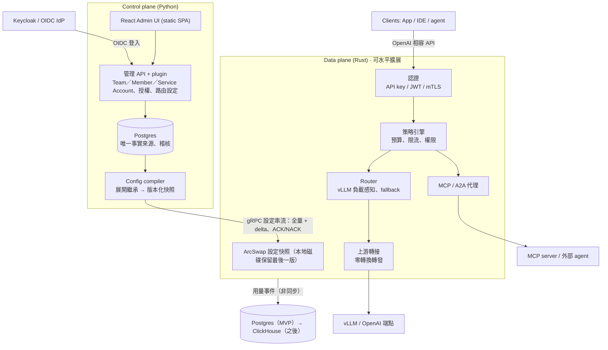

# Lumewarp 架構設計

> 來源：[Lumewarp 架構設計提案](https://claude.ai/artifact/HmNpAUHpzFNzQLCURx3nHo)（2026-10-21，Andy 已核可）。本檔是給 repo 與 Claude Code 讀的版本。

## 摘要

Lumewarp 是比 LiteLLM 更快、更好管理的 LLM gateway，拆成兩個獨立部署的元件：

- **Data plane（gateway）**：Rust。只處理請求，熱路徑不碰資料庫、不跑 Python。
- **Control plane（管理端）**：Python（FastAPI）+ React Admin UI。管理 Team／Member／Service Account、SSO、路由、plugin，產生設定快照。

兩者之間只透過一條版本化的 gRPC 設定串流溝通。control plane 掛掉時 gateway 照常服務。

核心原則：

1. 熱路徑不碰 DB、不跑 Python；計數與用量非同步送出。
2. 客製化（換 OAuth、加通知管道）用 Python plugin，結果編譯進設定快照由 gateway 執行；router 策略是編譯進 gateway 的 Rust crate。
3. 只做 OpenAI 相容 API，上游只有 vLLM 與 OpenAI（及 OpenAI 相容端點），不做其他 provider 轉換。
4. 設定是不可變的版本快照，可 canary、可回滾。
5. LLM、MCP、A2A 三種流量共用同一套認證、配額、稽核。

## 架構

## 語言與技術選型

| 元件 | 技術 | 理由 |
| --- | --- | --- |
| gateway | Rust：tokio、hyper、rustls、ArcSwap | 無 GC、p99 穩定、大量串流連線記憶體低 |
| control plane | Python：FastAPI、SQLAlchemy + Alembic、Authlib、grpcio | plugin 門檻最低，OIDC 生態成熟 |
| Admin UI | React + Vite 靜態 SPA、TanStack Query / Router、Tailwind v4、shadcn/ui（Radix primitives） | 編譯成靜態檔由 FastAPI 提供，部署不需 Node.js；型別由 OpenAPI 產生。可換 Preact 更輕 |
| 合約 | protobuf（設定快照 schema） | 兩種語言各自產生型別，schema 是唯一定義 |
| 授權 | Apache-2.0 | |

Admin UI 的呈現層全部是 shadcn/ui 元件（底層 Radix），版面用 Tailwind utility，`ui/src/styles.css` 只有主題 token 與 `@layer base`。`ui/scripts/check-shadcn.mjs` 是守門腳本：用 AST 掃 `ui/src` 的 `.ts`／`.tsx`，禁止舊的 page class、`components/ui/` 之外的原生 `<button>`／`<select>`／`<input>`／`<textarea>`／`<table>`／`<datalist>`／`<option>` 與 `radix-ui` import，並要求 `styles.css` 沒有 `@layer components`；沒有 allowlist，任何發現都讓檢查失敗。在 `ui/` 跑 `pnpm check` 會執行型別檢查、守門腳本自己的 fixture 測試與守門本身，CI 的 ui job 另外跑 Playwright。頁面按路由拆成 lazy chunk，只有登入後的首頁會先載入。Bundle（`pnpm build`，`gzip -9`）：entry chunk 145,047 bytes，安裝管理員進站實際下載的 JS 198,791 bytes（`ui/e2e/s11-lazy-routes.spec.ts` 守 219,415 bytes 上限），所有 JS chunk 分別壓縮後合計 238,642 bytes，CSS 13,283 bytes。Overview 與 Usage 的每日圖（`ui/src/components/UsageChart.tsx`）依模型堆疊，可切換 Tokens／Cost（每個瀏覽器各自記住，預設 Tokens），每個模型在頁面、範圍與指標切換間保持同色，超過八個模型折入 Other，資料表保留全部數字。

## 設定下發

1. 管理者在 UI/API 改設定，寫入 Postgres 並留稽核紀錄。
2. Config compiler 把 team 與 key owner 的繼承、路由、權限展開成已解析的 protobuf 快照，給遞增版本號，發布前驗證。
3. gateway 開機訂閱 gRPC 串流，先收全量，之後收 delta（例如新增/撤銷 API key）。
4. gateway 背景建好新索引，ArcSwap 原子替換；成功回 ACK，失敗回 NACK 並保留舊版。
5. 最後一份成功快照寫到本地磁碟，control plane 掛掉仍可重啟服務。
6. 支援 canary 發布；回滾 = 重推舊版本號。

反方向：用量、token、花費、稽核由 gateway 非同步批次送出（OTLP / NATS），MVP 寫入 Postgres，之後換 ClickHouse。預算與限流計數在 gateway 本地累加，約每秒與 Redis 對帳一次。

另有 standalone 模式：gateway 直接讀同格式 YAML，不需 control plane（GitOps、本機開發）。

## 功能

### SSO（Keycloak / OIDC）

- control plane 是標準 OIDC RP；Keycloak 是預設但非必要。SAML 交給 Keycloak brokering。
- 管理端登入：Authorization Code + PKCE 由 control plane 後端完成（Authlib），之後發伺服器端 session（httpOnly、`SameSite=Lax` cookie，寫入需 `X-Lumewarp-CSRF`）；以 `iss`+`sub` 認人；任何通過 IdP 驗證的使用者都能登入，首次登入 JIT 建立零權限使用者（只接受已驗證 email；`LUMEWARP_OIDC_JIT_USERS=false` 時只能登入已存在的帳號）。程式呼叫管理 API 用 PAT（bearer 只接受 PAT）。登入過程的 nonce 與 PKCE code verifier 不進 DB，放在用 `LUMEWARP_SECRET_KEY` 做 AES-256-GCM 封存的登入 cookie；沒設金鑰時服務拒絕啟動。
- IdP 負責認證，並可由 groups claim（`LUMEWARP_OIDC_GROUPS_CLAIM`，token 沒有時查 userinfo）告知誰在 admin group；內建後端只把這個 group 記在 session，登入時決定。team 權限不來自 IdP，其他 claim 也不授予權限。IdP 與 IAM 的人員狀態同步由部署方負責。
- 緊急登入（break-glass）：`POST /api/v1/session/break-glass` 用密碼換 session cookie，IdP 或 IAM 故障時仍可管理。生產用 argon2id hash（`LUMEWARP_BREAK_GLASS_PASSWORD_HASH`），明文密碼要 `LUMEWARP_DEV_MODE=true`。這個 session 不是使用者，不問授權後端；有 TTL（預設 1 小時，上限 4 小時）、失敗延遲與次數限制、可限制來源網段，嘗試都寫稽核，換密碼立刻失效。
- gateway 憑證只有虛擬 API key（只存 hash）；JWT／mTLS 呼叫 gateway 延後。
- 停權時推撤銷 delta，所有 gateway 秒級內拒絕：內建後端在移除成員的同一交易停用 key；外部 IAM 由 key reconciler 讀變更串流，約 5 秒內停用；IAM 錯誤或逾時絕不停用 key。

### 憑證儲存與稽核

- DB 只存不可逆或不可用的形式。API key、PAT、gateway token、session／CSRF token 與 OIDC state 只存 sha256：它們是 256-bit 隨機值，快速 hash 就足以防離線猜測。OIDC 的 nonce 與 PKCE code verifier 只放在 AES-256-GCM 封存的登入 cookie（金鑰由 `LUMEWARP_SECRET_KEY` 派生），`oidc_login_states` 只有 state hash、return path、redirect URI 與到期時間，用過即刪；SSO 開啟但沒設金鑰時服務拒絕啟動。Helm 以 `controlPlane.extraEnv` 的 `secretKeyRef` 傳入，範例見 [chart README](../deploy/helm/lumewarp/README.md#sso-and-authorization-backend)。
- notifier webhook 只存環境變數名稱（`config.url_ref`），值在投遞時才解析；名稱必須是 `[A-Za-z_][A-Za-z0-9_]*`、最多 200 字元，只允許可選的 `timeout_seconds`（0.001–30 秒），其他鍵與 inline URL 一律拒絕。CHECK constraint 在寫入時擋，投遞前再驗一次，所以 URL 或 token 不會出現在 `notifier_channels.config`。
- `upstreams.metrics_url` 不帶 query string（`?token=...` 會把憑證放進 API 會回傳、也會進稽核的欄位）；migration 0013 遇到已存的 query 會停止，並只列出 upstream 名稱、不印 URL。
- 稽核 `details` 是每個 action 的 allowlist：沒分類的欄位不記錄；`last_error` 類欄位只存 exception class。守門測試掃每個 Text／String／JSONB 欄位與原始碼中每個 `audit.record(action=...)`，新增而未分類就失敗。
- e2e suite 會掃描資料庫，確認沒有明文憑證。

### Team / Member / Service Account

- 階層：team → member（admin／member）與 service account → API key；沒有 org／project 層級。安裝層管理員不是角色：`LUMEWARP_ADMIN_GROUP` 指定的 IAM group 成員，或緊急 session。
- API key 屬於一個 team，owner 是該 team 的成員或 service account；key 本身不帶 policy，owner 身分也不進快照，compiler 只把展開後的有效策略寫進 key。
- team 與 key owner（member、service account）各自可設模型清單、限流、預算；owner 只能收窄 team，compiler 預先展開成每個 key 的有效策略。
- 自助 key：team 另可設 `max_keys_per_member`（每人在該 team 的非撤銷 key 上限，撤銷即釋放名額）與 `max_member_key_lifetime_seconds`（member key 最長效期）。數量上限只在建立時檢查；效期上限在建立、輪替與改到期日時強制，沒有到期日的 key 在建立或輪替時補上期限，超過上限則拒絕。service account 的 key 由 team admin 管理，不受這兩項限制；安裝層管理員與 team admin 也不能繞過 member key 的效期檢查。降低 team 上限不會自動撤銷既有 key：降低數量上限只會拒絕之後的建立（輪替不新增 key，仍可進行），降低效期上限則會拒絕之後超過上限的建立、輪替與延長。成員可以自行恢復自己暫停的 key（`owner`）與因被移出 team 而暫停的 key（`owner_removed`，恢復成員身分之後）；`admin` 暫停需要 team admin，`owner_deactivated` 需要管理員在帳號重新啟用之後處理，擁有者未啟用時任何人都不能恢復。
- 輪替寬限：`POST /keys/{id}/rotate` 可帶 `grace_seconds`（預設 0，最多 24 小時）。寬限內舊 hash 與新 hash 都以同一個 key_id 認證，用量歸同一個 key；舊 hash 自帶到期時間，gateway 只靠快照就能在 CP 停機、從磁碟快照開機時停止接受它。快照最多帶一個舊 hash，寬限內再輪替一次會提前結束較舊的那段寬限。撤銷會同時清除新舊 hash。過期的舊 hash 沒有背景清理：gateway 依快照自帶的到期時間停止接受它，下一次 compile 不再帶上它並以 delta 移除，DB 的欄位要到下一次輪替或撤銷才改變。
- `GET /users/me` 逐 team 回傳 member 的有效模型清單（與 compiler 的 `narrow()` 相同，team 政策與自身 member 政策取交集；若為 universal 則列出當下 catalog 並標 `all_models`）、有效限流、key 數量上限／最長效期與目前持有數，以及本月各層預算的剩餘額度；一般成員看不到他無權使用的上層清單。建立與輪替 key 以 principal 與 operation 為單位限流（各每分鐘 30 次，與目標 team／key 無關，計數在 process 內）：認證後、目標查詢與授權前檢查；安裝層管理員與緊急 session 豁免，只有 team admin 身分的 member 不豁免。成功寫入寫 audit；429 只進 metric、不寫 audit，避免灌爆稽核表。
- 授權：安裝層管理員、team admin、team member。member 可讀 team、建立與管理自己的 key；admin 另可改 team 設定、管理成員、service account 與 team 內所有 key；安裝層管理員可建立／刪除 team、管理安裝層設定，並通過所有 team 的檢查。
- 授權後端可換：內建用 session 的 group 與 `team_members`（所以內建後端下 PAT 不會是安裝層管理員，它沒有 group）；內附 `openfga` 與 `http` 後端，也可用 `lumewarp.authz` entry point 接外部系統。後端只回答關係，單一 async 函式 `check(user_id, relation, resource) -> Decision`：`relation` 是 `admin`（team）或 `member`（team、group），`resource` 是 `group:<admin group>` 或 `team:<uuid>`。`admin` 隱含 `member` 由後端保證；admin group 涵蓋所有 team 由 Lumewarp 自己套用。`ERROR`（後端不可用或逾時）不是 deny：管理 API 回 503。
- 用量與限流按 team 與 key owner 歸屬：member 的 scope id 是 `uuid5(team_id, user_id)`，service account 用其 id；限流 scope 為 `team:<id>`、`member:<id>`、`sa:<id>`。
- 預算：依 token 與單價計費，軟上限通知、硬上限拒絕。

### Admin UI

- 選單依角色出現，API 仍是最後的權限來源。member 看到 My keys、Usage、Settings；team admin 多 Overview、Teams（含單一 team 的 Members／Service accounts／Keys／Usage／Settings 分頁）與 Audit log；安裝層管理員多 Users、Upstreams、Models、Aliases、Routers、Gateways 與 Config versions。既非安裝層管理員也不是 team admin 的人首頁是 `/my-keys`，其餘是 Overview；緊急 session 不擁有 key，My keys 只說明這件事。
- 沒有獨立的 `/keys` 管理頁：整個 team 的 key 在 team 的 Keys 分頁。team admin 可管理別人的 key 與 service account 的 key；member 看得到同 team 的 key，但只能改自己的。
- My keys 逐 team（只列自己所屬的 team）顯示可呼叫的 model（取交集後的實際清單）、限流、本月剩餘預算、key 上限與最長效期，並可建立、改名、改到期日、輪替（可選寬限）、暫停、恢復與撤銷自己的 key，下方是本月個人用量。
- 存取變更：受保護頁面每次進入都重驗 `/users/me`。快取允許時頁面先掛上，背景重驗發現權限被收回就換成「沒有權限」；快取拒絕時先等重驗。用網址打開看不到的頁面只顯示說明，不對該 team 發請求。
- 授權後端不可用時顯示「暫時無法確認、這不是拒絕」的狀態（`authz_unavailable`），管理 API 回 503；My keys 不會把它當成「沒有 team」。
- 一次性 secret：建立或輪替 key、建立 PAT 與 gateway token 的 secret 由 root 的同一個對話框顯示，只有「I've saved it」能關（Esc、點擊外部、標頭的 X 都無效）。它在換頁、背景檢查失敗與 session 過期（401 轉到登入頁）後仍顯示，因為對話框在 router 與 guard 之上；登出會清掉，重新載入頁面則消失。secret 不進 query cache；mutation 快取裡只有不含 secret 的結果。

### Router

- 用戶端呼叫的是「名字」，一個名字是 model（一個 upstream 上的一個模型）、alias（model 或 router 的另一個名字，只有一層）或 router（把請求分給後面的 models）。三種共用名字空間，都可以改名，內部參照都用 id。權限依呼叫的名字檢查。完整規則見下方「模型目錄已實作」。
- 回應的 `model` 是呼叫時的名字；usage 的 `model` 是實際服務的 model，另外記錄來源的 alias、router、fallback 與 attempts。
- 策略是 Rust crate（`docs/router-strategies.md`），重新 build gateway 即可，proto、control plane、UI 都不用改。Retry、fallback、traffic split 只在 router 上；直接呼叫 model 就是一次嘗試。
- 策略：加權、最低延遲（EWMA）、最少進行中請求、vLLM 負載感知；依 team、header、輸入 token 數條件分流（延後）。
- 彈性：fallback 鏈、有上限的重試、circuit breaker、主動健康檢查、尊重 Retry-After。
- cache 親和：相同 session 或 prompt 前綴黏在同一 model（延後）。
- 變更即設定版本，可回滾；路由層百分比切流（traffic split，可依 header／team／key sticky）已實作，設定版本 canary 延後。

### MCP / A2A gateway（尚未實作）

- 註冊上游 MCP server（Streamable HTTP；stdio 由 sidecar 包裝），依 team 組成虛擬 MCP server，工具名加 namespace。
- 工具級權限、高風險工具需人工核准。
- gateway 是 MCP authorization 規範中的 OAuth resource server，代管上游使用者 OAuth token。
- A2A：Agent Card 註冊表，代理 JSON-RPC 與串流任務。
- 每次工具/agent 呼叫都進稽核並串在同一 trace。

## Python plugin

以 entry points 註冊（`lumewarp.auth`、`lumewarp.notifier`、`lumewarp.authz`），`pip install` 後重啟管理端生效。**Python 永遠不在 gateway 熱路徑上。**

| 擴充點 | 執行位置 | 例子 | 延遲影響 |
| --- | --- | --- | --- |
| 認證 plugin（`lumewarp.auth`） | control plane，只在首次 SSO 登入 | `map_identity(claims)` 把外部身分對應到 email 與顯示名稱，不授予權限 | 無 |
| 授權後端（`lumewarp.authz`） | control plane | `check(user_id, relation, resource)` 接公司自有 AAA；介面見 [control plane README](../control-plane/README.md#authorization) | 無 |
| 通知 plugin（`lumewarp.notifier`） | control plane，outbox 投遞 | `send(event, config)` 送預算通知；內建 webhook 的 config 只存環境變數名稱（`url_ref`） | 無 |
| 逐請求 hook（選用，延後） | gateway 呼叫外部 gRPC 服務 | 依 prompt 分類選模型 | 多一次往返，需明確開啟，有逾時與預設路由 |

## vLLM / OpenAI 一級支援

- 端點：`/v1/chat/completions`、`/v1/completions`、`/v1/embeddings`、`/v1/models` 原樣轉發；vLLM 額外參數（guided decoding、`extra_body`）直接透傳。
- 自動探索：定期讀 `/v1/models`，註冊模型與 LoRA adapter（延後）。
- 負載感知路由：讀 vLLM `/metrics` 的等待中請求數與 KV cache 使用率。
- prefix cache 親和（延後）。
- 健康檢查：vLLM `/health`。
- token 計量：用上游 usage（串流自動加 `stream_options.include_usage`）；自架 vLLM 可依 GPU 小時成本換算。

## Metrics 與 Alert

gateway 原生輸出 Prometheus `/metrics` 與（選用）OTLP traces；control plane 在獨立的 metrics listener（`LUMEWARP_METRICS_BIND`，預設 `127.0.0.1:9465`，不在 admin API port）輸出 `lumewarp_cp_*`（下表後半，完整說明見 [control-plane README](../control-plane/README.md#metrics)）；control plane 的 OTLP 尚未實作。

| 指標 | 標籤 | 用途 |
| --- | --- | --- |
| `lumewarp_requests_total` | requested, endpoint, model, team, status | 流量與錯誤率 |
| `lumewarp_request_duration_seconds` | requested, endpoint, model | 端到端延遲 |
| `lumewarp_gateway_overhead_seconds` | endpoint | gateway 自身額外延遲 |
| `lumewarp_ttft_seconds`、`lumewarp_tpot_seconds` | requested, model | 串流延遲 |
| `lumewarp_tokens_total` | requested, team, direction | token 用量 |
| `lumewarp_spend_total` | team | 花費 |
| `lumewarp_upstream_circuit_state` | model | 熔斷與健康 |
| `lumewarp_upstream_attempts_total` | requested, model, outcome | 每次上游嘗試；success / retryable_status / connect_error / timeout / circuit_open / non_retryable |
| `lumewarp_response_model_rewrite_compressed_total` | model | 需要改寫回應 `model` 但上游仍壓縮：原樣轉發、不解壓縮，用戶端看到上游模型名，usage 為 invalid |
| `lumewarp_fallbacks_total` | router, model | 切換至 fallback model |
| `lumewarp_retries_budget_exhausted_total` | router | 全域重試額度耗盡 |
| `lumewarp_upstream_healthy` | upstream | 主動健康檢查狀態（1 正常、0 異常）；探測不計入請求與用量 |
| `lumewarp_vllm_queue_depth`、`lumewarp_vllm_kv_cache_usage` | model | vLLM 負載（每秒背景抓取；`vllm_load` 路由使用） |
| `lumewarp_vllm_scrape_failures_total` | upstream | vLLM metrics 抓取失敗（失敗即退回 in-flight 比較） |
| `lumewarp_upstream_latency_ewma_seconds` | model | `lowest_latency` 使用的回應標頭時間 EWMA（於 `/metrics` 抓取時計算） |
| `lumewarp_split_requests_total` | router, split | 依 traffic split 分配的請求數（canary 比例） |
| `lumewarp_mcp_tool_calls_total` | server, tool, team, status | MCP 使用（尚未實作） |
| `lumewarp_config_version`、`lumewarp_config_apply_failures_total` | gateway | 設定同步 |
| `lumewarp_cp_compile_duration_seconds`、`lumewarp_cp_compile_failures_total` | — | 設定編譯（CP） |
| `lumewarp_cp_config_version`、`lumewarp_cp_outbox_pending` | — | 最新發布版本與 outbox 積壓（CP） |
| `lumewarp_cp_gateway_sessions`、`lumewarp_cp_gateway_acks_total` | result（ack／nack） | config stream 連線與回覆（CP） |
| `lumewarp_cp_usage_events_ingested_total`、`lumewarp_cp_usage_events_skipped_total` | reason（skipped） | 用量匯入（CP） |
| `lumewarp_cp_authz_checks_total` | backend, decision | 授權後端（CP） |
| `lumewarp_cp_keys_suspended_total`、`lumewarp_cp_key_reconcile_last_success_timestamp_seconds` | reason（suspended） | key 停用與 reconciler 新鮮度（CP） |
| `lumewarp_cp_key_writes_total` | operation（create／rotate）, result（success／rate_limited） | 自助建立／輪替 key 與其速率限制（CP） |

### Gateway 指標定義

上表之外，gateway 另有 `lumewarp_request_body_read_seconds`、`lumewarp_upstream_errors_total`、`lumewarp_in_flight_requests` 與 `lumewarp_config_info`，都由獨立 admin listener 的 `/metrics` 輸出；`lumewarp_config_version` 在 YAML 模式為 0。OTLP traces 為選用，沒有 OTLP metrics。非串流與串流的 overhead 均為「body 讀完 → upstream request 送出」加「upstream headers 收到 → handler 返回」；串流再加第一個 frame 已 ready 到轉交的本地處理時間，不含等待 upstream headers、prefill、後續 body 生成或 client socket flush／ACK。未路由的請求以 body 讀完到 handler 返回近似，未讀 body 則從 request start 計；取消中的 upload 只進 body-read duration，不算 overhead。此為內部處理時間近似，不同於 bench 的 gateway／direct 端到端延遲差值。完整操作、TTFT／body-read 與標籤定義見 [gateway README](../gateway/README.md)。

API key 級細節不進 metrics（避免標籤爆炸）。Alert：Helm chart 可選 ServiceMonitor（gateway admin port 與 control plane metrics port）；Prometheus 告警規則（`deploy/prometheus/rules.yaml`，附 promtool 測試）與四張 Grafana dashboard（`deploy/grafana/dashboards/`，Helm 可選安裝）；control plane 內建預算告警，經 webhook / Slack / Email / PagerDuty（業務），可用 notifier plugin 擴充。每個請求一條 OTel trace，接續 W3C `traceparent`。log 預設不記 prompt/response。

## Control plane 與 gateway

以下是 control plane、設定串流、Team 模型與 Admin UI 的實作；設計內容以上文為準。

**Control plane（`control-plane/`）**

- 單一 Python 程序：FastAPI（HTTP 8091）＋ gRPC（50051）的 ConfigService／UsageService／health，加上 compiler loop、月結 rollover 與 notifier outbox；`/readyz` 檢查 DB、migration head 與背景服務，`/healthz` 為 liveness，gRPC 意外停止會讓程序結束。
- Postgres schema 由 Alembic 管理（單一 scope）；每人 PAT；授權為安裝層管理員與 team admin／member，成員關係在 `team_members`，也可換成外部 `lumewarp.authz` 後端。
- REST `/api/v1`：team／member／service account／key（含撤銷與輪替）、預算／限流／模型 allowlist、upstream／model／router（含價格）、使用者、usage 聚合、audit、gateway 狀態與 token、config versions 與 routing rollback。
- 設定發布：寫入交易內同時寫 outbox；compiler 以 advisory lock 序列化，產生不可變版本快照；gRPC 串流支援全量／delta、digest、ACK／NACK、base mismatch 重送全量、壞版本隔離與 persist 重試，舊版 payload 依保留策略壓縮。
- 用量與預算：`UsageService.Report` 以 `request_id` 冪等寫入，同一交易累計 team 與 owner（member／service account）的 UTC 月總額並評估預算；超額把 key 翻成 `BUDGET_EXCEEDED` 並推新版本（eventual，約 5 秒內；不切斷進行中的串流）。soft limit 走 notifier outbox（內建 webhook，可換 plugin）。
- Plugin：`lumewarp.notifier`（outbox 投遞）與 `lumewarp.auth`（首次 SSO 登入的身分對應）已接上。
- Admin UI：Vite 靜態檔由 control plane 掛在 `/`，用 SSO 或緊急登入；API 文件在 `/docs`，OpenAPI 可離線輸出。UI 沒 build 時只有 API。

**Gateway（`gateway/`）**

- 新增 control-plane 模式：`--control-plane`、`--gateway-token-env`、`--state-dir`、`--scope`、`--gateway-id`、`--local-config`；standalone YAML 模式不變。
- 開機先載入 `<state-dir>/snapshot.pb`（驗證 scope、長度與結尾 SHA-256）並立即服務，再背景連線；沒有可用快照時 `/v1/*` 與 `/readyz` 回 503，不會退回 open router。每次套用先持久化再 swap 再 ACK，重啟可回到最後 ACK 的版本。
- CP 模式一律要求 key；status／expiry／allowlist 與預算狀態照舊（401／403／429）。rpm、tpm、max_parallel 在每個 gateway 行程本機累計（N 個實例可有 N 倍上限），429 帶 `Retry-After`。
- 用量：串流在上游支援時注入 `stream_options.include_usage`，客戶端沒要求時剝除多出的 usage chunk；事件經有界佇列（100k）每 1 秒或 500 筆批次送出，滿了就丟並計數；token／spend 指標與 `model.price` 成本換算已接上。
- 指標：config stream 連線／版本／NACK code、usage 佇列與 capture 狀態、tokens／spend 皆已輸出；`/metrics` 仍在 admin listener。

**部署**

- `deploy/helm/lumewarp`：control plane 與 gateway 的 Deployment／Service、DB URL 與 gateway token 的既有 Secret 參照、`/readyz`＋`/healthz` probes、gateway state dir（emptyDir 預設、PVC 選用）、migration hook Job、可選 ServiceMonitor。
- `deploy/dev/compose.yaml` 提供本機 Postgres 16。

**已知限制**

- 預算為 eventual；佇列滿或 gateway 重啟會遺失用量事件，進行中的串流不會因超額被切斷；月窗口固定為 UTC 日曆月。

## 權限、路由與可觀測性

權限模型是 team → member／service account，加上 SSO、可抽換的授權後端、路由韌性與可觀測性。設計內容以上文為準。

**權限與 SSO（control plane）**

- 模型：安裝層管理員 → team → member（admin／member）與 service account → API key；沒有 org 與 project。
- 授權：`Authorizer.check(user_id, relation, resource)`；內建 `builtin`、`openfga`（Check／BatchCheck／ListObjects／ReadChanges，`HIGHER_CONSISTENCY`）、`http`，或 `lumewarp.authz` entry point。每次呼叫有逾時（`LUMEWARP_AUTHZ_TIMEOUT_SECONDS`），逾時即 `ERROR` → 管理 API 503。共用情境測試 `authz/contract_tests.py`。
- key reconciler：有 `changes()` 時每 2 秒輪詢、只重算變動的使用者，另每 5 分鐘全掃；明確 deny → `SUSPENDED`（`owner_removed`）並推新版本。恢復權限不自動復原；service account 的 key 不受影響。
- OIDC 登入、伺服器端 session 與 CSRF 見上文 SSO 一節；admin group 成員不能以 email 自動連結。
- 成員可用 email 加入；成員與 key 顯示擁有者是否仍啟用。

**路由（gateway + control plane）**

- 快照與 standalone YAML 支援 `retry`、`fallbacks`、`health_check`、`circuit_breaker`、`traffic_split`、`vllm_load`、`rotation_grace` 與 `strategy:<name>` capability；control plane 只在欄位有用到時列出對應 capability，驗證規則與 gateway 一致（含 URI 文法）。fallback 只能是 model，需要至少 2 次 attempt 的 retry policy。
- 重試僅限回應送出前，串流僅限收到上游 headers 前；最多五次，
  共用原路由 timeout 與全域重試額度（預設 20%，低流量允許三次 burst；
  只有設定 `retry` 的路由請求會存入額度）。`Retry-After` 使用 model
  cooldown（上限 60 秒與 breaker `open_ms`），重試跳過冷卻中的 model。
  被路由 `total_timeout_ms` 截斷的 attempt 不算 model 失敗。
- model 熔斷狀態以名稱保存在 Runtime，跨快照保留；主動健康探測在背景執行，
  接受新快照後依 (upstream, URL, 設定, 憑證) 比對，只重啟有變動的探測。
  所有候選都異常或開路時仍嘗試一個，避免 fail closed；已進行中的
  half-open trial 不重複，改用其他候選。
- 每次 attempt 有獨立 OTel 子 span；請求指標與用量只記一次，歸屬實際產生
  回應的 attempt。回應的 `model` 見下節。
- `LOWEST_LATENCY`：每個 model 的回應標頭時間 EWMA，power of two choices。`VLLM_LOAD`：每秒背景抓取 vLLM `/metrics`（`num_requests_waiting`、KV cache 使用率），power of two choices；抓取失敗或超過 3 秒未更新就退回 in-flight 比較。
- traffic split：依權重選 split，再在 split 內依策略選 model；sticky 依 header／team／key 的固定種子雜湊。重試先留在同一 split，再換其他 split，最後才走 fallback。
- Bench A6（quick ×3，1000 RPS，含認證）：非串流 overhead p99 −0.07 ms（雜訊範圍），串流 TTFT overhead p99 3.3 ms；LiteLLM 同機飽和。
  路由功能完成時在 main 跑 full ×3（含認證）：1000 RPS 非串流 overhead p99 0.20 ms
  （A6 通過），300 RPS 0.28 ms；10000 RPS 時 lumewarp 與 direct 都達到目標速率。
  串流 TTFT overhead p99：並行 100 為 −1.9 ms（雜訊），並行 1000 為 14.5 ms。
  LiteLLM 在 1000 RPS 以上達不到目標速率。

**可觀測性**

- gateway 新指標見上表；control plane 在獨立 listener 輸出 `lumewarp_cp_*`。
- 19 條告警規則與 promtool 測試、四張 dashboard、Helm 可選 PrometheusRule／dashboard ConfigMap／兩個 ServiceMonitor。

**驗收**

- `scripts/e2e-identity.sh`：builtin 與 openfga 各跑一次 OIDC 登入、建 key、呼叫、用量對帳、撤權（實測 builtin 0.2 s、openfga 1.1 s 內回 401）、IAM 故障不誤停；另含路由 e2e（重試、fallback、熔斷、URI 契約）。
- `scripts/e2e-core.sh`（含路由 e2e）、`scripts/load-e2e.sh` 8/8。

## 模型目錄已實作

目錄的核心是 model、alias、router。以下先列現況，後面是已定的決定、實作取捨與尚未做的項目。

- **目錄與 API：** `/models`、`/aliases`、`/routers`、`/strategies`、`/catalog`。名字跨種類唯一（`catalog_names`），參照與權限都用 id（`policy_grants`），改名不弄斷關係；舊名字立刻 404，只有 model 可以 `keep_old_name_as_alias`。被參照的名字不能刪（409）。
- **快照：** `Snapshot` 直接帶 models、aliases、routers，gateway 在套用時建成一張名字表，請求路徑仍是一次查表。`Router.strategy` 是字串。`ApiKey.allowed_models` 由 control plane 展開成當下的名字。
- **Rollback：** 依 id 還原目錄（`config_versions.catalog_state`），已刪除的項目用原 id 重建；授權不還原。
- **回應改寫：** 不緩衝的掃描器（`rewrite.rs`）把 JSON 與 SSE 最外層的 `model` 換成呼叫的名字，大小不設上限。呼叫的名字等於 `upstream_model` 時走快速路徑。需要改寫時移除送往上游的 `Accept-Encoding`；上游仍壓縮就原樣轉發並累加 metric。契約見 [config protocol](config-protocol.md)。
- **Usage：** 每筆 event 保存 `requested`、`model`、`alias`、`router`、`upstream`、`upstream_model`、`fallback`、`attempts`、`endpoint`，加上 control plane 解析的 `model_id`、`alias_id`、`router_id`。`GET /usage` 不是每個欄位都能查：`group_by` 支援 `day`、`requested`、`model`、`upstream_model`、`alias`、`router`、`team`、`owner`、`key`；篩選支援 `from`、`to`、`team_id`、`user_id`、`service_account_id`、`key_id`、`requested`、`model`、`upstream_model`、`alias`、`router`、`model_id`、`alias_id`、`router_id`、`alias_missing`、`router_missing`。`upstream`、`fallback`、`attempts`、`endpoint` 只能從資料列讀。改名前後的用量連續。
- **策略：** `register!` 宣告 params 與成員欄位，schema 從 struct 產生，在 `Hello` 回報，存進 `gateway_strategies`；寫入時依 schema 驗證，內建策略有 commit 的 manifest。見 [router strategies](router-strategies.md)。
- **用 OTel 查請求：** gateway 不寫 access log。回應帶 `x-lumewarp-request-id`，等於 usage 的 `request_id` 與 span 的 `request_id`。`request` span 帶呼叫的名字、alias、router、最後的 model 與 attempts，每次嘗試一個 `upstream_attempt`。前提：沒設 OTLP endpoint 就沒有紀錄；取樣低於 100% 或 exporter 佇列滿了會查不到，要當 access log 建議 100%；保留多久由 OTel 後端決定。Sampler 不聽從用戶端 `traceparent` 的 sampled flag。Helm 的設定是 `gateway.otel.endpoint`、`gateway.otel.samplingRatio`。
- **Metrics：** 標籤 `model` 是實際服務的 model，`requested` 是呼叫的名字，`endpoint` 是 API 路徑。改名後 label 換成新名字，舊名字的時間序列就此結束，這是 Prometheus 的正常行為。
- **驗收：** `tests/e2e/test_catalog.py`（真實 control plane + gateway）。

**尚未包含：** 註冊時的連線測試、在 Models／Routers 顯示「已生效／被 NACK」、`api_key_ref` 錯誤的處理、對成員隱藏上游資訊、dropped spans 的 metric（span 遺失目前是無聲的）。

### 已定的決定（Andy，2026-11-02）

1. **名字全域唯一。** 一個 model 只對應一個 upstream + upstream_model，反過來不限制：同一個上游模型可以有多個 model。Model、alias、router 共用同一個名字空間，要負載平衡一律建 router。
2. **名字可以改。**
3. **Alias 可指向 model 或 router，只有一層，獨立授權。** 有 alias 權限就能呼叫，不需要目標的權限；有目標的權限也不會自動得到 alias。
4. **Router 底下只有 model 名字。** 成員只能是 model，不能放 alias 或其他 router。Fallback 目標也只能是 model，而且可以不設。
5. **權重放在 router 的成員上。** 同一個 model 在不同 router 可以有不同權重。Model 上不再有 weight。
6. **Retry、fallback、traffic split、strategy 都只在 router 上。** 直接呼叫 model 就是一次嘗試。Health check 和熔斷的設定仍在 upstream 上，熔斷狀態依 model 分開。需要重試就建單一成員的 router。
7. **權限依呼叫的名字檢查。** Key 能呼叫 `qwen-coder`，不代表能直接呼叫 `lumewarp/qwen3-a`，直接呼叫 model 要有該 model 的權限。Router 的 fallback 不重新檢查權限，和現在一樣。
8. **權限維持 team → member / service account。** Key 繼承持有者的範圍，不加 key 層。
9. **被參照的名字不能刪。** 被 router、alias 或 fallback 參照時回 409，並列出參照者。
10. **回應的 `model` 一律改寫成呼叫時的名字。** Control plane UI 要能同時用對外名字和上游模型名篩選。
11. **內部命名全部一起改。** 目前沒有遷移成本，不保留舊詞。
12. **Team 設成 All 就包含之後新增的名字。** 需要限制的 team 改用 Selected。
13. **Usage 的 `model` 記最後實際服務的 model，另外記錄來源的 alias 和 router。**
14. **Router 的設定由 Rust 擴充介面定義。** 內建和自訂策略走同一套，UI 依策略宣告的 schema 產生表單。策略只定義自己的設定，成員清單、retry、fallback、traffic split 由 gateway 統一提供。
15. **Gateway 不寫 access log，要查單一請求就到 OTel 找。**
16. **只有 model 改名有「Keep old name as alias」。** 預設勾選；router 和 alias 沒有。
17. **有 gateway 沒有某個策略時，預設不能儲存。** API 回 422 並列出缺少的 gateway，帶 `force` 才能存。
18. **Control plane 的上游資訊暫時維持現狀（Andy：先這樣處理）。** 任何已登入的人都能讀路由設定，team member 也能在 Usage 看到實際的 model 和上游模型名。回應改寫只影響 API 用戶端看到的名字，不算保密。之後要對成員隱藏再另外設計。

- **價格放在 model 上。** 費用永遠依實際服務的 model 計算。
- **權限清單驗證名字存在。** Member / service account 的清單必須是 team 範圍的子集，UI 也只列 team 範圍內的名字。
- **Team 範圍縮小時，** 不改 member 的設定，實際權限仍取交集（現有 `narrow` 的行為）。
- **刪除名字時，** 指向它的授權一起刪除並寫入 audit；被 router、alias 或 fallback 參照則依第 9 點回 409。

### 實作取捨

- **讀 body 前被拒絕的請求，`requested` 是空的。** 403、404、429（限流）在讀完 body 之後才決定，有值；已撤銷、停用、過期和超過預算的 key 在讀 body 之前就被拒絕，那時還不知道名字。要補就得為了被拒絕的請求讀 body，所以維持空值。
- **快速路徑可能回傳上游更具體的名字。** 呼叫的名字等於 `upstream_model` 時不走掃描器，例如呼叫 `gpt-4o`，OpenAI 可能回 `gpt-4o-2024-08-06`。這是第 10 點「一律改寫」之外的例外，另外兩個例外是錯誤回應和上游仍然壓縮的回應。
- **Binary 叫 `lumewarp`，** 指令是 `lumewarp strategies --json`。
- **Usage 的 migration（`0011`）是離線的。** 回填和建索引都在同一個交易內，全程持有 `ACCESS EXCLUSIVE`，要在維護時段執行。Downgrade 會遺失 provenance 欄位，文件有寫。
- **解析 usage 名字有寬限時間。** 依請求開始時間（`started_at`，舊 gateway 用完成時間），查不到精確的區間時，寬限時間內只有一個同種類的擁有者才補 id。預設 300 秒，`LUMEWARP_USAGE_CATALOG_GRACE_SECONDS`，0 是關閉。這容忍時鐘偏差和傳播延遲，不是身分證明：同種類舊名字在寬限時間內被重複使用時，落後的 gateway 仍可能算到新擁有者。
- **非串流回應超過 4 MiB 時，usage 是 `INVALID`。** 回應本身正常轉發和改寫，只是 usage 的 capture 上限 `MAX_JSON_CAPTURE` 讀不到 token。這個上限原本就有，但以前這種回應需要改寫時會中斷，現在會送達，所以比較容易遇到。
- **沒有 gateway 回報的策略也算 `config_invalid`。** 遷移過來的自訂 router 在 gateway 回報該策略之前都會顯示 `Config invalid`，資料不會被修改。
- **內建策略拒絕成員 params。** 以前填了會被忽略，現在 API 回 422、gateway NACK，因為空 schema 是 `additionalProperties: false`。已存的這種資料會顯示 `config_invalid`。
- **`Configure` trait。** `configure` 透過新的 `Configure<P, M>` trait 收到已解析的 struct，讓驗證的型別和讀取的型別是同一份；`Strategy` 只剩 `pick`。

### 尚未做

- 註冊時的連線測試（確認 upstream 連得上、`upstream_model` 存在）。
- 在 Models、Routers 顯示「已生效／被 NACK」。
- `api_key_ref` 錯誤造成 gateway 收不到新設定的問題。這項尚未實測，應該獨立設計。
- Token 月配額。

## 效能目標（尚未實測）

| 指標 | 目標 |
| --- | --- |
| gateway 額外延遲 p50（不含上游） | < 100 µs |
| gateway 額外延遲 p99 | < 1 ms |
| 單一 4 vCPU 實例 | ≥ 10,000 RPS（非串流） |
| 同時串流連線 | ≥ 50,000，記憶體 < 2 GB |
| 設定生效時間 | < 2 s |

驗證：固定延遲、可模擬 SSE 的 mock 上游；同機對 LiteLLM 與 Lumewarp 跑 1k / 5k / 10k RPS（oha 或 k6），比較額外延遲、TTFT、CPU、記憶體，結果進 CI 追蹤退化。

## Roadmap

下一步是 MCP / A2A（MCP 註冊聚合、工具權限、OAuth 代管；A2A 代理；三種流量共用稽核與 tracing），尚未規劃。

其他尚未實作的項目：

- JWT／mTLS 呼叫 gateway、SCIM、IdP→IAM 人員同步、讀 IdP claims 做 team 授權、更細的角色、key 層級限制。
- 跨 gateway 共享限流（Redis 對帳）、ClickHouse、設定版本 canary、cache 親和、依 header／token 數條件分流、逐請求外部 hook、LoRA 自動探索。
- control plane 的 OTLP metrics／traces（Prometheus `lumewarp_cp_*` 已有）；gateway 只有選用的 OTLP traces，沒有 metrics exporter。
- `gateway/Dockerfile`、`control-plane/Dockerfile` 可建置映像，但尚未有發佈映像的 CI；Helm chart 需自行指定 repository/tag。
