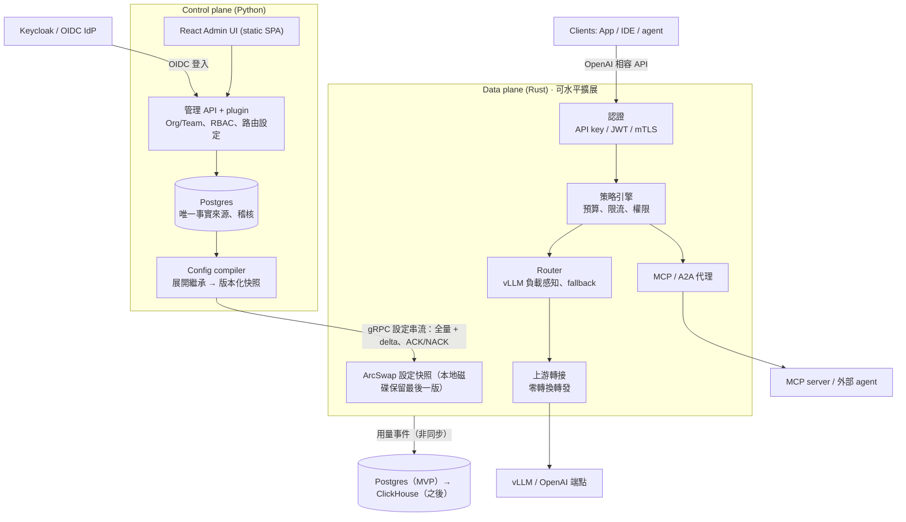

# Lumewarp 架構設計

> 來源：[Lumewarp 架構設計提案](https://claude.ai/artifact/HmNpAUHpzFNzQLCURx3nHo)（2026-10-21，Andy 已核可）。本檔是給 repo 與 Claude Code 讀的版本。

## 摘要

Lumewarp 是比 LiteLLM 更快、更好管理的 LLM gateway，拆成兩個獨立部署的元件：

- **Data plane（gateway）**：Rust。只處理請求，熱路徑不碰資料庫、不跑 Python。
- **Control plane（管理端）**：Python（FastAPI）+ React Admin UI。管理 Org/Team、SSO、路由、plugin，產生設定快照。

兩者之間只透過一條版本化的 gRPC 設定串流溝通。control plane 掛掉時 gateway 照常服務。

核心原則：

1. 熱路徑不碰 DB、不跑 Python；計數與用量非同步送出。
2. 客製化（換 OAuth、加 router、加通知管道）用 Python plugin，結果編譯進設定快照由 gateway 執行。
3. 只做 OpenAI 相容 API，上游只有 vLLM 與 OpenAI（及 OpenAI 相容端點），不做其他 provider 轉換。
4. 設定是不可變的版本快照，可 canary、可回滾。
5. LLM、MCP、A2A 三種流量共用同一套認證、配額、稽核。

## 架構

## 語言與技術選型

| 元件 | 技術 | 理由 |
| --- | --- | --- |
| gateway | Rust：tokio、hyper、rustls、ArcSwap | 無 GC、p99 穩定、大量串流連線記憶體低 |
| control plane | Python：FastAPI、SQLAlchemy + Alembic、Authlib、grpcio | plugin 門檻最低，OIDC 生態成熟 |
| Admin UI | React + Vite 靜態 SPA、TanStack Query / Router | 編譯成靜態檔由 FastAPI 提供，部署不需 Node.js；型別由 OpenAPI 產生。可換 Preact 更輕 |
| 合約 | protobuf（設定快照 schema） | 兩種語言各自產生型別，schema 是唯一定義 |
| 授權 | Apache-2.0 | |

## 設定下發

1. 管理者在 UI/API 改設定，寫入 Postgres 並留稽核紀錄。
2. Config compiler 把組織繼承、路由、權限展開成已解析的 protobuf 快照，給遞增版本號，發布前驗證。
3. gateway 開機訂閱 gRPC 串流，先收全量，之後收 delta（例如新增/撤銷 API key）。
4. gateway 背景建好新索引，ArcSwap 原子替換；成功回 ACK，失敗回 NACK 並保留舊版。
5. 最後一份成功快照寫到本地磁碟，control plane 掛掉仍可重啟服務。
6. 支援 canary 發布；回滾 = 重推舊版本號。

反方向：用量、token、花費、稽核由 gateway 非同步批次送出（OTLP / NATS），MVP 寫入 Postgres，之後換 ClickHouse。預算與限流計數在 gateway 本地累加，約每秒與 Redis 對帳一次。

另有 standalone 模式：gateway 直接讀同格式 YAML，不需 control plane（GitOps、本機開發）。

## 功能

### SSO（Keycloak / OIDC）

- control plane 是標準 OIDC RP；Keycloak 是預設但非必要。SAML 交給 Keycloak brokering。
- 管理端登入：Authorization Code + PKCE；groups claim 對應 Org/Team 與角色；之後加 SCIM。
- gateway 憑證：虛擬 API key（只存 hash）、IdP 簽發的 JWT（JWKS 本地驗證）、mTLS / workload identity。
- 停權時推撤銷 delta，所有 gateway 秒級內拒絕。

### Org / Team

- 階層：Organization → Team → Project → API key；每層可設預算、限流、模型清單、MCP 工具清單。
- 子層只能收窄父層限制；compiler 預先展開成每個 key 的有效策略。
- RBAC：Owner / Admin / Member / Viewer。
- 預算：依 token 與單價計費，軟上限通知、硬上限拒絕。

### Router

- 模型別名 → 路由 → 多個 deployment（上游 + 模型 + 憑證）。
- 策略：加權、最低延遲（EWMA）、最少進行中請求、vLLM 負載感知；依 team、header、輸入 token 數條件分流。
- 彈性：fallback 鏈、有上限的重試、circuit breaker、主動健康檢查、尊重 Retry-After。
- cache 親和：相同 session 或 prompt 前綴黏在同一 deployment。
- 變更即設定版本，可百分比切流與回滾。

### MCP / A2A gateway

- 註冊上游 MCP server（Streamable HTTP；stdio 由 sidecar 包裝），依 team 組成虛擬 MCP server，工具名加 namespace。
- 工具級權限、高風險工具需人工核准。
- gateway 是 MCP authorization 規範中的 OAuth resource server，代管上游使用者 OAuth token。
- A2A：Agent Card 註冊表，代理 JSON-RPC 與串流任務。
- 每次工具/agent 呼叫都進稽核並串在同一 trace。

## Python plugin

以 entry points 註冊（`lumewarp.auth`、`lumewarp.router`、`lumewarp.notifier`），`pip install` 後重啟管理端生效。**Python 永遠不在 gateway 熱路徑上。**

| 擴充點 | 執行位置 | 例子 | 延遲影響 |
| --- | --- | --- | --- |
| 認證 plugin | control plane | 公司自有 OAuth、LDAP、自訂 groups 對應；非 JWT 的 IdP 由管理端換發 Lumewarp JWT | 無 |
| Router policy plugin | control plane，定期執行 | 依 GPU 成本、時段、vLLM 負載算權重與規則，寫進快照 | 無 |
| 逐請求 hook（選用） | gateway 呼叫外部 gRPC 服務 | 依 prompt 分類選模型 | 多一次往返，需明確開啟，有逾時與預設路由 |

## vLLM / OpenAI 一級支援

- 端點：`/v1/chat/completions`、`/v1/completions`、`/v1/embeddings`、`/v1/models` 原樣轉發；vLLM 額外參數（guided decoding、`extra_body`）直接透傳。
- 自動探索：定期讀 `/v1/models`，註冊模型與 LoRA adapter。
- 負載感知路由：讀 vLLM `/metrics` 的等待中請求數與 KV cache 使用率。
- prefix cache 親和。
- 健康檢查：vLLM `/health`。
- token 計量：用上游 usage（串流自動加 `stream_options.include_usage`）；自架 vLLM 可依 GPU 小時成本換算。

## Metrics 與 Alert

gateway 與 control plane 都原生輸出 Prometheus `/metrics` 與 OTLP（metrics + traces）。

| 指標 | 標籤 | 用途 |
| --- | --- | --- |
| `lumewarp_requests_total` | model, route, deployment, team, status | 流量與錯誤率 |
| `lumewarp_request_duration_seconds` | model, route, deployment | 端到端延遲 |
| `lumewarp_gateway_overhead_seconds` | route | gateway 自身額外延遲 |
| `lumewarp_ttft_seconds`、`lumewarp_tpot_seconds` | model, deployment | 串流延遲 |
| `lumewarp_tokens_total` | model, team, direction | token 用量 |
| `lumewarp_spend_total` | team, project | 花費 |
| `lumewarp_upstream_circuit_state` | deployment | 熔斷與健康 |
| `lumewarp_vllm_queue_depth`、`lumewarp_vllm_kv_cache_usage` | deployment | vLLM 負載 |
| `lumewarp_mcp_tool_calls_total` | server, tool, team, status | MCP 使用 |
| `lumewarp_config_version`、`lumewarp_config_apply_failures_total` | gateway | 設定同步 |

API key 級細節不進 metrics（避免標籤爆炸）。Alert：Helm chart 附 Prometheus rules + Grafana dashboard（維運）；control plane 內建預算告警，經 webhook / Slack / Email / PagerDuty（業務），可用 notifier plugin 擴充。每個請求一條 OTel trace，接續 W3C `traceparent`。log 預設不記 prompt/response。

## 效能目標（尚未實測）

| 指標 | 目標 |
| --- | --- |
| gateway 額外延遲 p50（不含上游） | < 100 µs |
| gateway 額外延遲 p99 | < 1 ms |
| 單一 4 vCPU 實例 | ≥ 10,000 RPS（非串流） |
| 同時串流連線 | ≥ 50,000，記憶體 < 2 GB |
| 設定生效時間 | < 2 s |

驗證：固定延遲、可模擬 SSE 的 mock 上游；同機對 LiteLLM 與 Lumewarp 跑 1k / 5k / 10k RPS（oha 或 k6），比較額外延遲、TTFT、CPU、記憶體，結果進 CI 追蹤退化。

## Roadmap

| 階段 | 內容 | 進入下一階段的門檻 |
| --- | --- | --- |
| **P0** gateway 骨架 + benchmark | Rust gateway 以 YAML 啟動；OpenAI 相容端點，上游 vLLM 與 OpenAI，含 SSE；mock 上游 + 對 LiteLLM 的 benchmark 進 CI；基本 Prometheus 指標 | 同機額外延遲 p99 明顯低於 LiteLLM |
| **P1** control plane + Org/Team | Python control plane + Postgres + gRPC 設定串流與本地快照；plugin 介面；Org/Team/Project、虛擬 key、預算限流；React Admin UI 第一版 | control plane 停機時 gateway 照常服務、可重啟 |
| **P2** SSO + 路由 | Keycloak/OIDC、groups 對應、JWT 呼叫 gateway；vLLM 負載感知路由、fallback、canary、router plugin；OTel trace、告警規則與 dashboard | SSO → 發 key → 呼叫 → 計費 端到端跑通 |
| **P3** MCP / A2A | MCP 註冊聚合、工具權限、OAuth 代管；A2A 代理；三種流量共用稽核與 tracing | |

