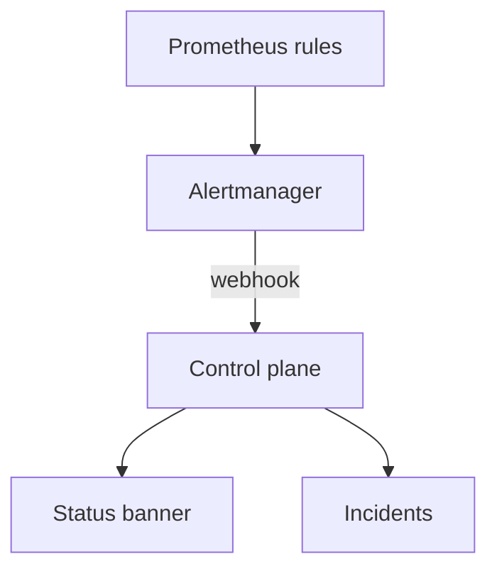

# Alerts and incidents

Lumewarp does not decide that a model is down or slow. Prometheus rules decide that, and
Alertmanager tells the control plane. The control plane stores every alert it is sent and
uses it for two things:

- a **status banner** that tells each signed-in user which of the names *they can call* are
  affected, in the words the alert carries;
- the **incident history**, which installation admins read in the Admin UI
  ([Incidents](../admin/incidents.md)): the alerts of one outage grouped into one incident,
  their timeline, and what Lumewarp saw in the request log around it.

[Incident flow, end to end](./incident-flow.md) follows one outage through every stage, with
timings and a rehearsal on the development stack.

Lumewarp only receives alerts. It never forwards them to Slack, a pager or anything else;
that stays in Alertmanager. Without Alertmanager no banner appears and the incident list is
empty; the health badges in the Admin UI keep working.



## Turn the receiver on

Set `LUMEWARP_ALERTMANAGER_TOKEN` on the control plane to a secret of at least 32
characters (`openssl rand -base64 48`). Unset, the receiver does not exist and
`POST /api/v1/alerts/alertmanager` answers `404`; an empty or shorter value stops the control
plane at startup. Only the control plane reads it. With the Helm chart set
`controlPlane.alertmanager.tokenSecret.name` ([Deploy with Helm](./helm.md)); with Docker
Compose uncomment the line in `.env` ([Deploy with Docker](./docker.md)).

Point Alertmanager's webhook at the control plane's HTTP listener, with the token as a bearer
token and `send_resolved: true`, which is what closes an incident:

```yaml
receivers:
  - name: lumewarp
    webhook_configs:
      - url: http://lumewarp-control-plane.lumewarp:8091/api/v1/alerts/alertmanager
        send_resolved: true
        http_config:
          authorization:
            type: Bearer
            credentials_file: /etc/alertmanager/secrets/lumewarp-token
route:
  receiver: default
  routes:
    - receiver: lumewarp
      continue: true
      matchers:
        - alertname =~ "Lumewarp.*"
```

`continue: true` keeps your other receivers working. Send only the alerts you want
recorded: every alert the receiver accepts becomes part of an incident, whatever its name.

The receiver accepts the Alertmanager webhook version 4 payload and nothing else (`version`
must be `"4"`). Its answer is `{"received": n}`. The token is checked before the body is
read, so an unset token is `404` and a wrong or missing one `401` whatever the body holds. The
body is then read in chunks and refused with `413` as soon as it passes 1 MiB; more than 1000
alerts in one delivery, another `version` or a malformed payload is `422`. The token
authenticates this route only: a session, a CSRF token or a personal access token is not
accepted there, and the call is not an audit entry. There is no request-rate limiter: the
token, the body cap and the alert cap are the bound.

## What an alert must carry

Lumewarp reads these labels and annotations. Anything else is stored as it arrived and shown
to administrators.

| Name | Kind | Meaning |
| --- | --- | --- |
| `lumewarp_status` | label | Makes the alert **user-visible**. Any value is allowed and shown as the state: the shipped rules use `down`, `degraded` and `congested`. The Admin UI shows `down` in red, `congested` and `degraded` in amber and any other value in grey. An alert without it appears to administrators only. |
| `lumewarp_summary` | annotation | The text users see. Without it the banner shows the state alone. |
| `summary`, `description` | annotations | Shown to installation admins on the incident. Never shown to other users. |
| `requested`, `model` | labels | A name from the catalog: a model, alias or router (one namespace for all three). |
| `upstream` | label | An upstream name. It stands for every model deployed on that upstream. |
| `zone` | label | Limits the alert to one zone. A missing or empty `zone` applies to every zone. |
| `severity`, `alertname` | labels | Stored and shown on the incident; `alertname` also decides which incident the alert joins. An alert without `alertname` is stored as `unknown`, so all such alerts group together. |
| `instance`, `gateway_id` | labels | Counted on the incident as one reporting gateway (`instance`, else `gateway_id`). |

`zone`, `severity` and `lumewarp_status` are cut to 64 characters and `alertname` to 256
where Lumewarp acts on them (the banner, grouping, filters); the stored labels keep the full
text.

The control plane resolves `requested`, `model` and `upstream` to catalog entries when the
alert arrives, again on every delivery of the same alert, so a name created after the alert
fired is picked up by the next repeat. An `upstream` is looked up by name in the alert's
zone, or in every zone that has an upstream of that name when there is no `zone`. A name
that matches nothing is not an error: the alert is kept with no target, and only
administrators see it.

Who is told about what: a firing alert with `lumewarp_status` appears to a user for each
**name that user may call in a zone where it can be served** and that the alert touches. A
model alert (or an upstream alert, which stands for the models deployed on it) reaches the
model itself and every alias or router that routes to it in that zone: an alias to the
model, a router that has it as a member or in a split, a router that has it as a fallback,
and an alias of such a router. The name shown is the one the user can call. A name counts as
callable only as the gateway would serve it: a model needs a deployment in the zone, a
router needs a deployed primary member (a deployed fallback alone is not enough), every split
of a split router needs a deployed model, a router whose weights are all zero is left out,
and an alias follows its target. When several alerts touch the same name and zone the
banner shows one entry: the worst state (`down`, then `congested`, then `degraded`, then any
other value), started when the earliest alert of that state started. The user's effective models and the zone's deployments are
the same ones `GET /users/me` reports. Someone with no grant on the affected name sees
nothing, and nobody sees an upstream name, a label or another annotation. A resolved alert
leaves the banner at once.

## What is stored

Each alert is one row, identified by Alertmanager's `fingerprint` and its `startsAt`.

- Delivery is idempotent. Alertmanager repeats firing alerts and may redeliver; the same
  alert updates its row in place and never creates a second one. A new firing of the same
  fingerprint has a new `startsAt` and is a new alert.
- A resolved alert records its `endsAt`. A firing alert has no end (Alertmanager's
  `0001-01-01T00:00:00Z` is stored as none).
- A resolved alert is **never reopened** by a late or repeated firing delivery of the same
  alert.
- Rows are never deleted; the history is kept for as long as the database is.

## How alerts become incidents

An **incident** is the group of alerts for one outage. The shipped rules alert per gateway,
so an upstream seen by four gateways arrives as four alerts; Lumewarp records them as one
incident that is "reported by 4 gateways".

When an alert first arrives it joins an existing incident that has

- the same `alertname`,
- the same zone (an alert without a zone only joins other alerts without a zone),
- the same resolved targets, compared by kind and id; an alert with no target compares its
  labels instead, ignoring `instance`, `gateway_id`, `pod`, `job`, `endpoint` and `service`,
- and an overlapping interval: the alert starts before the incident ended, or the incident is
  still firing.

Otherwise it opens a new incident. The incident's window is the union of its alerts: it
starts with the earliest one, is firing while any of them fires, and ends when the last one
resolves, so its duration is the time to repair of the whole outage. Its severity and its
user-visible state are those of its worst alert, and the number of gateways is the number of
distinct `instance` labels among its alerts (`gateway_id` for an alert without `instance`).

Membership is decided once, when the alert first arrives, and never moves: a later delivery
that resolves the alert to different targets updates its targets but not its incident. A
condition that resolves and fires again after the incident ended is a new incident. The
status banner reads the firing alerts themselves, so grouping does not change what users see.

## Rules that ship with Lumewarp

`deploy/prometheus/rules.yaml` (and the Helm chart's copy) sets `lumewarp_status` and
`lumewarp_summary` on the alerts that concern a model a user calls:

| Alert | `lumewarp_status` | Targets |
| --- | --- | --- |
| `LumewarpUpstreamCircuitOpen` | `down` | `model` |
| `LumewarpModelUnhealthy` | `down` | `model` |
| `LumewarpUpstreamUnhealthy` | `down` | `upstream` |
| `LumewarpGatewayHigh5xxRatio` | `degraded` | `requested` |
| `LumewarpTTFTHigh` | `congested` | `requested` |
| `LumewarpVLLMQueueHigh` | `congested` | `model` |
| `LumewarpVLLMKVCacheSaturated` | `congested` | `model` |

The other alerts have no `lumewarp_status` and are for administrators. Every alert in the
table above also carries `zone`. Gateway metrics have no zone label, so the rules join each
series with `lumewarp_gateway_info{zone}` (`group_left(zone)`), which every gateway
exports. `LumewarpGatewayDown` is deliberately without a zone: the info metric does not
exist while the target is down.

::: warning Roll the gateways out first
The joined alerts need `lumewarp_gateway_info`. A gateway that does not export it yet
produces no zone, and for these seven alerts no alert at all. Upgrade the gateways before
the rules. A standalone gateway has no zone, so its `zone` label is empty and its alerts apply
to every zone.
:::

To make your own alert user-visible, give it `lumewarp_status` and `lumewarp_summary`, and
one of the target labels. A rule that already has them, or an Alertmanager relabeling that
adds them, works the same.

```yaml
- alert: ChatModelSlow
  expr: histogram_quantile(0.99, sum by (le, requested) (rate(lumewarp_ttft_seconds_bucket[5m]))) > 8
  for: 10m
  labels:
    severity: warning
    lumewarp_status: congested
  annotations:
    lumewarp_summary: "{{ $labels.requested }} is responding slowly."
    summary: "TTFT p99 above 8 s for {{ $labels.requested }}"
```

## Prometheus

The control plane never queries Prometheus: an incident shows only the alerts Lumewarp
received and its own request log. An incident links back to the Prometheus expression that
fired (the alert's `generatorURL`); use Prometheus or Grafana for pod, CPU, memory or GPU
charts.

## Check it

Post a firing alert by hand, then look at the incident and the banner:

```sh
curl -sS -X POST http://127.0.0.1:8091/api/v1/alerts/alertmanager \
  -H "Authorization: Bearer $LUMEWARP_ALERTMANAGER_TOKEN" \
  -H 'Content-Type: application/json' \
  --data-binary '{"version":"4","status":"firing","alerts":[{
    "status":"firing",
    "labels":{"alertname":"Manual","requested":"<a model name>","lumewarp_status":"down"},
    "annotations":{"lumewarp_summary":"Down for a test."},
    "startsAt":"2026-01-01T00:00:00Z","endsAt":"0001-01-01T00:00:00Z",
    "generatorURL":"","fingerprint":"manual-1"}]}'
```

Repeating the call changes nothing. Send the same body with `"status":"resolved"` and a real
`endsAt` to close it. See also [Troubleshooting](./troubleshooting.md).
