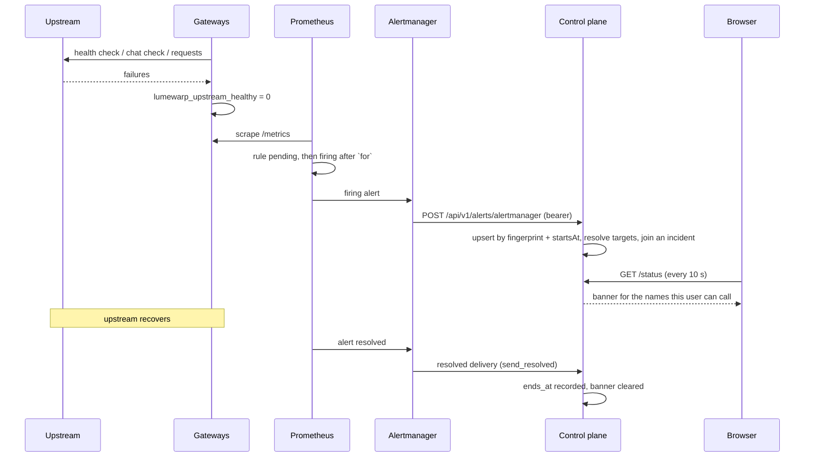

# Incident flow, end to end

This page follows one outage from the first failed health check to the closed incident:
which component decides what, what each reader sees at every step, how long each step takes,
and how to rehearse the whole flow on the development stack. The settings and the label
contract are in [Alerts and incidents](./alerts-and-incidents.md); the pages admins read are
in [Incidents](../admin/incidents.md).

## Who does what



- **The gateways measure.** Health checks, chat checks, the circuit breaker, vLLM queue and
  KV cache scrapes and the per-request counters become `lumewarp_*` metrics. The request path
  only counts; it never decides that anything is down.
- **Prometheus decides.** A rule in `deploy/prometheus/rules.yaml` turns a metric into an
  alert, holds it `pending` for its `for` duration, then fires it. The rule's labels say
  whether users see it (`lumewarp_status`) and what it is about (`model`, `upstream`,
  `requested`, `zone`).
- **Alertmanager delivers.** It groups, repeats and resolves alerts and posts them to the
  control plane's webhook, as well as to anything else you route them to (Slack, a pager).
- **The control plane records and shows.** It stores every alert it receives, resolves its
  names to catalog entries, groups the alerts of one outage into an incident, answers
  `GET /status` for each user and builds the incident page.
  It never evaluates a metric and never forwards an alert.

## The stages

### 1. Something fails

An upstream stops answering, a model's chat check fails, the circuit opens or the vLLM queue
grows. Requests may already be failing, retrying or falling back; each one is a row in the
request log with its `error_code` (for example `upstream_503` or `upstream_unavailable`) and
counts in `lumewarp_requests_total{error_source, code}`.

Nobody is told yet. Admins can see it on the health badges of the upstream and model pages
and in Grafana.

### 2. The rule goes pending

The next Prometheus evaluation sees the condition and the alert becomes `pending`. It is
visible on Prometheus' Alerts page only; Alertmanager has not heard of it.

### 3. The rule fires

After the rule's `for` (2 minutes for the health and circuit alerts, 10 for the congestion
alerts, 5 for the 5xx ratio) the alert fires and Prometheus sends it to Alertmanager, which
waits `group_wait` and posts the group to the control plane.

The control plane stores one row per alert, keyed by Alertmanager's fingerprint and the
alert's start, resolves `model`, `requested` and `upstream` to catalog targets in the
alert's `zone`, and adds the alert to an incident ([One outage, one incident](#one-outage-one-incident)).
From this moment:

| Reader | Sees |
| --- | --- |
| A user who can call an affected name | The banner, with the state and the `lumewarp_summary` text, at the next `/status` poll (within 10 s). An upstream alert names every model on that upstream and the aliases and routers that reach them. |
| A user who cannot call any affected name | Nothing. |
| An installation admin | The banner, each row linking to its incident, and the incident in **Incidents** as `firing`, with a duration that keeps counting and the number of gateways that reported it. |
| Your other Alertmanager receivers | Whatever you routed to them; Lumewarp does not change that. |

An alert without `lumewarp_status` skips the banner and only becomes an incident.

### 4. Investigating

The incident page answers "what did Lumewarp see": the traffic on the affected names from
10 minutes before the start, requests, time to first token and context size per minute
(average and p95), how many failed and with which error codes, how many requests a fallback
rescued, the median attempts, the teams and keys that sent the most, and the 50 most recent
failed requests. A failed request links to its row in [Requests](../admin/requests.md); its
`x-lumewarp-request-id` finds the per-attempt spans in your tracing backend. The timeline
puts each gateway's alert next to the related incidents that share a target within an hour,
so a cascade (an upstream down, then its models, then a 5xx ratio on a router) reads as one
story.

Lumewarp shows only what it received and logged. Admins follow the alert's link back to the
expression in Prometheus, and use Prometheus or Grafana for anything else (the health gauge,
pod restarts, CPU, memory, GPU).

### 5. Recovery

Once the metric is healthy again, the rule stops matching at the next evaluation and
Prometheus sends the alert as resolved; Alertmanager delivers it (`send_resolved: true`) at
its next group interval. The control plane records the alert's `ends_at` and the banner entry
disappears at the next poll. The incident resolves when its last alert does, and its
duration is the time to repair.

A resolved row is never reopened. If the same condition fires again after the incident has
ended, Alertmanager sends a new start time and it is a new incident. Rows are never deleted.

## How long each stage takes

Measured on the development stack (below) with an upstream made to fail all requests and
health checks:

| From the failure | What happened |
| --- | --- |
| about 30 s | rule `pending` (health check every 5 s, unhealthy after 2 failures, evaluation every 15 s) |
| about 3 min 20 s | rule firing, incident stored, `/status` lists every affected name in both zones |
| + up to 10 s | the banner appears in a browser that is already open |
| about 1.5 to 2 min after the upstream recovered | incident resolved, banner gone |

In your installation the delay to the banner is roughly:

```
health interval x unhealthy threshold
  + Prometheus scrape and evaluation intervals
  + the rule's `for`
  + Alertmanager `group_wait`
  + up to 10 s of banner polling
```

and the delay to resolution is the healthy threshold times the interval, an evaluation
interval and Alertmanager's `group_interval`. Shorten the rule's `for` only if a brief blip
should reach users; every shipped value is chosen to ignore single failed checks.

## One outage, one incident

The shipped rules alert per gateway: every gateway that sees an unhealthy upstream exports
its own `lumewarp_upstream_healthy` series, so an upstream seen by four gateways produces
four alerts, and their start times differ when the gateways noticed at different
evaluations. The control plane groups them into one incident that is "reported by 4
gateways".

An alert joins an incident when, at its first delivery, it has the same `alertname`, the
same zone (no zone matches only no zone), the same resolved targets (kind and id; without a
target, the same labels apart from `instance`, `gateway_id`, `pod`, `job`, `endpoint` and
`service`), and an interval that overlaps the incident's: it starts before the incident
ended, or the incident is still firing.

```text
gw1        |====================|
gw2           |=======================|
gw3              |=============|
gw4             |===========================|
incident   |================================|        |====|
           one incident, reported by 4 gateways      later firing, no overlap:
                                                      a new incident
```

The incident starts with its earliest alert, fires while any alert fires, and ends with the
last one; its severity and user-visible state are its worst alert's. Membership is decided
once and never moves. The banner is not affected by grouping: it shows each name once per
zone with the worst state of the firing alerts. Prometheus rules need no aggregation for
this.

## Rehearse it on the development stack

`DEV_EXTRAS=1 make dev` runs the whole chain locally: the mock upstream, four gateways, a
Prometheus with the shipped rules, an Alertmanager that posts to the control plane with a
development token (`deploy/dev/alertmanager.yaml`, `LUMEWARP_ALERTMANAGER_TOKEN` in the
`Makefile`), and the control plane. The seeded upstreams `mock-default` and `mock-prod` are health-checked every 5
seconds. Both point at the same mock, so a fault there affects both zones.

Sign in as `alice@example.com` (an installation admin) at <http://127.0.0.1:5173/> and break
the mock:

```sh
curl -X POST 'http://127.0.0.1:9100/fault?status=503'
```

Then watch the stages:

```sh
# 1. The gateways' view: 0 within about 10 s
curl -s http://127.0.0.1:9464/metrics | grep '^lumewarp_upstream_healthy'
# 2-3. Prometheus: pending, then firing after 2 minutes
curl -s http://127.0.0.1:19090/api/v1/alerts | jq '.data.alerts[] | {alert: .labels.alertname, state}'
```

In a browser: Prometheus' Alerts page at <http://127.0.0.1:19090/alerts>, Alertmanager at
<http://127.0.0.1:19093/>, and in the Admin UI the banner and **Incidents**
(<http://127.0.0.1:5173/incidents>).

Restore the mock and watch the incident resolve within two minutes:

```sh
curl -X POST 'http://127.0.0.1:9100/fault?status=0'
```

Other faults the mock can inject:

| Command | Effect |
| --- | --- |
| `curl -X POST 'http://127.0.0.1:9100/fault?status=429'` | Every request and health check returns that status (any 400 to 599). |
| `curl http://127.0.0.1:4000/v1/chat/completions -H 'x-mock-fail: 503' ...` | Only this request fails (`reset` and `timeout` also work), which feeds the error codes and the 5xx ratio without failing health checks. |
| `curl -X POST 'http://127.0.0.1:9100/load?waiting=150&kv_cache_usage=0.95'` | The mock's vLLM metrics report a queue and a full KV cache. The congestion rules read them only from an upstream of kind `vllm` with a metrics URL, which the seeded upstreams are not. |

The seed also stores six demo alerts with traffic shaped to match, so the pages have content
before you break anything: a firing `LumewarpVLLMQueueHigh` on `llama-3.1-8b` in `default`
(the banner shows it until the next seed), and resolved incidents for a model down with
router fallbacks, an upstream down in `prod`, a 5xx burst on the router `chat`, slow TTFT,
and an admin-only usage alert. Every `make dev-seed` replaces them, sliding their times
forward; their fingerprints start with `seed-dev-`.

The receiver can also be called by hand, without Prometheus; see
[Check it](./alerts-and-incidents.md#check-it).

## When nothing shows up

Walk the chain from the start; the first stage that is missing is the one to fix.

| Check | If it fails |
| --- | --- |
| The gateway's `/metrics` shows the failing metric (`lumewarp_upstream_healthy 0`, circuit state `2`) | The upstream has no health check, chat check or circuit breaker configured, so nothing measures it. |
| `lumewarp_gateway_info{zone}` exists on every gateway | The gateway predates it; the zone-joined rules produce nothing. Upgrade the gateways. |
| Prometheus' Alerts page shows the rule `firing` | The rule's `for` has not elapsed, the rules file is not loaded, or the scrape job does not match. |
| Alertmanager's UI lists the alert | Prometheus' `alerting` section does not point at Alertmanager. |
| Alertmanager's log shows no webhook error | `404`: `LUMEWARP_ALERTMANAGER_TOKEN` is not set on the control plane. `401`: the tokens differ. `422`: not a version 4 payload. |
| **Incidents** lists the alert | The route does not send this alert to the Lumewarp receiver. |
| The incident has targets | The `model`, `requested` or `upstream` label names nothing in the catalog (in that zone); only admins see such an alert. |
| The banner shows it | The alert has no `lumewarp_status`, it is resolved, or this user cannot call any affected name in a zone where it is deployed. |
